# 02. Skema Database Server (SQL Server `fai26`), Lengkap

Dokumen ini **dihasilkan langsung dari katalog database yang berjalan** (`sys.tables`, `sys.columns`, `sys.sql_modules`, dst.) pada database pengembangan `fai26_dev` tanggal 22 November 2026 (API 0.21.0, migrasi sampai 012), bukan ditulis dari ingatan. Hanya struktur yang diambil; tidak ada isi data selain hitungan baris dan master kode yang bukan data pribadi. Skrip sumber: `erd/fAI26_server_sqlserver.sql` (skema dasar) ditambah `fai26-api/migrations/002` sampai `012`.

Bahasa kolom: nama tabel dan kolom memakai bahasa Indonesia; semua waktu `DATETIME2` **UTC**; keterangan di kolom "Keterangan" ditambahkan dari dokumen proyek, bukan dari katalog.

## Daftar isi

1. Konvensi dan gambaran
2. Peta relasi
3. Tabel satu per satu (24 tabel)
4. View dan prosedur (jembatan ERP)
5. Role database `fai26_hvdm`
6. Data awal: permission, role, matriks hak, kode temuan IPD
7. Urutan migrasi dan isinya
8. Hitungan baris pada database pengembangan

## 1. Konvensi dan gambaran

- **Kolom audit standar** (enam kolom, disingkat **[audit6]**): `dibuat_pada` (bawaan `SYSUTCDATETIME()`), `dibuat_oleh`, `diubah_pada`, `diubah_oleh`, `dihapus_pada`, `dihapus_oleh`. Padanan di ERP: `REC_CREATDATE/CREATBY`, `REC_MODIFDATE/MODIFBY`, `REC_DELDATE/DELBY`. Kolom `*_oleh` berisi `app_user.user_id` dan **sengaja tanpa foreign key**.
- **Hapus lunak:** baris dianggap ada bila `dihapus_pada IS NULL`. Banyak keunikan memakai **indeks terfilter** `WHERE dihapus_pada IS NULL`. Data tidak dihapus permanen (kecuali jalur GPS lama bila kebijakan penyimpanan diaktifkan).
- **`diubah_pada` wajib diisi** pada setiap perubahan master dan status: versi master untuk HP dihitung darinya dan HP mengetahui status baru catatan dari sana.
- **Kolom `#` pada tabel** adalah nomor urut kolom di database; enam kolom audit tidak ditampilkan per tabel (disingkat [audit6]) sehingga nomor tampak melompat.
- **Skrip memakai `sqlcmd -I`** (`QUOTED_IDENTIFIER ON` untuk indeks terfilter).
- **Tiga kelompok tabel:** (1) akses dan perangkat, (2) master (diunduh HP lewat `GET /api/master`), (3) staging panen dan IPD (yang ditulis API dan dibaca ERP atau web).
- **Kunci ke ERP:** `blok.erp_oid` = `fai_panen.asm3_oid` = ERP `asm3.OID`; `pemanen.erp_hrmb_code` = `fai_panen.pemanen_hrmb_code` = ERP `hrmb` (`HRMBCODE`); `unit.erp_db` = nama database ERP. **Jangan** memakai `blok_id`, `pemanen_id`, atau `user_id` internal sebagai kunci ERP.

## 2. Peta relasi

```mermaid
erDiagram
    unit_id ||--o{ app_user : "unit_id"
    role_id ||--o{ user_role : "role_id"
    user_id ||--o{ user_role : "user_id"
    permission_id ||--o{ role_permission : "permission_id"
    role_id ||--o{ role_permission : "role_id"
    device_id ||--o{ auth_sesi : "device_id"
    user_id ||--o{ auth_sesi : "user_id"
    user_id ||--o{ divisi : "asisten_user_id"
    unit_id ||--o{ divisi : "unit_id"
    divisi_id ||--o{ blok : "divisi_id"
    unit_id ||--o{ blok : "unit_id"
    blok_id ||--o{ tph : "blok_id"
    unit_id ||--o{ pemanen : "unit_id"
    device_id ||--o{ fai_panen : "device_id"
    unit_id ||--o{ fai_panen : "unit_id"
    id ||--o{ fai_panen_grading : "panen_id"
    id ||--o{ fai_panen_pemanen : "panen_id"
    id ||--o{ fai_foto : "panen_id"
    id ||--o{ fai_impor_log : "panen_id"
    user_id ||--o{ fai_ipd : "asisten_user_id"
    device_id ||--o{ fai_ipd : "device_id"
    divisi_id ||--o{ fai_ipd : "divisi_id"
    unit_id ||--o{ fai_ipd : "unit_id"
    id ||--o{ fai_ipd_pokok : "ipd_id"
    kode_id ||--o{ fai_ipd_temuan : "kode_id"
    id ||--o{ fai_ipd_temuan : "pokok_id"
    id ||--o{ fai_ipd_foto : "ipd_id"
    id ||--o{ fai_ipd_jejak : "ipd_id"
```



**Relasi logis tanpa foreign key** (dijaga aplikasi): `fai_panen.asm3_oid` dan `fai_ipd.asm3_oid` terhadap `blok.erp_oid`; `fai_panen.pemanen_hrmb_code` dan `fai_ipd.pemanen_hrmb_code` terhadap `pemanen.erp_hrmb_code`; `fai_panen.mandor_hrmb_code` terhadap kode HRMB mandor; semua kolom `*_oleh` dan `fai_panen.disetujui_oleh` terhadap `app_user.user_id`; `audit_log.baris_id` terhadap id baris pada `tabel`; `unit.erp_db` terhadap nama database ERP.

## 3. Tabel satu per satu

### 3.1 `unit`  (Akses)

Kebun atau unit ERP. Menghubungkan fAI26 ke database ERP unit itu (`erp_db`) dan tahun cluster.

| # | Kolom | Tipe | Null | Bawaan | Keterangan |
|---|---|---|---|---|---|
| 1 | `unit_id` | int IDENTITY | NOT NULL |  |  |
| 2 | `kode` | nvarchar(20) | NOT NULL |  |  |
| 3 | `nama` | nvarchar(100) | NOT NULL |  |  |
| 4 | `erp_db` | nvarchar(50) | NOT NULL |  | nama database ERP unit, mis. `kp_stl2025` |
| 5 | `tahun_cluster` | int | NOT NULL |  | tahun cluster ERP |
| 6 | `aktif` | bit | NOT NULL | `1` |  |
| | [audit6] | | | | enam kolom audit standar (lihat bagian 1) |

- **Kunci utama:** `unit_id`
- **Unik:** `UQ__unit__25A87492E5D6D5A4` (kode)

### 3.2 `device`  (Akses)

HP (atau peramban web admin) yang pernah login. Dibuat saat login pertama. Perangkat nonaktif tidak bisa login dan sesinya dicabut.

| # | Kolom | Tipe | Null | Bawaan | Keterangan |
|---|---|---|---|---|---|
| 1 | `device_id` | uniqueidentifier | NOT NULL |  | UUID dibuat HP |
| 2 | `nama` | nvarchar(60) | NULL |  |  |
| 3 | `os_versi` | nvarchar(30) | NULL |  |  |
| 4 | `app_versi` | nvarchar(20) | NULL |  |  |
| 5 | `aktif` | bit | NOT NULL | `1` |  |
| 6 | `terakhir_sinkron` | datetime2 | NULL |  |  |
| | [audit6] | | | | enam kolom audit standar (lihat bagian 1) |

- **Kunci utama:** `device_id`

### 3.3 `app_user`  (Akses)

Akun fAI26 (bukan akun ERP). Membawa kode HRMB mandor dan afdeling untuk akun mandor.

| # | Kolom | Tipe | Null | Bawaan | Keterangan |
|---|---|---|---|---|---|
| 1 | `user_id` | int IDENTITY | NOT NULL |  |  |
| 2 | `unit_id` | int | NOT NULL |  |  |
| 3 | `erp_user_oid` | int | NULL |  | opsional, kaitan ke user ERP |
| 4 | `username` | nvarchar(50) | NOT NULL |  | huruf kecil, `a-z 0-9 . _ -`, 3 sampai 50 karakter |
| 5 | `nama` | nvarchar(100) | NOT NULL |  |  |
| 6 | `aktif` | bit | NOT NULL | `1` |  |
| 7 | `gagal_login` | int | NOT NULL | `0` | 5 gagal berturut-turut mengunci akun 15 menit |
| 8 | `terkunci_sampai` | datetime2 | NULL |  |  |
| 9 | `login_terakhir` | datetime2 | NULL |  |  |
| 10 | `password_hash` | nvarchar(255) | NOT NULL |  | bcrypt |
| 11 | `wajib_ganti_password` | bit | NOT NULL | `0` | 1 setelah kata sandi direset admin |
| 18 | `mandor_hrmb_code` | int | NULL |  | kode HRMB mandor pemilik akun (akun mandor); migrasi 007 |
| 19 | `afdeling_kode` | nvarchar(20) | NULL |  | sama dengan `divisi.kode`; migrasi 007 |
| 20 | `foto_profil_versi` | bigint | NULL |  | versi foto profil (berkas di folder media `profil/<user_id>.jpg`); migrasi 011 |
| | [audit6] | | | | enam kolom audit standar (lihat bagian 1) |

- **Kunci utama:** `user_id`
- **Unik:** `UQ__app_user__F3DBC5723D79BD05` (username)
- **FK:** `unit_id` ke `unit.unit_id`

### 3.4 `role`  (Akses)

Peran (KRANI, MANDOR, ASISTEN, ADMIN, AUDITOR, ASKEP, KTU, dan peran buatan admin).

| # | Kolom | Tipe | Null | Bawaan | Keterangan |
|---|---|---|---|---|---|
| 1 | `role_id` | int IDENTITY | NOT NULL |  |  |
| 2 | `kode` | nvarchar(30) | NOT NULL |  |  |
| 3 | `nama` | nvarchar(60) | NOT NULL |  |  |
| 4 | `deskripsi` | nvarchar(200) | NULL |  |  |
| 5 | `bawaan` | bit | NOT NULL | `0` |  |
| | [audit6] | | | | enam kolom audit standar (lihat bagian 1) |

- **Kunci utama:** `role_id`
- **Unik:** `UQ__role__25A87492FE34D7E6` (kode)

### 3.5 `permission`  (Akses)

Daftar hak (permission) yang tetap; diberikan ke role lewat `role_permission`.

| # | Kolom | Tipe | Null | Bawaan | Keterangan |
|---|---|---|---|---|---|
| 1 | `permission_id` | int IDENTITY | NOT NULL |  |  |
| 2 | `kode` | nvarchar(50) | NOT NULL |  |  |
| 3 | `modul` | nvarchar(30) | NOT NULL |  |  |
| 4 | `nama` | nvarchar(100) | NOT NULL |  |  |
| | [audit6] | | | | enam kolom audit standar (lihat bagian 1) |

- **Kunci utama:** `permission_id`
- **Unik:** `UQ__permissi__25A87492AD1EB972` (kode)

### 3.6 `user_role`  (Akses)

Role yang dipegang akun, dengan masa berlaku opsional.

| # | Kolom | Tipe | Null | Bawaan | Keterangan |
|---|---|---|---|---|---|
| 1 | `ur_id` | int IDENTITY | NOT NULL |  |  |
| 2 | `user_id` | int | NOT NULL |  |  |
| 3 | `role_id` | int | NOT NULL |  |  |
| 4 | `berlaku_mulai` | date | NULL |  |  |
| 5 | `berlaku_sampai` | date | NULL |  |  |
| | [audit6] | | | | enam kolom audit standar (lihat bagian 1) |

- **Kunci utama:** `ur_id`
- **Indeks unik:** `ux_user_role_user_id_role_id` (user_id,role_id) `WHERE ([dihapus_pada] IS NULL)`
- **FK:** `role_id` ke `role.role_id`
- **FK:** `user_id` ke `app_user.user_id`

### 3.7 `role_permission`  (Akses)

Hak yang dimiliki sebuah role. Diubah admin dari halaman Hak Akses web.

| # | Kolom | Tipe | Null | Bawaan | Keterangan |
|---|---|---|---|---|---|
| 1 | `rp_id` | int IDENTITY | NOT NULL |  |  |
| 2 | `role_id` | int | NOT NULL |  |  |
| 3 | `permission_id` | int | NOT NULL |  |  |
| | [audit6] | | | | enam kolom audit standar (lihat bagian 1) |

- **Kunci utama:** `rp_id`
- **Indeks unik:** `ux_role_permission_role_id_permission_id` (role_id,permission_id) `WHERE ([dihapus_pada] IS NULL)`
- **FK:** `permission_id` ke `permission.permission_id`
- **FK:** `role_id` ke `role.role_id`

### 3.8 `auth_sesi`  (Akses)

Sesi login per perangkat. Hanya hash refresh token yang disimpan; token diganti tiap dipakai (rotasi).

| # | Kolom | Tipe | Null | Bawaan | Keterangan |
|---|---|---|---|---|---|
| 1 | `sesi_id` | uniqueidentifier | NOT NULL |  |  |
| 2 | `user_id` | int | NOT NULL |  |  |
| 3 | `device_id` | uniqueidentifier | NOT NULL |  |  |
| 4 | `refresh_token_hash` | nvarchar(128) | NOT NULL |  | SHA-256 dari refresh token; token asli tidak disimpan |
| 5 | `kedaluwarsa_pada` | datetime2 | NOT NULL |  |  |
| 6 | `dicabut_pada` | datetime2 | NULL |  |  |
| 7 | `ip` | nvarchar(45) | NULL |  |  |
| 8 | `dibuat_pada` | datetime2 | NOT NULL | `sysutcdatetime()` |  |
| 9 | `dibuat_oleh` | int | NULL |  |  |
| 10 | `diubah_pada` | datetime2 | NULL |  |  |
| 11 | `diubah_oleh` | int | NULL |  |  |

- **Kunci utama:** `sesi_id`
- **Indeks:** `ix_auth_sesi_user_id` (user_id)
- **FK:** `device_id` ke `device.device_id`
- **FK:** `user_id` ke `app_user.user_id`

### 3.9 `audit_log`  (Akses)

Jejak audit hanya-tambah. Akun API tidak boleh UPDATE atau DELETE (migrasi 004 di server sungguhan). Juga menampung audit dari HP.

| # | Kolom | Tipe | Null | Bawaan | Keterangan |
|---|---|---|---|---|---|
| 1 | `audit_id` | uniqueidentifier | NOT NULL |  |  |
| 2 | `tabel` | nvarchar(50) | NOT NULL |  |  |
| 3 | `baris_id` | nvarchar(50) | NOT NULL |  | id baris pada `tabel` (teks/UUID/angka) |
| 4 | `aksi` | nvarchar(20) | NOT NULL |  | mis. BUAT, UBAH, HAPUS, SETUJU, TOLAK, LOGIN, LOGIN_GAGAL, TERIMA, IMPOR, IMPOR_GAGAL, IMPOR_ULANG, RESET_PASSWORD, GANTI_PASSWORD, LIHAT_JALUR, HAPUS_JEJAK_LAMA |
| 5 | `nilai_lama` | nvarchar(MAX) | NULL |  |  |
| 6 | `nilai_baru` | nvarchar(MAX) | NULL |  |  |
| 7 | `user_id` | int | NULL |  |  |
| 8 | `username` | nvarchar(50) | NULL |  |  |
| 9 | `device_id` | uniqueidentifier | NULL |  |  |
| 10 | `waktu` | datetime2 | NOT NULL |  | waktu kejadian (dari HP bila audit HP) |
| 11 | `waktu_server` | datetime2 | NULL |  |  |
| 12 | `ip` | nvarchar(45) | NULL |  |  |
| 13 | `keterangan` | nvarchar(300) | NULL |  |  |

- **Kunci utama:** `audit_id`
- **Indeks:** `ix_audit_log_tabel_baris_id` (tabel,baris_id)
- **Indeks:** `ix_audit_log_user_id_waktu` (user_id,waktu)

### 3.10 `divisi`  (Master)

Divisi atau afdeling. Membawa `erp_oid` (OID afdeling di ERP) dan asisten penyetuju IPD (`asisten_user_id`).

| # | Kolom | Tipe | Null | Bawaan | Keterangan |
|---|---|---|---|---|---|
| 1 | `divisi_id` | int IDENTITY | NOT NULL |  |  |
| 2 | `unit_id` | int | NOT NULL |  |  |
| 3 | `erp_oid` | int | NULL |  | OID afdeling di ERP (admin yang mengisi) |
| 4 | `kode` | nvarchar(20) | NOT NULL |  |  |
| 5 | `nama` | nvarchar(100) | NOT NULL |  |  |
| 6 | `aktif` | bit | NOT NULL | `1` |  |
| 13 | `asisten_user_id` | int | NULL |  | asisten penyetuju IPD divisi ini (migrasi 009); hanya akun ASISTEN aktif satu unit |
| | [audit6] | | | | enam kolom audit standar (lihat bagian 1) |

- **Kunci utama:** `divisi_id`
- **FK:** `asisten_user_id` ke `app_user.user_id`
- **FK:** `unit_id` ke `unit.unit_id`

### 3.11 `blok`  (Master)

Blok kebun. `erp_oid` adalah kunci ke ERP (`asm3.OID`).

| # | Kolom | Tipe | Null | Bawaan | Keterangan |
|---|---|---|---|---|---|
| 1 | `blok_id` | int IDENTITY | NOT NULL |  |  |
| 2 | `unit_id` | int | NOT NULL |  |  |
| 3 | `divisi_id` | int | NULL |  |  |
| 4 | `erp_oid` | bigint | NOT NULL |  | **OID blok di ERP (`asm3.OID`)**; menjadi `fai_panen.asm3_oid` |
| 5 | `kode` | nvarchar(20) | NOT NULL |  |  |
| 6 | `nama` | nvarchar(100) | NULL |  |  |
| 7 | `luas_ha` | float | NULL |  |  |
| 8 | `tahun_tanam` | int | NULL |  |  |
| 9 | `sph` | float | NULL |  | pokok per hektar |
| 10 | `aktif` | bit | NOT NULL | `1` |  |
| | [audit6] | | | | enam kolom audit standar (lihat bagian 1) |

- **Kunci utama:** `blok_id`
- **Indeks unik:** `ux_blok_unit_id_kode` (unit_id,kode) `WHERE ([dihapus_pada] IS NULL)`
- **FK:** `divisi_id` ke `divisi.divisi_id`
- **FK:** `unit_id` ke `unit.unit_id`

### 3.12 `tph`  (Master)

Tempat pengumpulan hasil, dengan kode QR dan koordinat opsional.

| # | Kolom | Tipe | Null | Bawaan | Keterangan |
|---|---|---|---|---|---|
| 1 | `tph_id` | int IDENTITY | NOT NULL |  |  |
| 2 | `blok_id` | int | NOT NULL |  |  |
| 3 | `no_tph` | nvarchar(10) | NOT NULL |  | nomor TPH, unik per blok |
| 4 | `qr_kode` | nvarchar(100) | NOT NULL |  | `FAI26|TPH|1|<unit>|<blok>|<no>`; dibuat server |
| 5 | `lat` | float | NULL |  |  |
| 6 | `lon` | float | NULL |  |  |
| 7 | `aktif` | bit | NOT NULL | `1` |  |
| | [audit6] | | | | enam kolom audit standar (lihat bagian 1) |

- **Kunci utama:** `tph_id`
- **Unik:** `UQ__tph__909D2B6505260F09` (qr_kode)
- **Indeks unik:** `ux_tph_blok_id_no_tph` (blok_id,no_tph) `WHERE ([dihapus_pada] IS NULL)`
- **FK:** `blok_id` ke `blok.blok_id`

### 3.13 `pemanen`  (Master)

Pemanen. `erp_hrmb_code` adalah kunci ke ERP (`hrmb`); `mandor_hrmb_code` mengelompokkan pemanen per mandor.

| # | Kolom | Tipe | Null | Bawaan | Keterangan |
|---|---|---|---|---|---|
| 1 | `pemanen_id` | int IDENTITY | NOT NULL |  |  |
| 2 | `unit_id` | int | NOT NULL |  |  |
| 3 | `erp_hrmb_code` | int | NOT NULL |  | **kunci pemanen di ERP** (`HRMBCODE`) |
| 4 | `kode` | nvarchar(20) | NULL |  |  |
| 5 | `nama` | nvarchar(100) | NOT NULL |  |  |
| 6 | `aktif` | bit | NOT NULL | `1` |  |
| 13 | `mandor_hrmb_code` | int | NULL |  | kode HRMB mandor kelompoknya; migrasi 005 |
| | [audit6] | | | | enam kolom audit standar (lihat bagian 1) |

- **Kunci utama:** `pemanen_id`
- **FK:** `unit_id` ke `unit.unit_id`

### 3.14 `fai_panen`  (Panen (staging ERP))

Satu baris per catatan panen (satu TPH, satu pemanen). Inilah yang dibaca HVDM lewat view.

| # | Kolom | Tipe | Null | Bawaan | Keterangan |
|---|---|---|---|---|---|
| 1 | `id` | uniqueidentifier | NOT NULL |  | = `panen_id` dari HP (UUID); kunci anti ganda |
| 2 | `unit_id` | int | NOT NULL |  |  |
| 3 | `device_id` | uniqueidentifier | NOT NULL |  |  |
| 4 | `tanggal_panen` | date | NOT NULL |  | tanggal panen (bukan tanggal kirim); menentukan tahun cluster ERP |
| 5 | `asm3_oid` | bigint | NOT NULL |  | OID blok di ERP |
| 6 | `blok_kode` | nvarchar(20) | NULL |  |  |
| 7 | `tph_kode` | nvarchar(30) | NULL |  | hanya nomor TPH, bukan QR penuh |
| 8 | `rotasi` | int | NULL |  | selalu kosong dari HP saat ini |
| 9 | `kondisi_cuaca` | int | NULL |  | selalu kosong dari HP saat ini |
| 10 | `brondolan_kg` | float | NULL |  | kilogram |
| 11 | `gps_lat` | decimal(9,6) | NULL |  |  |
| 12 | `gps_lon` | decimal(9,6) | NULL |  |  |
| 13 | `gps_akurasi_m` | float | NULL |  |  |
| 14 | `gps_waktu` | datetime2 | NULL |  |  |
| 15 | `gps_mock` | bit | NOT NULL | `0` |  |
| 16 | `jarak_ke_tph_m` | float | NULL |  |  |
| 17 | `status_lokasi` | nvarchar(20) | NOT NULL | `'TANPA_GPS'` | DI_TPH, DI_LUAR, AKURASI_RENDAH, TANPA_GPS, TPH_TANPA_KOORDINAT |
| 18 | `model_versi` | nvarchar(50) | NULL |  |  |
| 19 | `catatan` | nvarchar(500) | NULL |  |  |
| 20 | `diterima_server` | datetime2 | NOT NULL | `sysutcdatetime()` |  |
| 21 | `status_erp` | nvarchar(12) | NOT NULL | `'BARU'` | MENUNGGU (menunggu krani), BARU, DIBACA, DIIMPOR, DITOLAK |
| 22 | `disetujui_oleh` | int | NULL |  | krani penyetuju (sejak alur persetujuan krani, migrasi 008) |
| 23 | `disetujui_pada` | datetime2 | NULL |  |  |
| 30 | `afdeling_kode` | nvarchar(20) | NULL |  | salinan saat diterima, dari akun pencatat (cadangan: divisi blok) |
| 31 | `afdeling_erp_oid` | int | NULL |  | salinan `divisi.erp_oid` |
| 32 | `mandor_hrmb_code` | int | NULL |  | salinan dari akun pencatat (cadangan: master pemanen) |
| 33 | `pemanen_hrmb_code` | int | NULL |  | **pemanen tunggal** catatan (`HRMBCODE`); sumber utama sejak migrasi 007 |
| | [audit6] | | | | enam kolom audit standar (lihat bagian 1) |

- **Kunci utama:** `id`
- **Indeks:** `ix_fai_panen_status_erp_tanggal_panen` (status_erp,tanggal_panen)
- **Indeks:** `ix_fai_panen_unit_id_tanggal_panen` (unit_id,tanggal_panen)
- **Indeks unik:** `ux_fai_panen_tph_pemanen` (tanggal_panen,unit_id,asm3_oid,tph_kode,pemanen_hrmb_code) `WHERE ([dihapus_pada] IS NULL AND [pemanen_hrmb_code] IS NOT NULL AND [tph_kode] IS NOT NULL)`
- **FK:** `device_id` ke `device.device_id`
- **FK:** `unit_id` ke `unit.unit_id`
- **CHECK:** `ck_fai_panen_status_erp` ([status_erp]='DITOLAK' OR [status_erp]='DIIMPOR' OR [status_erp]='DIBACA' OR [status_erp]='BARU' OR [status_erp]='MENUNGGU')

### 3.15 `fai_panen_grading`  (Panen (staging ERP))

Hasil per kelas kematangan (enam baris per catatan, termasuk yang bernilai nol).

| # | Kolom | Tipe | Null | Bawaan | Keterangan |
|---|---|---|---|---|---|
| 1 | `id` | bigint IDENTITY | NOT NULL |  |  |
| 2 | `panen_id` | uniqueidentifier | NOT NULL |  |  |
| 3 | `kelas_kode` | nvarchar(20) | NOT NULL |  |  |
| 4 | `erp_kolom` | nvarchar(30) | NULL |  | kolom `hvd1da` tujuan; NULL untuk unripe dan underripe |
| 5 | `jml_ai` | int | NOT NULL | `0` | hitungan kamera (jangan dipakai ERP) |
| 6 | `jml_final` | int | NOT NULL | `0` | **angka akhir setelah koreksi; pakai ini untuk ERP** |
| 7 | `diubah_manual` | bit | NOT NULL | `0` | 1 bila `jml_ai` berbeda dari `jml_final` |
| | [audit6] | | | | enam kolom audit standar (lihat bagian 1) |

- **Kunci utama:** `id`
- **Indeks unik:** `ux_fai_panen_grading_panen_id_kelas_kode` (panen_id,kelas_kode) `WHERE ([dihapus_pada] IS NULL)`
- **FK:** `panen_id` ke `fai_panen.id` ON DELETE CASCADE

### 3.16 `fai_panen_pemanen`  (Panen (staging ERP))

DEPRECATED sejak migrasi 007: salinan kompatibilitas satu baris per catatan. HVDM tidak membacanya.

| # | Kolom | Tipe | Null | Bawaan | Keterangan |
|---|---|---|---|---|---|
| 1 | `id` | bigint IDENTITY | NOT NULL |  |  |
| 2 | `panen_id` | uniqueidentifier | NOT NULL |  |  |
| 3 | `hrmb_code` | int | NULL |  |  |
| 4 | `jjg_alokasi` | int | NULL |  |  |
| | [audit6] | | | | enam kolom audit standar (lihat bagian 1) |

- **Kunci utama:** `id`
- **FK:** `panen_id` ke `fai_panen.id` ON DELETE CASCADE

### 3.17 `fai_foto`  (Panen (staging ERP))

Foto bukti catatan panen (satu panorama per pindai). Berkasnya di folder media server.

| # | Kolom | Tipe | Null | Bawaan | Keterangan |
|---|---|---|---|---|---|
| 1 | `id` | uniqueidentifier | NOT NULL |  |  |
| 2 | `panen_id` | uniqueidentifier | NOT NULL |  |  |
| 3 | `jenis` | nvarchar(10) | NOT NULL |  |  |
| 4 | `nama_file` | nvarchar(200) | NOT NULL |  | path relatif `<panen_id>/<foto_id>.jpg` di folder media |
| 5 | `sha256` | nvarchar(64) | NULL |  |  |
| | [audit6] | | | | enam kolom audit standar (lihat bagian 1) |

- **Kunci utama:** `id`
- **FK:** `panen_id` ke `fai_panen.id` ON DELETE CASCADE
- **CHECK:** `ck_fai_foto_jenis` ([jenis]='DETEKSI' OR [jenis]='ASLI')

### 3.18 `fai_impor_log`  (Panen (staging ERP))

Riwayat tiap percobaan impor oleh ERP; ditulis oleh prosedur `sp_fai_*`. Pesan galat terakhir tampil di HP.

| # | Kolom | Tipe | Null | Bawaan | Keterangan |
|---|---|---|---|---|---|
| 1 | `id` | bigint IDENTITY | NOT NULL |  |  |
| 2 | `panen_id` | uniqueidentifier | NOT NULL |  |  |
| 3 | `waktu_impor` | datetime2 | NOT NULL |  |  |
| 4 | `hvd1m_oid` | bigint | NULL |  | OID header yang dibuat di ERP (NULL bila gagal) |
| 5 | `hvd1da_oid` | bigint | NULL |  | OID baris yang dibuat di ERP (NULL bila gagal) |
| 6 | `hasil` | nvarchar(10) | NOT NULL |  |  |
| 7 | `pesan_error` | nvarchar(500) | NULL |  | tampil di HP pencatat (log GAGAL terakhir) |
| 8 | `diimpor_oleh` | int | NULL |  |  |
| 9 | `dibuat_pada` | datetime2 | NOT NULL | `sysutcdatetime()` |  |
| 10 | `dibuat_oleh` | int | NULL |  |  |
| 11 | `diubah_pada` | datetime2 | NULL |  |  |
| 12 | `diubah_oleh` | int | NULL |  |  |

- **Kunci utama:** `id`
- **Indeks:** `ix_fai_impor_log_panen_id` (panen_id)
- **FK:** `panen_id` ke `fai_panen.id`
- **CHECK:** `ck_fai_impor_log_hasil` ([hasil]='GAGAL' OR [hasil]='OK')

### 3.19 `ipd_kode_temuan`  (IPD)

Master kode temuan inspeksi (A, G, S, M1 sampai M4, B1, B2, C, R). Dikelola lewat migrasi (belum ada halaman admin).

| # | Kolom | Tipe | Null | Bawaan | Keterangan |
|---|---|---|---|---|---|
| 1 | `kode_id` | int IDENTITY | NOT NULL |  |  |
| 2 | `kode` | nvarchar(10) | NOT NULL |  |  |
| 3 | `nama` | nvarchar(100) | NOT NULL |  |  |
| 4 | `kelompok` | nvarchar(10) | NOT NULL |  | BUAH, BRONDOLAN, atau PELEPAH; buah dan brondolan = loses, pelepah = temuan lain |
| 5 | `urut` | int | NOT NULL | `0` |  |
| 6 | `aktif` | bit | NOT NULL | `1` |  |
| | [audit6] | | | | enam kolom audit standar (lihat bagian 1) |

- **Kunci utama:** `kode_id`
- **Unik:** `UQ__ipd_kode__25A874922EAE70F7` (kode)
- **CHECK:** `ck_ipd_kode_temuan_kelompok` ([kelompok]='PELEPAH' OR [kelompok]='BRONDOLAN' OR [kelompok]='BUAH')

### 3.20 `fai_ipd`  (IPD)

Satu baris per inspeksi (satu pemanen, satu ancak). Menunggu asisten, disetujui (terkunci), atau ditolak.

| # | Kolom | Tipe | Null | Bawaan | Keterangan |
|---|---|---|---|---|---|
| 1 | `id` | uniqueidentifier | NOT NULL |  | = `ipd_id` dari HP (UUID) |
| 2 | `unit_id` | int | NOT NULL |  |  |
| 3 | `device_id` | uniqueidentifier | NOT NULL |  |  |
| 4 | `tanggal_inspeksi` | date | NOT NULL |  |  |
| 5 | `asm3_oid` | bigint | NOT NULL |  | OID blok di ERP (dari `blok.erp_oid`) |
| 6 | `blok_kode` | nvarchar(20) | NULL |  |  |
| 7 | `divisi_id` | int | NOT NULL |  | divisi inspeksi; asisten penyetuju diambil dari divisi |
| 8 | `asisten_user_id` | int | NULL |  | asisten yang berwenang menyetujui (ikut pindah bila asisten divisi diganti) |
| 9 | `pemanen_hrmb_code` | int | NOT NULL |  | pemanen yang diinspeksi (satu inspeksi satu pemanen, satu ancak) |
| 10 | `ancak_no` | nvarchar(30) | NULL |  |  |
| 11 | `mandor_user_id` | int | NULL |  | kemandoran: satu mandor (migrasi 010; sebelumnya mandor blok dan ancak) |
| 12 | `mandor_hrmb` | int | NULL |  | kode HRMB mandor (migrasi 010) |
| 15 | `catatan` | nvarchar(500) | NULL |  |  |
| 16 | `status` | nvarchar(12) | NOT NULL | `'MENUNGGU'` | MENUNGGU (asisten), DISETUJUI (terkunci), DITOLAK |
| 17 | `pesan_tolak` | nvarchar(300) | NULL |  |  |
| 18 | `diterima_server` | datetime2 | NOT NULL | `sysutcdatetime()` |  |
| 19 | `divalidasi_oleh` | int | NULL |  | tidak dipakai alur sekarang (cadangan rancangan awal) |
| 20 | `divalidasi_pada` | datetime2 | NULL |  | tidak dipakai alur sekarang |
| 21 | `disetujui_oleh` | int | NULL |  |  |
| 22 | `disetujui_pada` | datetime2 | NULL |  |  |
| | [audit6] | | | | enam kolom audit standar (lihat bagian 1) |

- **Kunci utama:** `id`
- **Indeks:** `ix_fai_ipd_asisten_status` (asisten_user_id,status)
- **Indeks:** `ix_fai_ipd_pemanen_blok_tanggal` (pemanen_hrmb_code,asm3_oid,tanggal_inspeksi)
- **Indeks:** `ix_fai_ipd_status` (status,tanggal_inspeksi)
- **Indeks:** `ix_fai_ipd_unit_id_tanggal_inspeksi` (unit_id,tanggal_inspeksi)
- **FK:** `asisten_user_id` ke `app_user.user_id`
- **FK:** `device_id` ke `device.device_id`
- **FK:** `divisi_id` ke `divisi.divisi_id`
- **FK:** `mandor_user_id` ke `app_user.user_id`
- **FK:** `unit_id` ke `unit.unit_id`
- **CHECK:** `ck_fai_ipd_status` ([status]='DITOLAK' OR [status]='DISETUJUI' OR [status]='MENUNGGU')

### 3.21 `fai_ipd_pokok`  (IPD)

Satu baris per pokok yang diperiksa (nomor baris dan pokok), termasuk yang bersih. `dicatat_pada` untuk memasangkan pokok dengan titik jalur.

| # | Kolom | Tipe | Null | Bawaan | Keterangan |
|---|---|---|---|---|---|
| 1 | `id` | bigint IDENTITY | NOT NULL |  |  |
| 2 | `ipd_id` | uniqueidentifier | NOT NULL |  |  |
| 3 | `no_baris` | int | NOT NULL |  |  |
| 4 | `no_pokok` | int | NOT NULL |  |  |
| 11 | `dicatat_pada` | datetime2 | NULL |  | waktu pokok dicatat di HP (migrasi 012); NULL untuk HP lama |
| | [audit6] | | | | enam kolom audit standar (lihat bagian 1) |

- **Kunci utama:** `id`
- **Indeks unik:** `ux_fai_ipd_pokok_ipd_id_baris_pokok` (ipd_id,no_baris,no_pokok) `WHERE ([dihapus_pada] IS NULL)`
- **FK:** `ipd_id` ke `fai_ipd.id` ON DELETE CASCADE
- **CHECK:** `ck_fai_ipd_pokok_angka` ([no_baris]>(0) AND [no_pokok]>(0))

### 3.22 `fai_ipd_temuan`  (IPD)

Temuan pada sebuah pokok: kode dan jumlah.

| # | Kolom | Tipe | Null | Bawaan | Keterangan |
|---|---|---|---|---|---|
| 1 | `id` | bigint IDENTITY | NOT NULL |  |  |
| 2 | `pokok_id` | bigint | NOT NULL |  |  |
| 3 | `kode_id` | int | NOT NULL |  |  |
| 4 | `jumlah` | int | NOT NULL | `1` | jumlah temuan (bawaan 1, harus lebih dari 0) |
| 5 | `catatan` | nvarchar(200) | NULL |  |  |
| | [audit6] | | | | enam kolom audit standar (lihat bagian 1) |

- **Kunci utama:** `id`
- **Indeks unik:** `ux_fai_ipd_temuan_pokok_id_kode_id` (pokok_id,kode_id) `WHERE ([dihapus_pada] IS NULL)`
- **FK:** `kode_id` ke `ipd_kode_temuan.kode_id`
- **FK:** `pokok_id` ke `fai_ipd_pokok.id` ON DELETE CASCADE
- **CHECK:** `ck_fai_ipd_temuan_jumlah` ([jumlah]>(0))

### 3.23 `fai_ipd_foto`  (IPD)

Foto bukti inspeksi (tanpa batas jumlah) dengan keterangan dan urutan.

| # | Kolom | Tipe | Null | Bawaan | Keterangan |
|---|---|---|---|---|---|
| 1 | `id` | uniqueidentifier | NOT NULL |  |  |
| 2 | `ipd_id` | uniqueidentifier | NOT NULL |  |  |
| 3 | `keterangan` | nvarchar(200) | NULL |  |  |
| 4 | `urut` | int | NOT NULL | `0` |  |
| 5 | `nama_file` | nvarchar(200) | NOT NULL |  |  |
| 6 | `sha256` | nvarchar(64) | NULL |  |  |
| | [audit6] | | | | enam kolom audit standar (lihat bagian 1) |

- **Kunci utama:** `id`
- **FK:** `ipd_id` ke `fai_ipd.id` ON DELETE CASCADE

### 3.24 `fai_ipd_jejak`  (IPD)

Titik jalur GPS inspektur selama inspeksi (data lokasi; akses dan penyimpanan diatur, lihat dokumen keamanan).

| # | Kolom | Tipe | Null | Bawaan | Keterangan |
|---|---|---|---|---|---|
| 1 | `jejak_id` | bigint IDENTITY | NOT NULL |  |  |
| 2 | `ipd_id` | uniqueidentifier | NOT NULL |  |  |
| 3 | `urut` | int | NOT NULL |  | urutan titik (0, 1, 2, ...); unik per inspeksi |
| 4 | `waktu` | datetime2 | NOT NULL |  |  |
| 5 | `lat` | decimal(9,6) | NOT NULL |  |  |
| 6 | `lon` | decimal(9,6) | NOT NULL |  |  |
| 7 | `akurasi_m` | decimal(6,1) | NULL |  | akurasi GPS dalam meter |

- **Kunci utama:** `jejak_id`
- **Unik:** `ux_fai_ipd_jejak_ipd_urut` (ipd_id,urut)
- **FK:** `ipd_id` ke `fai_ipd.id`

## 4. View dan prosedur (jembatan ERP)

Dibuat oleh `003_jembatan_erp.sql`, view diperbarui di `005_hvdm_satu_pemanen.sql` dan `007_mandor_input.sql`. Definisi di bawah adalah **isi sebenarnya di database** saat ini. ERP membaca view dan memanggil prosedur; ERP **tidak pernah** menulis tabel `fai_*` langsung.

| Objek | Jenis | Fungsi |
|---|---|---|
| `dbo.v_fai_panen_siap_impor` | view | Satu baris per catatan berstatus `BARU` atau `DIBACA` (tidak `MENUNGGU`, tidak dihapus), lengkap dengan kolom `JJG_*` hasil penjumlahan `jml_final` per `erp_kolom` |
| `dbo.v_fai_panen_pemanen_siap_impor` | view | Satu baris per catatan: `panen_id`, `hrmb_code`, `jjg_alokasi` (kompatibilitas) |
| `dbo.sp_fai_tandai_dibaca` | prosedur | `BARU` menjadi `DIBACA` |
| `dbo.sp_fai_impor_ok` | prosedur | `BARU`/`DIBACA` menjadi `DIIMPOR`; log OK dan audit IMPOR |
| `dbo.sp_fai_impor_gagal` | prosedur | menjadi `DITOLAK`; log GAGAL dengan pesan wajib dan audit IMPOR_GAGAL |
| `dbo.sp_fai_ulang_impor` | prosedur | `DITOLAK` menjadi `BARU`; audit IMPOR_ULANG |

```sql
-- ===== v_fai_panen_pemanen_siap_impor (VIEW)

-- Pemanen tunggal per catatan, kini diturunkan dari fai_panen (bukan dari tabel deprecated).
CREATE   VIEW dbo.v_fai_panen_pemanen_siap_impor AS
SELECT f.id AS panen_id, f.pemanen_hrmb_code AS hrmb_code,
       COALESCE((SELECT SUM(g.jml_final) FROM dbo.fai_panen_grading g WHERE g.panen_id = f.id AND g.dihapus_pada IS NULL), 0) AS jjg_alokasi
FROM dbo.fai_panen f
WHERE f.pemanen_hrmb_code IS NOT NULL AND f.dihapus_pada IS NULL AND f.status_erp IN ('BARU', 'DIBACA');

GO

-- ===== v_fai_panen_siap_impor (VIEW)

-- View HVDM: kolom lama dipertahankan; ditambah unit dan waktu_panen. pemanen_hrmb_code kini dari fai_panen.
CREATE   VIEW dbo.v_fai_panen_siap_impor AS
SELECT
    f.id                      AS panen_id,
    f.unit_id,
    u.kode                    AS unit_kode,
    u.kode                    AS unit,
    u.erp_db                  AS unit_erp_db,
    f.tanggal_panen,
    f.asm3_oid,
    f.blok_kode,
    f.tph_kode,
    f.afdeling_kode,
    f.afdeling_erp_oid,
    f.mandor_hrmb_code,
    COALESCE(f.pemanen_hrmb_code, pm.hrmb_code) AS pemanen_hrmb_code,   -- satu TPH = satu pemanen
    pm.jjg_alokasi            AS pemanen_jjg,         -- sama dengan jjg_total (seluruh janjang dikreditkan ke pemanen ini)
    f.dibuat_pada             AS waktu_panen,          -- waktu catatan dibuat di HP (UTC)
    f.rotasi,
    f.kondisi_cuaca,
    f.brondolan_kg,
    f.catatan,
    f.status_erp,
    f.status_lokasi,
    f.gps_lat,
    f.gps_lon,
    f.jarak_ke_tph_m,
    f.model_versi,
    f.diterima_server,
    f.disetujui_pada,
    pencatat.username         AS pencatat_username,
    penyetuju.username        AS disetujui_username,
    COALESCE(g.jjg_ripe, 0)     AS JJG_RIPE,
    COALESCE(g.jjg_overripe, 0) AS JJG_OVERRIPE,
    COALESCE(g.jjg_empty, 0)    AS JJG_EMPTY,
    COALESCE(g.jjg_busuk, 0)    AS JJG_BUSUK,
    COALESCE(g.jjg_sakit, 0)    AS JJG_SAKIT,
    COALESCE(g.jjg_unknown, 0)  AS JJG_UNKNOWN,
    COALESCE(g.jjg_landak, 0)   AS JJG_LANDAK,
    COALESCE(g.jjg_tanpa_kolom, 0) AS jjg_tanpa_kolom,
    COALESCE(g.jjg_total, 0)    AS jjg_total,
    COALESCE(g.k_ripe, 0)       AS jml_ripe,
    COALESCE(g.k_overripe, 0)   AS jml_overripe,
    COALESCE(g.k_underripe, 0)  AS jml_underripe,
    COALESCE(g.k_unripe, 0)     AS jml_unripe,
    COALESCE(g.k_empty, 0)      AS jml_empty,
    COALESCE(g.k_abnormal, 0)   AS jml_abnormal,
    COALESCE(p.jumlah_pemanen, 0) AS jumlah_pemanen
FROM dbo.fai_panen f
JOIN dbo.unit u ON u.unit_id = f.unit_id
LEFT JOIN dbo.app_user pencatat  ON pencatat.user_id  = f.dibuat_oleh
LEFT JOIN dbo.app_user penyetuju ON penyetuju.user_id = f.disetujui_oleh
OUTER APPLY (
    SELECT TOP 1 y.hrmb_code, y.jjg_alokasi FROM dbo.fai_panen_pemanen y
    WHERE y.panen_id = f.id AND y.dihapus_pada IS NULL ORDER BY y.id
) pm
OUTER APPLY (
    SELECT
        SUM(CASE WHEN x.erp_kolom = 'JJG_RIPE'    THEN x.jml_final ELSE 0 END) AS jjg_ripe,
        SUM(CASE WHEN x.erp_kolom = 'JJG_OVERRIPE' THEN x.jml_final ELSE 0 END) AS jjg_overripe,
        SUM(CASE WHEN x.erp_kolom = 'JJG_EMPTY'   THEN x.jml_final ELSE 0 END) AS jjg_empty,
        SUM(CASE WHEN x.erp_kolom = 'JJG_BUSUK'   THEN x.jml_final ELSE 0 END) AS jjg_busuk,
        SUM(CASE WHEN x.erp_kolom = 'JJG_SAKIT'   THEN x.jml_final ELSE 0 END) AS jjg_sakit,
        SUM(CASE WHEN x.erp_kolom = 'JJG_UNKNOWN' THEN x.jml_final ELSE 0 END) AS jjg_unknown,
        SUM(CASE WHEN x.erp_kolom = 'JJG_LANDAK'  THEN x.jml_final ELSE 0 END) AS jjg_landak,
        SUM(CASE WHEN x.erp_kolom IS NULL OR x.erp_kolom = '' THEN x.jml_final ELSE 0 END) AS jjg_tanpa_kolom,
        SUM(x.jml_final) AS jjg_total,
        SUM(CASE WHEN x.kelas_kode = 'ripe'      THEN x.jml_final ELSE 0 END) AS k_ripe,
        SUM(CASE WHEN x.kelas_kode = 'overripe'  THEN x.jml_final ELSE 0 END) AS k_overripe,
        SUM(CASE WHEN x.kelas_kode = 'underripe' THEN x.jml_final ELSE 0 END) AS k_underripe,
        SUM(CASE WHEN x.kelas_kode = 'unripe'    THEN x.jml_final ELSE 0 END) AS k_unripe,
        SUM(CASE WHEN x.kelas_kode = 'empty'     THEN x.jml_final ELSE 0 END) AS k_empty,
        SUM(CASE WHEN x.kelas_kode = 'abnormal'  THEN x.jml_final ELSE 0 END) AS k_abnormal
    FROM dbo.fai_panen_grading x
    WHERE x.panen_id = f.id AND x.dihapus_pada IS NULL
) g
OUTER APPLY (
    SELECT COUNT(*) AS jumlah_pemanen FROM dbo.fai_panen_pemanen y WHERE y.panen_id = f.id AND y.dihapus_pada IS NULL
) p
WHERE f.dihapus_pada IS NULL AND f.status_erp IN ('BARU', 'DIBACA');

GO

-- ===== sp_fai_impor_gagal (SQL_STORED_PROCEDURE)

-- Impor gagal: BARU atau DIBACA -> DITOLAK, @pesan tampil di HP krani. Satu transaksi dengan log dan audit.
CREATE   PROCEDURE dbo.sp_fai_impor_gagal
    @panen_id UNIQUEIDENTIFIER, @pesan NVARCHAR(500), @diimpor_oleh INT = NULL
AS
BEGIN
    SET NOCOUNT ON;
    SET XACT_ABORT ON;
    IF @pesan IS NULL OR LTRIM(RTRIM(@pesan)) = N'' THROW 50003, 'Pesan alasan penolakan wajib diisi.', 1;
    BEGIN TRAN;
    DECLARE @lama NVARCHAR(12);
    SELECT @lama = status_erp FROM dbo.fai_panen WITH (UPDLOCK, HOLDLOCK) WHERE id = @panen_id AND dihapus_pada IS NULL;
    IF @lama IS NULL THROW 50001, 'Catatan panen tidak ditemukan.', 1;
    IF @lama NOT IN ('BARU', 'DIBACA') THROW 50002, 'Catatan panen sudah diproses (bukan BARU atau DIBACA).', 1;

    UPDATE dbo.fai_panen SET status_erp = 'DITOLAK', diubah_pada = SYSUTCDATETIME(), diubah_oleh = @diimpor_oleh
    WHERE id = @panen_id;
    INSERT INTO dbo.fai_impor_log (panen_id, waktu_impor, hasil, pesan_error, diimpor_oleh, dibuat_oleh)
    VALUES (@panen_id, SYSUTCDATETIME(), 'GAGAL', LEFT(@pesan, 500), @diimpor_oleh, @diimpor_oleh);
    INSERT INTO dbo.audit_log (audit_id, tabel, baris_id, aksi, nilai_lama, nilai_baru, user_id, waktu, waktu_server, keterangan)
    VALUES (NEWID(), 'fai_panen', CONVERT(NVARCHAR(50), @panen_id), 'IMPOR_GAGAL', @lama, 'DITOLAK', @diimpor_oleh,
            SYSUTCDATETIME(), SYSUTCDATETIME(), LEFT(@pesan, 300));
    COMMIT;
    SELECT 1 AS berubah;
END;

GO

-- ===== sp_fai_impor_ok (SQL_STORED_PROCEDURE)

-- Impor berhasil: BARU atau DIBACA -> DIIMPOR, menulis fai_impor_log (OK) dan audit_log (IMPOR), dalam satu transaksi.
CREATE   PROCEDURE dbo.sp_fai_impor_ok
    @panen_id UNIQUEIDENTIFIER, @hvd1m_oid BIGINT, @hvd1da_oid BIGINT, @diimpor_oleh INT = NULL
AS
BEGIN
    SET NOCOUNT ON;
    SET XACT_ABORT ON;
    BEGIN TRAN;
    DECLARE @lama NVARCHAR(12);
    SELECT @lama = status_erp FROM dbo.fai_panen WITH (UPDLOCK, HOLDLOCK) WHERE id = @panen_id AND dihapus_pada IS NULL;
    IF @lama IS NULL THROW 50001, 'Catatan panen tidak ditemukan.', 1;
    IF @lama NOT IN ('BARU', 'DIBACA') THROW 50002, 'Catatan panen sudah diproses (bukan BARU atau DIBACA).', 1;

    UPDATE dbo.fai_panen SET status_erp = 'DIIMPOR', diubah_pada = SYSUTCDATETIME(), diubah_oleh = @diimpor_oleh
    WHERE id = @panen_id;
    INSERT INTO dbo.fai_impor_log (panen_id, waktu_impor, hvd1m_oid, hvd1da_oid, hasil, diimpor_oleh, dibuat_oleh)
    VALUES (@panen_id, SYSUTCDATETIME(), @hvd1m_oid, @hvd1da_oid, 'OK', @diimpor_oleh, @diimpor_oleh);
    INSERT INTO dbo.audit_log (audit_id, tabel, baris_id, aksi, nilai_lama, nilai_baru, user_id, waktu, waktu_server, keterangan)
    VALUES (NEWID(), 'fai_panen', CONVERT(NVARCHAR(50), @panen_id), 'IMPOR', @lama, 'DIIMPOR', @diimpor_oleh,
            SYSUTCDATETIME(), SYSUTCDATETIME(),
            LEFT(CONCAT('hvd1m=', @hvd1m_oid, ' hvd1da=', @hvd1da_oid), 300));
    COMMIT;
    SELECT 1 AS berubah;
END;

GO

-- ===== sp_fai_tandai_dibaca (SQL_STORED_PROCEDURE)

-- BARU -> DIBACA. Mengembalikan jumlah baris yang berubah (0 bila status bukan BARU: aman dipanggil ulang).
CREATE   PROCEDURE dbo.sp_fai_tandai_dibaca @panen_id UNIQUEIDENTIFIER
AS
BEGIN
    SET NOCOUNT ON;
    UPDATE dbo.fai_panen SET status_erp = 'DIBACA', diubah_pada = SYSUTCDATETIME()
    WHERE id = @panen_id AND status_erp = 'BARU' AND dihapus_pada IS NULL;
    SELECT @@ROWCOUNT AS berubah;
END;

GO

-- ===== sp_fai_ulang_impor (SQL_STORED_PROCEDURE)

-- DITOLAK -> BARU, supaya catatan yang ditolak karena data ERP belum lengkap bisa diimpor lagi setelah diperbaiki.
-- Riwayat fai_impor_log tetap (hanya ditambah). Status BARU dilihat HP sebagai TERKIRIM lagi.
CREATE   PROCEDURE dbo.sp_fai_ulang_impor @panen_id UNIQUEIDENTIFIER, @oleh INT = NULL
AS
BEGIN
    SET NOCOUNT ON;
    SET XACT_ABORT ON;
    BEGIN TRAN;
    UPDATE dbo.fai_panen SET status_erp = 'BARU', diubah_pada = SYSUTCDATETIME(), diubah_oleh = @oleh
    WHERE id = @panen_id AND status_erp = 'DITOLAK' AND dihapus_pada IS NULL;
    DECLARE @n INT = @@ROWCOUNT;
    IF @n = 1
        INSERT INTO dbo.audit_log (audit_id, tabel, baris_id, aksi, nilai_lama, nilai_baru, user_id, waktu, waktu_server)
        VALUES (NEWID(), 'fai_panen', CONVERT(NVARCHAR(50), @panen_id), 'IMPOR_ULANG', 'DITOLAK', 'BARU', @oleh,
                SYSUTCDATETIME(), SYSUTCDATETIME());
    COMMIT;
    SELECT @n AS berubah;
END;

GO
```

## 5. Role database `fai26_hvdm`

Dibuat oleh `006_peran_hvdm.sql` untuk login ERP (HVDM). Hak yang ada di database:

| Status | Hak | Objek |
|---|---|---|
| GRANT | SELECT | `v_fai_panen_siap_impor` |
| GRANT | SELECT | `v_fai_panen_pemanen_siap_impor` |
| GRANT | EXECUTE | `sp_fai_tandai_dibaca` |
| GRANT | EXECUTE | `sp_fai_impor_ok` |
| GRANT | EXECUTE | `sp_fai_impor_gagal` |
| GRANT | EXECUTE | `sp_fai_ulang_impor` |

Tidak ada hak tulis pada tabel. View dan prosedur memakai hak pemilik lewat *ownership chaining*. Menambahkan login ERP ke peran: `ALTER ROLE fai26_hvdm ADD MEMBER [login_hvdm];` (contoh di komentar berkas 006). Login API (bukan ERP) memakai `db_datareader` dan `db_datawriter` ditambah `DENY UPDATE, DELETE ON audit_log` (migrasi 004).

## 6. Data awal

### 6.1 Permission (26)

| ID | Kode | Modul | Arti |
|---|---|---|---|
| 1 | `panen.lihat` | Panen | Melihat catatan panen |
| 2 | `panen.buat` | Panen | Membuat catatan panen |
| 3 | `panen.ubah` | Panen | Mengubah catatan panen milik sendiri |
| 4 | `panen.koreksi` | Panen | Mengoreksi catatan panen orang lain |
| 5 | `panen.hapus` | Panen | Menghapus lunak catatan panen |
| 6 | `panen.kirim` | Panen | Mengirim catatan ke server |
| 7 | `panen.setujui` | Panen | Menyetujui catatan panen krani |
| 8 | `grading.ubah` | Panen | Mengubah hasil grading (jml_final) |
| 9 | `master.lihat` | Master | Melihat data master |
| 10 | `master.kelola` | Master | Mengelola data master di fAI26 |
| 11 | `laporan.lihat` | Laporan | Melihat rekap panen |
| 12 | `impor.erp` | ERP | Menjalankan impor ke ERP |
| 13 | `user.kelola` | Akses | Mengelola pengguna |
| 14 | `role.kelola` | Akses | Mengelola role dan permission |
| 15 | `device.kelola` | Akses | Mengelola perangkat HP |
| 16 | `audit.lihat` | Audit | Melihat audit log |
| 17 | `model.kelola` | Model | Mengelola versi model YOLO |
| 18 | `akses.panen` | Akses HP | Membuka fitur Panen di HP |
| 19 | `akses.ipd` | Akses HP | Membuka fitur IPD di HP |
| 20 | `ipd.buat` | IPD | Membuat inspeksi panen detail |
| 21 | `ipd.kirim` | IPD | Mengirim inspeksi (otomatis menyatakan valid) |
| 22 | `ipd.setujui` | IPD | Menyetujui inspeksi yang dikirim mandor |
| 23 | `ipd.lihat` | IPD | Melihat daftar inspeksi di dashboard web |
| 24 | `laporan.ipd` | Laporan | Melihat laporan loses IPD |
| 25 | `ipd.kelola` | IPD | Mengelola kode temuan IPD |
| 26 | `ipd.jejak` | IPD | Melihat jalur GPS inspeksi di peta |

### 6.2 Role (7 pada database pengembangan)

| ID | Kode | Nama | Keterangan | Bawaan |
|---|---|---|---|---|
| 1 | `KRANI` | Krani | Mencatat panen di TPH | 1 |
| 2 | `MANDOR` | Mandor | Mengawasi dan mengoreksi catatan krani | 1 |
| 3 | `ASISTEN` | Asisten | Melihat rekap dan menjalankan impor ke ERP | 1 |
| 4 | `ADMIN` | Admin | Mengelola pengguna, master, perangkat, dan model | 1 |
| 5 | `AUDITOR` | Auditor | Membaca data dan audit log, tanpa mengubah | 1 |
| 6 | `ASKEP` | Askep | Melihat dashboard, catatan panen, produktivitas, dan laporan IPD (tanpa mengubah) | 1 |
| 7 | `KTU` | KTU | Melihat dashboard, catatan panen, produktivitas, dan laporan IPD (tanpa mengubah) | 1 |

### 6.3 Matriks hak (role x permission)

| Permission | KRANI | MANDOR | ASISTEN | ADMIN | AUDITOR | ASKEP | KTU |
|---|---|---|---|---|---|---|---|
| `panen.lihat` | v | v | v | v | v | v | v |
| `panen.buat` | v | v |  | v |  |  |  |
| `panen.ubah` | v | v |  | v |  |  |  |
| `panen.koreksi` |  | v | v | v |  |  |  |
| `panen.hapus` |  | v | v | v |  |  |  |
| `panen.kirim` | v | v |  | v |  |  |  |
| `panen.setujui` | v |  |  | v |  |  |  |
| `grading.ubah` | v | v |  | v |  |  |  |
| `master.lihat` | v | v | v | v | v | v | v |
| `master.kelola` |  |  |  | v |  |  |  |
| `laporan.lihat` |  | v | v | v | v | v | v |
| `impor.erp` |  |  | v |  |  |  |  |
| `user.kelola` |  |  |  | v |  |  |  |
| `role.kelola` |  |  |  | v |  |  |  |
| `device.kelola` |  |  |  | v |  |  |  |
| `audit.lihat` |  |  |  |  | v |  |  |
| `model.kelola` |  |  |  | v |  |  |  |
| `akses.panen` | v | v | v |  |  |  |  |
| `akses.ipd` | v | v | v |  |  |  |  |
| `ipd.buat` | v | v | v |  |  |  |  |
| `ipd.kirim` | v | v | v |  |  |  |  |
| `ipd.setujui` |  |  | v |  |  |  |  |
| `ipd.lihat` | v | v | v | v | v | v | v |
| `laporan.ipd` |  |  | v | v | v | v | v |
| `ipd.kelola` |  |  |  | v |  |  |  |
| `ipd.jejak` |  |  | v | v |  | v | v |

Catatan: hak role dapat diubah admin dari halaman **Hak Akses** web; `ADMIN` tidak boleh kehilangan `role.kelola`. Peran `ADMIN` tidak memegang `audit.lihat`, karena itu akun admin pertama diberi juga `AUDITOR`. `panen.koreksi` berarti boleh melihat dan mengirim catatan orang lain di unit yang sama. `ipd.jejak` (jalur GPS) hanya untuk yang perlu melihatnya. Hak `akses.panen` dan `akses.ipd` menentukan kotak yang tampil di layar awal HP.

### 6.4 Kode temuan IPD (master `ipd_kode_temuan`)

| Kode | Nama | Kelompok | Urut | Dihitung sebagai |
|---|---|---|---|---|
| `A` | Potong buah mentah | BUAH | 1 | loses |
| `G` | Tangkai panjang | BUAH | 2 | loses |
| `S` | Buah masak tidak dipanen | BUAH | 3 | loses |
| `M1` | Buah diperam | BUAH | 4 | loses |
| `M2` | Buah dipanen tidak dibawa ke TPH | BUAH | 5 | loses |
| `M3` | Buah matahari | BUAH | 6 | loses |
| `M4` | Buah tidak disusun di TPH | BUAH | 7 | loses |
| `B1` | Brondolan tak dikutip > 3 butir | BRONDOLAN | 8 | loses |
| `B2` | Brondolan dibuang ke gawangan | BRONDOLAN | 9 | loses |
| `C` | Pelepah sengkleh tidak dipotong | PELEPAH | 10 | temuan lain (tidak masuk persen loses) |
| `R` | Pelepah tidak disusun di gawangan | PELEPAH | 11 | temuan lain (tidak masuk persen loses) |

**Rumus:** persen loses = pokok yang memuat paling sedikit satu kode loses dibagi pokok yang diperiksa. Kode pelepah (C, R) dilaporkan terpisah. Hanya inspeksi berstatus `DISETUJUI` yang masuk laporan loses.

## 7. Urutan migrasi dan isinya

Skema dasar `erd/fAI26_server_sqlserver.sql` dijalankan lebih dulu pada database kosong. Semua migrasi **aman diulang** (diuji pada simulasi pemasangan). Migrasi 004 dijalankan DBA di server sungguhan setelah login API ada (nama user diganti).

| No | Berkas | Isi |
|---|---|---|
| 002 | `fai26-api/migrations/002_master.sql` | Tabel master (divisi, blok, TPH, pemanen) untuk database yang dibuat sebelum master ada |
| 003 | `fai26-api/migrations/003_jembatan_erp.sql` | View dan empat prosedur jembatan ke ERP (`CREATE OR ALTER`) |
| 004 | `fai26-api/migrations/004_audit_log_deny.sql` | `DENY UPDATE, DELETE` pada `audit_log` untuk akun API (server sungguhan; ganti `[api_fai26]`) |
| 005 | `fai26-api/migrations/005_hvdm_satu_pemanen.sql` | `pemanen.mandor_hrmb_code`; `fai_panen.afdeling_kode/afdeling_erp_oid/mandor_hrmb_code`; view HVDM versi satu pemanen |
| 006 | `fai26-api/migrations/006_peran_hvdm.sql` | Role `fai26_hvdm` (baca dua view, jalankan empat prosedur) |
| 007 | `fai26-api/migrations/007_mandor_input.sql` | `app_user.mandor_hrmb_code/afdeling_kode`; `fai_panen.pemanen_hrmb_code`; indeks unik anti ganda `ux_fai_panen_tph_pemanen`; view menambah `unit` dan `waktu_panen`. Berhenti dengan pesan bila ada catatan ganda lama |
| 008 | `fai26-api/migrations/008_menunggu_persetujuan.sql` | CHECK `ck_fai_panen_status_erp` memuat `MENUNGGU` (persetujuan krani lewat server) |
| 009 | `fai26-api/migrations/009_ipd.sql` | Modul IPD: `ipd_kode_temuan` (11 kode), `fai_ipd`, `fai_ipd_pokok`, `fai_ipd_temuan`, `fai_ipd_foto`, `divisi.asisten_user_id`; role ASKEP dan KTU; permission `akses.panen`, `akses.ipd`, `ipd.*`, `laporan.ipd` |
| 010 | `fai26-api/migrations/010_satu_kemandoran.sql` | IPD memakai satu kemandoran: menghapus `mandor_ancak_user_id` dan `mandor_ancak_hrmb`, mengganti nama `mandor_blok_*` menjadi `mandor_*`. **Menghapus kolom**: cadangkan dulu bila sudah ada data IPD |
| 011 | `fai26-api/migrations/011_foto_profil.sql` | `app_user.foto_profil_versi` |
| 012 | `fai26-api/migrations/012_jejak_ipd.sql` | `fai_ipd_pokok.dicatat_pada` dan tabel `fai_ipd_jejak` (jalur GPS inspeksi) |

Tidak ada migrasi sejak 012 (versi API 0.20.1 dan 0.21.0 tidak mengubah skema). Instalasi dari nol dan latihan pemasangan: lihat `FINAL/08_PENERAPAN_DAN_OPERASI.md`.

## 8. Hitungan baris pada database pengembangan (22 Nov 2026)

Hanya gambaran ukuran; `fai26_dev` berisi master asli kebun (blok, TPH, pemanen) dan data uji panen/IPD. Nilai `erp_oid` blok dan `erp_hrmb_code` pemanen di sana masih **sementara** (900001 dan seterusnya, 800001 dan seterusnya) sampai diganti nilai asli dari ERP.

| Tabel | Baris |
|---|---|
| `unit` | 1 |
| `device` | 14 |
| `app_user` | 11 |
| `role` | 7 |
| `permission` | 26 |
| `user_role` | 12 |
| `role_permission` | 79 |
| `auth_sesi` | 51 |
| `audit_log` | 237 |
| `divisi` | 2 |
| `blok` | 118 |
| `tph` | 2487 |
| `pemanen` | 61 |
| `fai_panen` | 8 |
| `fai_panen_grading` | 54 |
| `fai_panen_pemanen` | 9 |
| `fai_foto` | 8 |
| `fai_impor_log` | 0 |
| `ipd_kode_temuan` | 11 |
| `fai_ipd` | 7 |
| `fai_ipd_pokok` | 103 |
| `fai_ipd_temuan` | 46 |
| `fai_ipd_foto` | 9 |
| `fai_ipd_jejak` | 4 |
