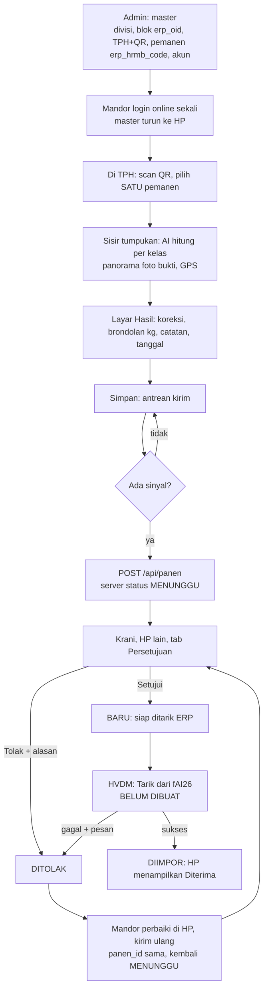
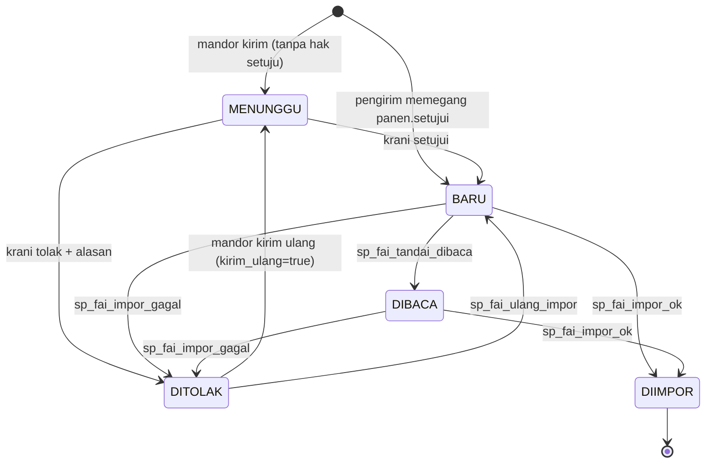
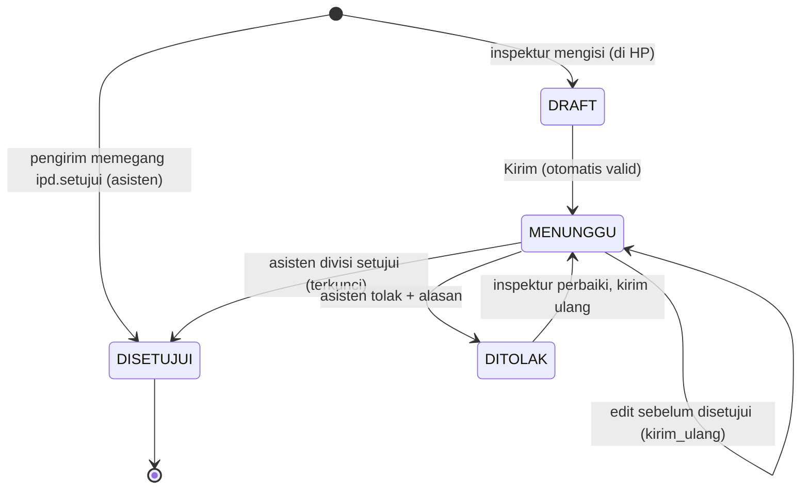

# 07. Alur Bisnis, Status, dan Aturan

Dokumen ini menjelaskan **bagaimana sistem bekerja dari sisi pekerjaan**: siapa melakukan apa, status apa yang berubah, dan aturan apa yang ditegakkan di HP, server, dan ERP. Sumber: kode yang berjalan, tes integrasi, dan keputusan Ptoni. Label **[Fakta]** (terbukti di kode/tes), **[Keputusan]** (ditetapkan Ptoni).

## 1. Alur Panen end-to-end

1. **Admin** (web) mengisi master: divisi (dengan `erp_oid`), blok (dengan `erp_oid` = OID blok di ERP), TPH (QR dibuat otomatis), pemanen (dengan `erp_hrmb_code`, `mandor_hrmb_code`), akun (mandor dengan `mandor_hrmb_code` dan `afdeling_kode`), dan mencetak QR TPH.
2. **Mandor** login online sekali (master dan akun turun ke HP), lalu bekerja offline sampai 7 hari.
3. Di TPH: scan QR (atau pilih manual) → pilih pemanen (wajib, satu) → MULAI → SELESAI. Kamera + AI menghitung janjang per kelas; foto bukti panorama; GPS dinilai terhadap koordinat TPH (menandai, tidak memblokir).
4. Layar Hasil: koreksi jumlah per kelas, brondolan (kg), catatan, tanggal → **Simpan**. Catatan masuk antrean kirim.
5. Saat ada sinyal: `POST /api/panen`, lalu foto (`POST /api/panen/{id}/media`), lalu audit (`POST /api/audit/batch`). Server menyimpan ke `fai_panen` (+ `fai_panen_grading`, `fai_panen_pemanen`, `fai_foto`) dengan `status_erp = MENUNGGU` (mandor tidak memegang `panen.setujui`).
6. **Krani** (HP sendiri, **harus login online**) membuka tab Persetujuan: daftar dari server dengan foto bukti; **Setujui** (jadi `BARU`) atau **Tolak** dengan alasan (jadi `DITOLAK`, alasan masuk `fai_impor_log` sebagai `Ditolak krani: ...`).
7. **HVDM** menarik `BARU`/`DIBACA`, membuat `hvd1m`/`hvd1da`, melapor `DIIMPOR` atau `DITOLAK` lewat prosedur.
8. HP menanyakan status (`GET /api/panen?sejak=`) dan menampilkan **Diterima** atau **Ditolak + alasan**.

**Jalur kompatibel:** akun yang memegang `panen.setujui` (krani) yang mengirim sendiri dianggap menyetujui sendiri (status langsung `BARU`); catatan yang dikirim mandor atas nama krani (hak `panen.koreksi`) tetap membawa pencatat sebenarnya.

## 2. Dua daftar status (jangan tertukar)

### 2.1 Di HP (`panen_header.status`)

| Status | Arti |
|---|---|
| `DRAFT` | Disimpan, belum masuk antrean (alur krani lama) |
| `DISETUJUI` | Masuk antrean kirim |
| `SIAP_KIRIM` | Ada di daftar tetapi **tidak dipakai** |
| `MENUNGGU_SETUJU` | Terkirim ke server, menunggu krani ("Menunggu krani") |
| `TERKIRIM` | Server `BARU` atau `DIBACA` (disetujui, menunggu ERP) |
| `DITERIMA` | ERP sudah mengimpor (server `DIIMPOR`) |
| `DITOLAK` | Krani atau ERP menolak, atau server menolak isi; `pesan_server` berisi alasan |

### 2.2 Di server (`fai_panen.status_erp`)

Pemetaan ke HP: `MENUNGGU` = Menunggu krani; `BARU`/`DIBACA` = Terkirim; `DIIMPOR` = Diterima; `DITOLAK` = Ditolak. **Catatan `DIIMPOR` tidak boleh diubah di HP**; koreksi lewat catatan baru atau lewat ERP.

## 3. Aturan Panen [Fakta]

### 3.1 Aturan server saat menerima `POST /api/panen`

Server **menolak (422)** catatan yang: unit tidak dikenal; `status_lokasi` atau `kelas_kode` tidak dikenal, atau kelas ganda; jumlah negatif; **blok, TPH, atau pemanen tidak ada di master**; **pemanen bukan milik mandor akun** (akun mandor); **total janjang nol**; **pemanen tidak tepat satu** (atau `hrmb_code` kosong, atau `jjg_alokasi` ≠ total janjang); tanggal atau UUID salah format. Unit pada catatan harus sama dengan unit akun pengirim (403 bila beda). Kombinasi **tanggal + unit + blok + TPH + pemanen** yang sudah ada dengan `panen_id` lain dijawab **409** (indeks unik `ux_fai_panen_tph_pemanen`).

Pencatat catatan = pemilik token, **kecuali** `pencatat_username` dikirim oleh pemegang `panen.koreksi`. `fai_panen.dibuat_oleh` adalah user_id pencatat sebenarnya, bukan pengirim. **Mandor dan afdeling catatan diambil server dari akun** (bukan isi kiriman) dan **disalin** ke catatan (`afdeling_kode`, `afdeling_erp_oid`, `mandor_hrmb_code`); salinan tidak berubah bila master diubah kemudian. Master belum lengkap berarti NULL dan catatan tetap diterima; **HVDM yang menolaknya**.

### 3.2 Aturan edit [Keputusan 20 Nov]

| Keadaan | Boleh diubah mandor? |
|---|---|
| Belum terkirim (di HP) | Ya |
| `MENUNGGU` (menunggu krani) | **Ya**, lewat Riwayat → "Edit sebelum disetujui" dan kirim ulang (`kirim_ulang=true`); status tetap `MENUNGGU` |
| `DITOLAK` | Ya, kirim ulang; kembali `MENUNGGU` |
| `BARU`/`DIBACA`/`DIIMPOR` (disetujui) | **Tidak** (terkunci; server 423, HP menandai) |

### 3.3 Aturan persetujuan krani [Fakta]

- Hak `panen.setujui` (KRANI dan ADMIN; MANDOR tidak). Harus **online** dan login online untuk akun itu (perbaikan O-01).
- Tolak: alasan **wajib**, maksimal 300 karakter. Setujui/tolak pada catatan yang sudah diproses dijawab **409** ("sudah diproses di tempat lain").
- Setujui dengan **dialog konfirmasi**; "Setujui semua" juga dikonfirmasi.
- Audit `SETUJU` ditulis; `disetujui_oleh` = krani; `pencatat_username` tetap mandor.

### 3.4 Satu TPH satu pemanen [Keputusan 18 Nov]

Diputuskan rekan Ptoni di perusahaan. Setiap catatan = tepat satu pemanen = seluruh janjang dikreditkan ke dia = tepat satu baris `hvd1da`. HP menolak MULAI/Simpan tanpa pemanen; server menolak catatan tanpa pemanen tunggal. Tidak ada pembagian janjang.

### 3.5 Koreksi hitungan dan nilai yang sah

`jml_ai` (kamera) dan `jml_final` (setelah koreksi) keduanya disimpan; `diubah_manual=1` bila beda. **Hanya `jml_final` yang sah untuk ERP.** `fai_panen_grading` selalu memuat enam baris per catatan (termasuk nol).

### 3.6 Status lokasi

`DI_TPH` (dalam 50 m dari titik TPH dan akurasi ≤ 30 m), `DI_LUAR`, `AKURASI_RENDAH`, `TANPA_GPS`, `TPH_TANPA_KOORDINAT`. **Hanya menandai, tidak memblokir**; parameter (radius, akurasi) masih usulan dan akan disetel dari uji lapangan. Koordinat TPH direkam krani/mandor saat pertama dipakai; server tidak menimpa titik yang ada.

## 4. Alur dan aturan IPD [Fakta]

1. Inspektur (mandor atau asisten) memilih **tanggal, divisi, blok, pemanen** (satu catatan = satu ancak), nomor ancak (opsional), dan **kemandoran** (satu akun aktif berperan MANDOR). Pemanen + blok yang sama dalam **7 hari terakhir** memicu **peringatan** (bukan larangan).
2. **Pokok demi pokok**: nomor baris dan pokok; **semua pokok yang diperiksa dicatat** (termasuk bersih) agar persen loses terhitung. Temuan: kode **A, G, S, M1 sampai M4, B1, B2, C, R**, jumlah bawaan 1.
3. Kirim: server menentukan inspektur (token), unit, dan **asisten penyetuju dari divisi** (`divisi.asisten_user_id`; bila divisi belum punya asisten, semua pemegang `ipd.setujui` di unit melihatnya). Saat asisten divisi diganti, inspeksi `MENUNGGU` divisi itu **ikut pindah**.
4. **Validasi server (422):** divisi dan blok ada di master dan blok milik divisi itu; pemanen ada di master; kode temuan dikenal; `mandor_username` akun aktif berperan MANDOR; 1 sampai 3000 pokok, nomor 1 sampai 9999, tidak ganda (409); jumlah temuan 1 sampai 9999, kode tidak ganda dalam satu pokok; jalur GPS maksimal 20.000 titik dengan koordinat sah (bukan 0,0) dan waktu valid.
5. **Persetujuan asisten:** `ipd.setujui`; setelah `DISETUJUI` **terkunci** (`kirim_ulang` dijawab **423**). Tolak butuh alasan. Hanya yang `DISETUJUI` masuk laporan loses.
6. **Rumus:** kode buah dan brondolan (A, G, S, M1, M2, M3, M4, B1, B2) = **loses**; pelepah (C, R) = **temuan lain** (tidak memengaruhi produksi, dilaporkan terpisah). Persen loses = pokok yang memuat paling sedikit satu kode loses ÷ pokok diperiksa.
7. **Foto bukti** tanpa batas jumlah, dikompres di HP (1600 px, JPEG 80), tiap foto berketerangan; berkas HP dihapus setelah terunggah.
8. **Jalur GPS:** direkam selama mencatat (tiap 3 m, akurasi ≤ 25 m); ikut terkirim; **hanya pemegang `ipd.jejak`** (ADMIN, ASISTEN, ASKEP, KTU) menerimanya dari API; mandor tidak. Lihat `09_KEAMANAN_DAN_PRIVASI.md`.

Bahan kode temuan (master `ipd_kode_temuan`): lihat `02_SKEMA_DATABASE_SERVER.md` bagian 6.4.

## 5. Alur keamanan akun

- **Login:** `POST /api/auth/login` (username, password, `device_id` UUID dari HP). Perangkat baru otomatis didaftarkan. 5 salah berturut-turut mengunci akun 15 menit (423). Perangkat nonaktif ditolak (403) dan sesinya dicabut.
- **Token:** akses 15 menit; refresh 30 hari yang diganti tiap dipakai; hanya hash refresh token yang disimpan (`auth_sesi.refresh_token_hash`).
- **Reset password oleh admin:** `wajib_ganti_password = 1`; pengguna harus mengganti saat login berikutnya (web: dialog wajib tidak bisa ditutup).
- **Ganti password sendiri:** hanya online; mencabut sesi perangkat lain.
- **Hak akses:** dibaca ulang dari database di setiap panggilan API; role berlaku bila hari ini di antara `berlaku_mulai` dan `berlaku_sampai` (kosong = tanpa batas).

## 6. Admin: master dan pengguna

- Penghapusan master selalu **lunak** (`dihapus_pada`). `diubah_pada` wajib diisi pada setiap perubahan (versi master HP bergantung padanya).
- Kode blok tidak boleh mengandung `|` (dipakai QR); unik per unit (`WHERE dihapus_pada IS NULL`). Nomor TPH unik per blok. `qr_kode` dibuat server; mengubah kode blok/nomor TPH mengubah QR (QR lama tidak berlaku).
- **Asisten divisi** hanya boleh akun ASISTEN aktif di unit yang sama.
- **Role buatan admin:** kode, nama, keterangan; boleh dihapus selama bukan role bawaan dan tidak dipegang akun aktif. `ADMIN` tidak boleh kehilangan `role.kelola`.
- **Akun mandor** wajib punya `mandor_hrmb_code` dan `afdeling_kode` supaya HP-nya menerima pemanen miliknya dan blok/TPH afdelingnya.

## 7. Aturan lintas sistem (ERP)

1. HP tidak menyentuh ERP; ERP membaca view `v_fai_panen_siap_impor` dan memanggil prosedur `sp_fai_*`; tidak menulis `fai_*` langsung.
2. **Satu catatan = satu baris `hvd1da`**; HVDM mengelompokkan header (mandor + afdeling + tanggal) [Dugaan; verifikasi].
3. Catatan `MENUNGGU` dan `DITOLAK` **tidak terlihat** HVDM.
4. Kunci ke ERP: `asm3_oid` dan `pemanen_hrmb_code`, bukan id internal.
5. Tahun cluster ERP dari `tanggal_panen`.
6. Penolakan ERP wajib menyertakan pesan yang tampil di HP (≤ 500 karakter).
7. Rincian dan pemetaan: `12_ERP_YANG_PERLU_DIBUAT.md`.

## 8. Sumber diagram

Diagram alur dan ERD sumber (Mermaid) ada di `lampiran/diagram/`: arsitektur (`fAI26_H90_1`), modul ERP (`_2`), komunikasi (`_3`), alur pindai TPH (`_4`), IPD (`fAI26_IPD_1`, `_2`), persetujuan (`fAI26_PERSETUJUAN_1_alur`), jalur GPS (`fAI26_GPS_1`), ERD server (`fAI26_ERD_server_akses`, `_erp`) dan HP (`fAI26_ERD_mobile`). Berkas `.mmd` belum dirender menjadi gambar; buka di editor Mermaid.
