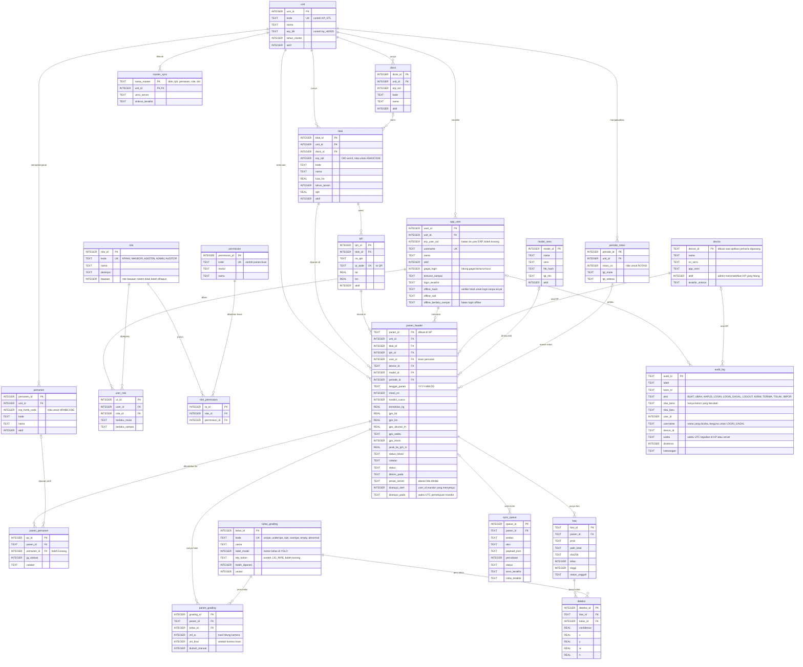
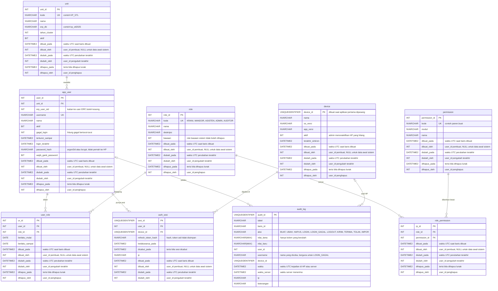
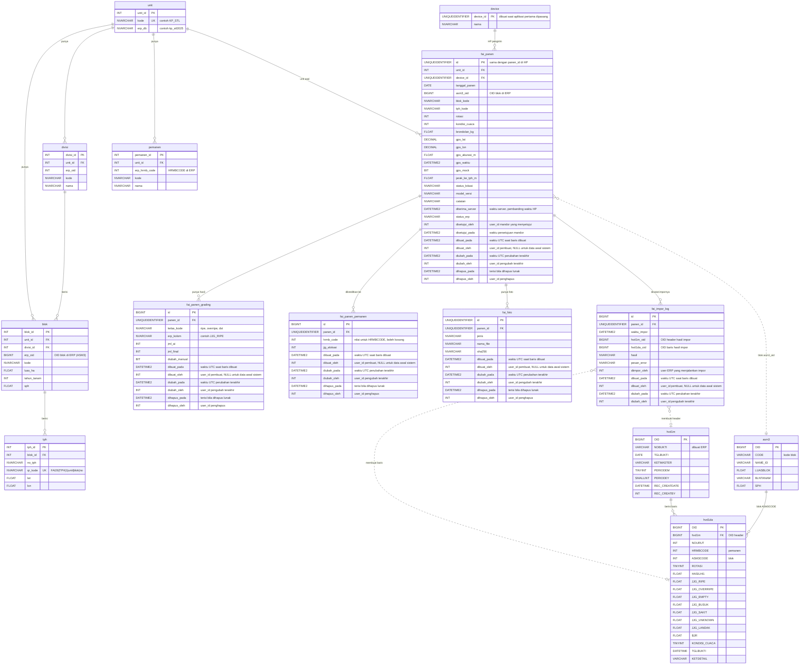

# fAI26: ERD Database Mobile (versi 2, dengan audit dan akses)

Dokumen ini berisi rancangan basis data aplikasi mobile fAI26 (pencatatan panen dan grading TBS) supaya datanya bisa masuk ke mySAP365 lewat TCode HVD1. Versi 2 menambahkan dua hal: jejak audit di setiap tabel, dan tabel akses (user, role, permission) untuk login ke aplikasi.

**Revisi 11 Nov 2026 (versi 2.3):** master untuk HP. Server fAI26 mendapat tabel `divisi`, `blok`, `tph`, dan `pemanen` (salinan dari ERP atau diisi admin) supaya HP bisa mengunduh master lewat `GET /api/master`. Versi master dihitung dari isi tabel (jumlah baris dan waktu ubah terbaru), tanpa kolom tambahan. Untuk database server yang sudah ada, jalankan `fai26-api/migrations/002_master.sql`.

**Revisi 10 Nov 2026 (versi 2.2):** verifikasi lokasi pencatat. `panen_header` dan `fai_panen` mendapat kolom `gps_akurasi_m`, `gps_waktu`, `gps_mock`, `jarak_ke_tph_m`, dan `status_lokasi` (lihat penjelasan di bagian `panen_header`). Skrip SQLite dan SQL Server, diagram Mermaid, dan versi Room di HP (skema 2, dengan migrasi dari 1) sudah disesuaikan.

**Revisi 10 Nov 2026 (versi 2.1):** (1) salah ketik di skrip SQLite diperbaiki: `offline_berlaku_sampaiTEXT` menjadi `offline_berlaku_sampai TEXT`; (2) `label_model` pada data awal `kelas_grading` disesuaikan dengan urutan keluaran model best.tflite (0 Abnormal, 1 Empty Bunch, 2 Overripe, 3 Ripe, 4 Underripe, 5 Unripe), sebelumnya salah (0 sampai 5 = unripe sampai abnormal); (3) persetujuan mandor ditambahkan: status `DISETUJUI`, kolom `disetujui_oleh` dan `disetujui_pada` di `panen_header` dan `fai_panen`, permission `panen.setujui`; (4) `erp_kolom` abnormal diisi `JJG_UNKNOWN` sementara.

Tanda yang dipakai: **[Fakta]** hasil membaca database ERP, **[Usulan]** rancangan dariku, **[Cek]** hal yang perlu dikonfirmasi ke pembimbing.

---

## 1. Keputusan yang dipakai

Empat keputusan ini kamu pilih sendiri, dan seluruh rancangan di bawah mengikutinya.

| Soal | Keputusan |
|---|---|
| Sumber akun login | Akun fAI26 sendiri. Admin membuat akun krani dan mandor. Kolom `erp_user_oid` opsional untuk mengaitkan ke user ERP. |
| Login tanpa sinyal | Login pertama wajib online. Setelah itu HP boleh login offline sampai batas waktu tertentu. |
| Hak akses | Role plus permission. Hak akses per role bisa diatur lewat tabel, bukan tertulis kaku di kode. |
| Audit | Kolom audit di setiap tabel, hapus lunak, ditambah tabel `audit_log` yang menyimpan nilai lama dan nilai baru. |
| Persetujuan mandor | Catatan krani disetujui mandor sebelum dikirim (jawaban Ptoni, 10 Nov 2026). |

---

## 2. Prinsip rancangan

1. **HP punya database sendiri (SQLite).** Aplikasi tetap jalan tanpa sinyal. Semua catatan disimpan dulu di HP.
2. **ID dibuat di HP.** Catatan panen memakai UUID (`panen_id`). Server menolak UUID yang sudah ada, jadi kirim ulang tidak membuat data dobel.
3. **Master disalin dari ERP.** Blok, TPH, pemanen, dan periode datang dari server. Setiap master membawa kolom kunci ERP (`erp_oid`, `erp_hrmb_code`), supaya hasil scan QR dan pilihan pemanen bisa dipetakan balik ke ERP.
4. **Hasil grading dipisah per kelas.** `panen_grading` menyimpan satu baris per kelas. Kolom `jml_ai` berisi hitungan kamera, kolom `jml_final` berisi angka setelah koreksi krani.
5. **Pemanen opsional.** Buah di TPH sering bercampur, jadi `panen_pemanen` boleh kosong atau berisi pembagian janjang per pemanen. **[Cek]**
6. **HP tidak menyentuh tabel ERP.** HP mengirim ke tabel perantara `fai_*` di server. Proses di sisi ERP yang membuat dokumen HVD1 lewat kode aplikasi, supaya `OID`, `NOBUKTI`, dan audit `REC_*` terisi benar.
7. **Semua waktu disimpan dalam UTC.** Format di SQLite `YYYY-MM-DDTHH:MM:SSZ`. Aplikasi menampilkannya dalam WIB.
8. **Data tidak dihapus permanen.** Penghapusan hanya mengisi `dihapus_pada` dan `dihapus_oleh`.

---

## 3. Jejak audit

### 3.1 Kolom audit standar

Setiap tabel data memakai enam kolom yang sama. Pola ini mirip kolom `REC_*` di ERP, jadi mudah dijelaskan ke pembimbing.

| Kolom | Isi | Padanan di ERP |
|---|---|---|
| `dibuat_pada` | Waktu UTC baris dibuat | `REC_CREATDATE` |
| `dibuat_oleh` | `user_id` pembuat. NULL untuk data awal sistem | `REC_CREATBY` |
| `diubah_pada` | Waktu UTC perubahan terakhir | `REC_MODIFDATE` |
| `diubah_oleh` | `user_id` pengubah terakhir | `REC_MODIFBY` |
| `dihapus_pada` | Terisi bila baris dihapus lunak | `REC_DELDATE` |
| `dihapus_oleh` | `user_id` penghapus | `REC_DELBY` |

Kolom `dibuat_oleh`, `diubah_oleh`, dan `dihapus_oleh` merujuk ke `app_user.user_id`. Garis relasinya tidak digambar di ERD supaya diagram tetap terbaca, dan kolomnya sengaja tanpa foreign key. Alasannya, master yang diunduh ke HP bisa dibuat oleh user yang tidak ada di HP itu.

### 3.2 Tabel mana memakai apa

| Tingkat | Kolom | Dipakai oleh |
|---|---|---|
| Penuh | 6 kolom audit | Semua tabel master, akses, dan transaksi (`panen_header`, `panen_pemanen`, `panen_grading`, `foto`, `fai_panen`, dan sejenisnya) |
| Dasar | `dibuat_*` dan `diubah_*` | Tabel teknis: `deteksi`, `sync_queue`, `master_sync`, `auth_sesi`, `fai_impor_log` |
| Tidak ada | Kolom sendiri | `audit_log` (catatan yang tidak boleh diubah) |

### 3.3 Hapus lunak

- Aplikasi tidak pernah menjalankan `DELETE` pada tabel data. Ia mengisi `dihapus_pada` dan `dihapus_oleh`.
- Semua query harus menyaring `WHERE dihapus_pada IS NULL`. Buat satu fungsi repository yang menambahkan syarat ini otomatis supaya tidak lupa.
- Unique constraint pada pasangan kolom (misalnya `user_id` dan `role_id` di `user_role`) dibuat sebagai index unik dengan syarat `WHERE dihapus_pada IS NULL`. Dengan begitu, role yang sudah dihapus lunak bisa diberikan lagi tanpa bentrok.
- Kode unik satu kolom (`username`, `kode`) memakai unique biasa. Username milik akun yang sudah dihapus tetap terpakai, dan itu memang disengaja supaya riwayat audit tidak tertukar orangnya.

### 3.4 Tabel `audit_log` (riwayat nilai lama dan baru)

Kolom audit hanya menjawab siapa dan kapan. Untuk menjawab apa yang berubah, `audit_log` menyimpan nilai lama dan nilai baru dalam JSON.

| Kolom | Isi |
|---|---|
| `audit_id` | UUID, dibuat di HP atau server |
| `tabel`, `baris_id` | Tabel dan baris yang berubah |
| `aksi` | `BUAT`, `UBAH`, `HAPUS`, `LOGIN`, `LOGIN_GAGAL`, `LOGOUT`, `KIRIM`, `TERIMA`, `TOLAK`, `IMPOR` |
| `nilai_lama`, `nilai_baru` | JSON, hanya kolom yang berubah |
| `user_id`, `username`, `device_id` | Pelaku dan HP asal. `username` menyimpan nama yang diketik saat `LOGIN_GAGAL` |
| `waktu` | Waktu kejadian (jam HP atau jam server) |
| `waktu_server` | Waktu server menerima (hanya di server) |
| `disinkron` | Penanda sudah terkirim ke server (hanya di HP) |

Contoh satu baris, saat krani mengoreksi jumlah ripe dari 12 menjadi 14:

```json
{
  "audit_id": "5b0e7c1e-3c9b-4c1c-9d5a-0d3f9a1e2b77",
  "tabel": "panen_grading",
  "baris_id": "41",
  "aksi": "UBAH",
  "nilai_lama": { "jml_final": 12, "diubah_manual": 0 },
  "nilai_baru": { "jml_final": 14, "diubah_manual": 1 },
  "user_id": 7,
  "device_id": "a8f1c3de-7b44-4a0e-8d52-1c6a7f0b9e10",
  "waktu": "2026-11-05T02:41:09Z"
}
```

**Yang dicatat ke `audit_log`:**

- Di HP: pembuatan, perubahan, dan penghapusan lunak pada `panen_header`, `panen_grading`, `panen_pemanen`, dan `foto`, serta login, login gagal, dan logout.
- Di server: semua yang di atas setelah diterima, ditambah perubahan pada `app_user`, `role`, `permission`, `user_role`, `role_permission`, `device`, master, dan hasil impor ke ERP.

**Aturan keamanan audit_log:**

- Tabel ini hanya boleh `INSERT`. Tidak ada `UPDATE` atau `DELETE`. Di SQL Server, akun API diberi `DENY UPDATE, DELETE` (baris perintahnya ada di skrip SQL Server).
- Baris audit dari HP masuk lewat antrean `sync_queue` dengan `entitas = 'AUDIT'`, memakai UUID yang sama, sehingga kirim ulang tidak menggandakan baris.

### 3.5 Siapa yang mengisi kolom audit

- **Di HP:** lapisan repository (Dart) mengisi `dibuat_*`, `diubah_*`, `dihapus_*`, dan menulis `audit_log` dalam satu transaksi SQLite yang sama dengan perubahan datanya. Kalau salah satu gagal, keduanya dibatalkan.
- **Di server:** API mengisi kolom audit untuk perubahan yang berasal dari admin. Untuk catatan panen dari HP, `dibuat_pada` dan `dibuat_oleh` memakai nilai dari HP, sedangkan server menambahkan `diterima_server` memakai jam server.
- **Kenapa dua waktu:** jam HP bisa salah atau diubah. Selisih `dibuat_pada` dan `diterima_server` menjadi petunjuk bila ada kejanggalan saat audit.
- **Di ERP:** `REC_CREATBY` pada dokumen HVD1 diisi user ERP yang menjalankan impor, karena ID user ERP berbeda dengan ID user fAI26. Siapa krani pencatatnya tetap tersimpan di `fai_panen.dibuat_oleh` dan `fai_impor_log`. **[Usulan]** Tulis juga username fAI26 ke `hvd1da.KETDETAIL` agar orang ERP bisa melihatnya.

---

## 4. Akses dan login

### 4.1 Tabel akses

| Tabel | Fungsi |
|---|---|
| `app_user` | Akun pengguna. Server menyimpan `password_hash`. HP menyimpan `offline_hash`, `offline_salt`, dan `offline_berlaku_sampai`. |
| `role` | Peran: KRANI, MANDOR, ASISTEN, ADMIN, AUDITOR. |
| `permission` | Hak akses tunggal, contoh `panen.buat`. |
| `user_role` | Satu user bisa memegang beberapa role, dengan masa berlaku opsional. |
| `role_permission` | Daftar permission milik tiap role. |
| `auth_sesi` | Sesi login di server (refresh token dalam bentuk hash). Tidak ada di HP. |
| `device` | HP yang terdaftar. Admin bisa menonaktifkan HP yang hilang. |

Relasi: `app_user` dan `role` terhubung lewat `user_role` (banyak ke banyak). `role` dan `permission` terhubung lewat `role_permission` (banyak ke banyak).

### 4.2 Role dan permission awal **[Usulan]**

| Permission | Keterangan | KRANI | MANDOR | ASISTEN | ADMIN | AUDITOR |
|---|---|---|---|---|---|---|
| `panen.lihat` | Melihat catatan panen | x | x | x | x | x |
| `panen.buat` | Membuat catatan panen | x | x |  |  |  |
| `panen.ubah` | Mengubah catatan panen milik sendiri | x | x |  |  |  |
| `panen.koreksi` | Mengoreksi catatan panen orang lain |  | x | x |  |  |
| `panen.hapus` | Menghapus lunak catatan panen |  | x | x |  |  |
| `panen.kirim` | Mengirim catatan ke server | x | x |  |  |  |
| `panen.setujui` | Menyetujui catatan panen krani sebelum dikirim |  | x |  |  |  |
| `grading.ubah` | Mengubah hasil grading (jml_final) | x | x |  |  |  |
| `master.lihat` | Melihat data master | x | x | x | x | x |
| `master.kelola` | Mengelola data master di fAI26 |  |  |  | x |  |
| `laporan.lihat` | Melihat rekap panen |  | x | x | x | x |
| `impor.erp` | Menjalankan impor ke ERP |  |  | x |  |  |
| `user.kelola` | Mengelola pengguna |  |  |  | x |  |
| `role.kelola` | Mengelola role dan permission |  |  |  | x |  |
| `device.kelola` | Mengelola perangkat HP |  |  |  | x |  |
| `audit.lihat` | Melihat audit log |  |  |  |  | x |
| `model.kelola` | Mengelola versi model YOLO |  |  |  | x |  |

Kolom `bawaan = 1` menandai role bawaan sistem yang tidak boleh dihapus. **[Cek]** Tanyakan pembimbing apakah ada peran lain di kebun, misalnya KTU atau Askep, yang perlu role sendiri.

### 4.3 Alur login pertama (wajib online)

1. Pengguna mengisi username dan password.
2. HP memanggil `POST /api/auth/login` beserta `device_id`.
3. Server memeriksa: akun aktif, tidak terkunci, HP tidak dinonaktifkan, dan `password_hash` cocok (argon2id atau bcrypt).
4. Bila cocok, server membuat baris `auth_sesi` dan menjawab dengan access token (pendek, misalnya 15 menit), refresh token, profil user, daftar role, dan daftar permission.
5. HP menyimpan token di penyimpanan aman (Android Keystore lewat `flutter_secure_storage`, bukan di SQLite).
6. HP menghitung verifier lokal dari password yang baru diketik: `offline_hash = hash(password + offline_salt)`, lalu menyimpannya di `app_user` bersama `offline_berlaku_sampai`. Password asli tidak pernah disimpan.
7. HP menyalin `app_user`, `user_role`, `role`, `permission`, dan `role_permission` milik unitnya ke SQLite.
8. Server menulis `audit_log` aksi `LOGIN`.

### 4.4 Alur login offline

1. Pengguna mengisi username dan password tanpa sinyal.
2. HP mencari `app_user` lokal, lalu memeriksa `aktif`, `terkunci_sampai`, dan `offline_berlaku_sampai`.
3. HP menghitung hash dari password yang diketik dan membandingkannya dengan `offline_hash`.
4. Bila cocok, aplikasi terbuka dan `gagal_login` kembali ke 0. Bila salah, `gagal_login` naik. Setelah 5 kali gagal, akun terkunci 15 menit lewat `terkunci_sampai`.
5. HP menulis `audit_log` aksi `LOGIN` (atau `LOGIN_GAGAL`) dengan keterangan `OFFLINE`, lalu mengirimnya saat sinyal kembali.
6. Saat sinyal kembali, HP memperbarui token dan memperpanjang `offline_berlaku_sampai`. Bila server menjawab bahwa akun atau HP sudah dinonaktifkan, HP langsung logout paksa dan menghapus `offline_hash`.

**Parameter yang diusulkan [Usulan]:** masa berlaku login offline 7 hari, kunci akun setelah 5 kali gagal selama 15 menit, panjang password minimal 8 karakter. **[Cek]** Tanyakan pembimbing berapa lama krani biasanya tidak ada sinyal. Masa berlaku itu juga menjadi batas risiko bila HP hilang, karena server tidak bisa mencabut akses offline sebelum HP tersambung lagi.

### 4.5 Pengamanan tambahan

- **Password:** server hanya menyimpan hash. HP tidak pernah menerima `password_hash`, sehingga kolom itu hanya ada di tabel server.
- **Ganti password:** kolom `wajib_ganti_password` memaksa pengguna mengganti password pada login berikutnya (dipakai setelah admin mereset).
- **HP hilang:** admin menonaktifkan baris `device` dan mencabut `auth_sesi`. Akses offline berhenti paling lambat saat `offline_berlaku_sampai` lewat.
- **Pemeriksaan hak akses ada di dua tempat.** HP membaca permission dari SQLite untuk menampilkan atau menyembunyikan tombol. Server memeriksa ulang permission pada setiap panggilan API, karena HP tidak boleh dipercaya sepenuhnya.
- **Satu akun, satu unit.** `app_user.unit_id` menentukan unit pengguna. Bila nanti ada mandor yang memegang beberapa unit, tambahkan kolom `unit_id` di `user_role`.

### 4.6 Endpoint API untuk akses **[Usulan]**

| Method | Alamat | Fungsi |
|---|---|---|
| POST | /api/auth/login | Login, mengembalikan token, role, dan permission. |
| POST | /api/auth/refresh | Memperbarui access token memakai refresh token. |
| POST | /api/auth/logout | Mencabut sesi. |
| GET | /api/auth/me | Profil, role, dan permission terbaru. |
| POST | /api/auth/ganti-password | Mengganti password sendiri. |
| GET, POST, PUT | /api/admin/users | Kelola pengguna (permission `user.kelola`). |
| GET, PUT | /api/admin/roles | Kelola role dan permission (permission `role.kelola`). |
| PUT | /api/admin/devices/{id} | Aktifkan atau nonaktifkan HP (permission `device.kelola`). |
| GET | /api/audit | Cari audit log (permission `audit.lihat`). |
| POST | /api/audit/batch | Terima audit log dari HP. |

---

## 5. ERD database HP

Ada dua gambar. Versi ringkas tidak menampilkan kolom audit supaya mudah dibaca. Versi lengkap menampilkan semuanya (Lampiran A).

- Gambar ringkas: `fAI26_ERD_mobile_ringkas.png`
- Gambar lengkap: `fAI26_ERD_mobile.png`

Kode Mermaid versi ringkas:



Tabel di HP: `unit`, `divisi`, `blok`, `tph`, `pemanen`, `periode_rotasi` (master dari ERP); `kelas_grading`, `model_versi`, `device` (master aplikasi); `app_user`, `role`, `permission`, `user_role`, `role_permission` (akses); `panen_header`, `panen_pemanen`, `panen_grading`, `foto`, `deteksi` (transaksi); `audit_log`, `sync_queue`, `master_sync` (jejak dan sinkronisasi). Total 22 tabel.

### 5.1 Penjelasan tabel inti

**`panen_header`** adalah satu kali pencatatan di satu TPH. Kolom `user_id` berisi krani pencatat, sedangkan `dibuat_oleh` berisi siapa yang menekan tombol simpan (biasanya orang yang sama, bisa berbeda bila mandor menginput untuk krani). Kolom `status` bergerak lewat `DRAFT`, `DISETUJUI` (mandor sudah menyetujui), `SIAP_KIRIM`, `TERKIRIM`, `DITERIMA`, atau `DITOLAK`. Kolom `disetujui_oleh` dan `disetujui_pada` mencatat mandor yang menyetujui dan waktunya.

**Verifikasi lokasi (ditambahkan 10 Nov 2026 atas permintaan Ptoni).** Kolom `gps_lat`, `gps_lon` berisi titik GPS pencatat, `gps_akurasi_m` akurasi titik dalam meter, `gps_waktu` kapan titik diambil, `gps_mock` bernilai 1 bila Android menandai titik sebagai lokasi palsu, `jarak_ke_tph_m` jarak titik itu ke `tph.lat` dan `tph.lon`, dan `status_lokasi` salah satu dari `DI_TPH` (jarak dalam radius), `DI_LUAR` (di luar radius), `AKURASI_RENDAH` (akurasi lebih buruk dari batas, tidak bisa dinilai), `TANPA_GPS` (GPS mati atau izin ditolak), dan `TPH_TANPA_KOORDINAT` (TPH belum punya koordinat di master). Status ini tanda untuk mandor, bukan pemblokir penyimpanan. Nilai awal radius 50 meter dan akurasi maksimum 30 meter, disetel dari uji lapangan.

**`panen_grading`** berisi hasil per kelas. Pasangan `panen_id` dan `kelas_id` unik (selama belum dihapus lunak).

**`kelas_grading`** menghubungkan kelas model dengan kolom HVD1. Kelas yang belum punya kolom di ERP (unripe dan underripe) mengisi `erp_kolom` dengan NULL, jadi datanya tetap tersimpan di staging.

**`sync_queue`** menyimpan antrean kirim untuk tiga jenis data: `PANEN`, `FOTO`, dan `AUDIT`.

**`master_sync`** mencatat versi dan waktu terakhir tiap master diunduh. Kunci tabelnya gabungan (`nama_master` dan `unit_id`).

---

## 6. ERD server: akses dan audit

Gambar: `fAI26_ERD_server_akses.png`. Di server, `app_user` memiliki `password_hash` dan `wajib_ganti_password`. Kolom `offline_*` hanya ada di HP.



---

## 7. ERD server: staging dan tabel HVD1 di ERP

Gambar: `fAI26_ERD_server_erp.png`. Bagian atas adalah tabel perantara milikmu (`fai_*`). Bagian bawah adalah tabel ERP hasil pembacaan langsung. Garis putus-putus berarti hubungan logis tanpa foreign key, karena ERP memang tidak memakai foreign key dan relasinya dijaga XPO dari sisi aplikasi.



**[Fakta]** Struktur tabel ERP (`hvd1m`, `hvd1da`, `asm3`) di gambar hanya menampilkan kolom yang relevan. Struktur lengkap ada di Bab 13.5 file `fAI26_Panduan_Alur_Lengkap.md`.

**[Usulan]** Tabel `fai_*` dan tabel akses dibuat di database tersendiri (misalnya `fai26`) pada server yang sama. **[Cek]** Apakah boleh membuat database baru di server sandbox.

---

## 8. Pemetaan HP ke staging ke HVD1

| HP (SQLite) | Staging (SQL Server) | HVD1 di ERP | Catatan |
|---|---|---|---|
| `panen_header.panen_id` | `fai_panen.id` | tidak ada | Kunci anti-dobel. Disimpan juga di `fai_impor_log`. |
| `panen_header.tanggal_panen` | `fai_panen.tanggal_panen` | `hvd1m.TGLBUKTI`, `hvd1da.TGLBUKTI` | Satu header HVD1 per tanggal dan unit. |
| tidak ada | tidak ada | `hvd1m.NOBUKTI` | Dibuat ERP saat impor. |
| `blok.erp_oid` | `fai_panen.asm3_oid` | `hvd1da.ASM3CODE` | Hasil scan QR. |
| `tph.no_tph` | `fai_panen.tph_kode` | belum ada kolom | **[Cek]** Bisa masuk `KETDETAIL`. |
| `pemanen.erp_hrmb_code` | `fai_panen_pemanen.hrmb_code` | `hvd1da.HRMBCODE` | Boleh kosong. |
| `panen_grading` (ripe) | `fai_panen_grading` | `hvd1da.JJG_RIPE` | Langsung. |
| `panen_grading` (overripe) | `fai_panen_grading` | `hvd1da.JJG_OVERRIPE` | Langsung. |
| `panen_grading` (empty) | `fai_panen_grading` | `hvd1da.JJG_EMPTY` | Langsung. |
| `panen_grading` (abnormal) | `fai_panen_grading` | `JJG_BUSUK`, `JJG_SAKIT`, `JJG_UNKNOWN` | Perlu keputusan pemecahan. |
| `panen_grading` (unripe, underripe) | `fai_panen_grading` | belum ada kolom | **[Cek]** Tetap di staging. |
| jumlah ripe ditambah overripe | dihitung saat impor | `hvd1da.HASILHI1` | **[Cek]** Isinya jumlah janjang atau berat. |
| `panen_header.rotasi_no` | `fai_panen.rotasi` | `hvd1da.ROTASI` | |
| `panen_header.kondisi_cuaca` | `fai_panen.kondisi_cuaca` | `hvd1da.KONDISI_CUACA` | Samakan kode cuaca dengan ERP. |
| `panen_header.brondolan_kg` | `fai_panen.brondolan_kg` | belum ada kolom | **[Cek]** |
| `panen_header.catatan` | `fai_panen.catatan` | `hvd1da.KETDETAIL` | |
| `panen_header.disetujui_oleh`, `disetujui_pada` | `fai_panen.disetujui_oleh`, `disetujui_pada` | tidak ada | Jejak persetujuan mandor tetap di server fAI26. |
| `dibuat_pada`, `dibuat_oleh` | `fai_panen.dibuat_pada`, `dibuat_oleh` | `REC_CREATDATE`, `REC_CREATBY` | Tanggal diisi saat impor. `REC_CREATBY` diisi user ERP pengimpor. |
| `foto`, `deteksi`, `gps_*`, `device_id`, `model_id`, `audit_log` | `fai_foto`, `fai_panen.*`, `audit_log` | tidak ada | Bukti dan jejak tetap di server fAI26. |

---

## 9. Alur impor ke ERP

1. HP mengirim `panen_header`, `panen_grading`, `panen_pemanen`, foto, dan `audit_log` lewat API. Server menyimpan ke `fai_*` dengan `status_erp = 'BARU'` dan mencatat `diterima_server`.
2. Pengguna ERP dengan permission `impor.erp` membuka layar impor (TCode baru atau tombol di dekat HVD1), lalu memilih tanggal dan unit.
3. Kode ERP membaca baris `BARU`, mencari atau membuat header `hvd1m` untuk tanggal itu, membuat baris `hvd1da`, lalu mengisi kolom `JJG_*` sesuai tabel pemetaan.
4. Kode ERP menulis satu baris `fai_impor_log` (berisi `hvd1m_oid`, `hvd1da_oid`, `diimpor_oleh`, dan hasilnya), menulis `audit_log` aksi `IMPOR`, lalu mengubah `status_erp` menjadi `DIIMPOR`.
5. Bila gagal (misalnya blok tidak ditemukan), `status_erp` menjadi `DITOLAK` dan pesannya tersimpan. Pesan itu naik kembali ke HP lewat `panen_header.pesan_server`.
6. Setelah dibangun di Visual Studio, kamu publish lewat DevAgro Hub lalu memuat ulang aplikasi sendiri. Bagian ini tidak bisa kulakukan dari sini.

---

## 10. Aturan sinkronisasi

- **Kirim ulang aman.** Server memakai `panen_id` dan `audit_id` sebagai kunci. Kiriman ulang dengan ID yang sama dijawab sukses tanpa membuat baris baru.
- **Urutan kirim:** `panen_header` dulu, lalu `audit_log`, lalu foto. Foto besar boleh menyusul belakangan.
- **Master turun ke HP:** unduh `unit`, `divisi`, `blok`, `tph`, `pemanen`, `periode_rotasi`, dan data akses saat login dan saat ada sinyal. Bandingkan `versi_server` di `master_sync`.
- **Catatan `DITERIMA` tidak boleh diubah di HP.** Koreksi dilakukan lewat catatan baru atau lewat ERP.
- **Master nonaktif.** Baris dengan `aktif = 0` atau `dihapus_pada` terisi tetap tersimpan di HP supaya catatan lama tetap bisa ditampilkan.
- **Perubahan akses.** Bila admin mengubah role seorang user, HP baru tahu saat sinkron berikutnya. Karena itu server tetap memeriksa permission setiap panggilan.

---

## 11. Hal yang perlu dikonfirmasi

1. Arti `FCM4CODE` dan `HVM2CODE` di `hvd1da`, dan apakah HVD1 mengisinya.
2. Tabel `asm3` di `kp_stl2025` kosong. Cari database yang berisi data blok nyata, atau minta pembimbing mengisi data contoh.
3. Di mana janjang mentah dicatat, karena `hvd1da` tidak punya `JJG_MENTAH`.
4. Cara memecah kelas "abnormal" ke `JJG_BUSUK`, `JJG_SAKIT`, dan `JJG_UNKNOWN`.
5. Isi `HASILHI1`: jumlah janjang atau berat.
6. Kode `KONDISI_CUACA` yang dipakai ERP.
7. Apakah pembagian hasil ke pemanen per TPH dicatat krani.
8. Apakah `divisi` memang tabel master tersendiri di ERP dan apa namanya.
9. Apakah kolom `JJG_*`, `BJR`, `harvest_employee_id`, dan `NOSPB` sudah dipakai dokumen HVD1 yang ada.
10. Siapa yang menjadi admin aplikasi (yang membuat akun krani dan mandor) dan apakah ada peran lain selain lima role awal.
11. Berapa lama krani biasanya tidak mendapat sinyal, untuk menentukan masa berlaku login offline.
12. ~~Apakah mandor perlu menyetujui catatan krani sebelum dikirim.~~ **Sudah dijawab (10 Nov 2026): perlu.** Status `DISETUJUI`, kolom `disetujui_oleh` dan `disetujui_pada`, dan permission `panen.setujui` sudah ditambahkan di dokumen dan skrip ini.

---

## 12. Daftar file dan cara memakai Mermaid

| File | Isi |
|---|---|
| `fAI26_ERD_Database_Mobile.md` | Dokumen ini. |
| `fAI26_ERD_mobile.mmd` / `.png` | ERD HP lengkap dengan kolom audit. |
| `fAI26_ERD_mobile_ringkas.mmd` / `.png` | ERD HP tanpa kolom audit, lebih mudah dibaca. |
| `fAI26_ERD_server_akses.mmd` / `.png` | ERD server untuk akses dan audit. |
| `fAI26_ERD_server_erp.mmd` / `.png` | ERD staging dan tabel HVD1. |
| `fAI26_mobile_sqlite.sql` | Skrip tabel HP (SQLite), sudah dijalankan dan lolos. |
| `fAI26_server_sqlserver.sql` | Skrip tabel server (SQL Server), sudah dijalankan di SQL Server 2025 (10 Nov 2026): 14 tabel, 3 indeks terfilter, data awal 5 role dan 17 permission. Sejak 21 Nov 2026 ditambah modul IPD (bab 13): 5 tabel, 11 kode temuan, role ASKEP dan KTU, 8 permission. |

Cara memakai kode Mermaid:

1. Buka web pembuat diagram Mermaid, misalnya Mermaid Live Editor (mermaid.live).
2. Salin seluruh isi satu file `.mmd` ke kolom kode.
3. Ekspor sebagai PNG atau SVG. SVG tetap tajam saat diperbesar, jadi cocok untuk laporan.
4. Diagram HP lengkap sangat besar. Untuk laporan, pakai versi ringkas atau ekspor PNG berskala besar.

---

## 13. Modul IPD (Inspeksi Panen Detail)

Ditambahkan 21 Nov 2026 (rencana: `progres/RENCANA_IPD.md`). IPD mencatat **loses** (kehilangan hasil) di titik panen: brondolan tidak dikutip, buah tinggal, dan temuan lain. Tabel panen tidak diubah. DDL lengkapnya ada di `fAI26_mobile_sqlite.sql` (versi DB HP 5) dan `fAI26_server_sqlserver.sql` / `fai26-api/migrations/009_ipd.sql`; diagramnya di `fAI26_ERD_mobile.mmd` dan `fAI26_ERD_server_erp.mmd`.

### 13.1 Aturan bisnis

1. Satu catatan IPD = satu pemanen (satu ancak). Pindah ancak berarti catatan baru dari awal.
2. Yang menginspeksi (biasanya mandor, bisa asisten) mengisi pokok per pokok. **Semua pokok yang diperiksa dicatat**, termasuk yang bersih, supaya persen loses bisa dihitung.
3. Satu pokok boleh punya beberapa temuan (kode berbeda). Tiap temuan punya jumlah (bawaan 1).
4. Di awal inspeksi inspektur memilih **Divisi** (Divisi 1 atau Divisi 2). **Asisten terisi otomatis** dari divisi itu (contoh yang disebut Ptoni: Divisi 1 = Ferdi, Divisi 2 = Ginting). Asisten tiap divisi disimpan di `divisi.asisten_user_id` dan **diatur admin lewat web**, jadi bila asisten diganti cukup diganti di sana. Saat diganti, inspeksi divisi itu yang masih MENUNGGU ikut pindah ke asisten baru. Daftar blok difilter menurut divisi yang dipilih.
5. Kepala catatan juga memuat tanggal, blok, pemanen, nomor ancak (opsional), **mandor di blok** dan **mandor di ancak**. Kedua mandor **dipilih dari daftar akun berperan MANDOR** (tabel `app_user` di HP, yang sudah memuat semua akun unit beserta rolenya lewat master), bukan diketik. Kode HRMB mandor disalin ke catatan untuk ERP nanti.
6. Foto bukti **tidak dibatasi jumlahnya** (pohon banyak), tiap foto punya keterangan. Foto **dikompres saat disimpan** di HP. Setelah foto terkirim ke server, **berkas di HP dihapus** (`ipd_foto.path_lokal` menjadi NULL) supaya memori tidak penuh; fotonya dilihat dari server bila perlu.
7. Persetujuan dua tingkat: inspektur menyatakan valid saat menekan **Kirim** (otomatis), lalu **asisten yang tercatat di catatan itu** (`asisten_user_id`, pemegang `ipd.setujui`) menyetujui atau menolak dengan alasan. Bila divisi belum punya asisten, pemegang `ipd.setujui` di unit itu melihat catatannya. Aturan edit sama dengan panen: selama MENUNGGU inspektur boleh mengubah (kirim ulang); setelah DISETUJUI terkunci (server menjawab 423). Bila yang mengirim memegang `ipd.setujui` (asisten), catatan langsung DISETUJUI.
8. **Inspeksi ulang bebas** (mengikuti instruksi ASKEP, tidak ada anti ganda), tetapi HP memberi **peringatan** saat pemanen dan blok yang sama pernah diinspeksi dalam 7 hari terakhir: tanggal, inspektur, dan statusnya ditampilkan, lalu inspektur boleh lanjut. Pencarian memakai data server (bila ada sinyal) dan data HP sendiri.
9. Tahap ini belum terhubung ke ERP (TCode belum ditentukan). Kode blok (`asm3_oid`) dan pemanen (`pemanen_hrmb_code`) sudah disimpan terstruktur agar siap dijembatani nanti.

### 13.2 Tabel

| Tabel HP | Tabel server | Isi |
|---|---|---|
| `kode_temuan` | `ipd_kode_temuan` | Master 11 kode temuan (kode, nama, kelompok, urut, aktif). Diunduh HP lewat master. |
| `app_user` + `user_role` (sudah ada) | `app_user` + `user_role` | Daftar mandor (role MANDOR) dan asisten (role ASISTEN) untuk dipilih di HP; sudah diunduh lewat master (`user`). Tidak ada tabel baru. |
| `divisi` (kolom baru `asisten_user_id`) | `divisi` (kolom baru `asisten_user_id`) | Asisten tiap divisi, diatur admin. |
| `ipd_header` | `fai_ipd` | Satu inspeksi: tanggal, divisi, asisten, blok, pemanen, inspektur, mandor blok dan ancak, status, validasi, persetujuan. |
| `ipd_pokok` | `fai_ipd_pokok` | Pokok yang diperiksa: nomor baris dan nomor pokok, unik per inspeksi. |
| `ipd_temuan` | `fai_ipd_temuan` | Temuan pada pokok: kode dan jumlah, unik per pokok dan kode. |
| `ipd_foto` | `fai_ipd_foto` | Foto bukti (tanpa batas jumlah) dengan keterangan dan urutan. Di HP dikompres, berkasnya dihapus setelah terkirim. |

Kode temuan:

| Kode | Temuan | Kelompok |
|---|---|---|
| A | Potong buah mentah | BUAH |
| G | Tangkai panjang | BUAH |
| S | Buah masak tidak dipanen | BUAH |
| M1 | Buah diperam | BUAH |
| M2 | Buah dipanen tidak dibawa ke TPH | BUAH |
| M3 | Buah matahari | BUAH |
| M4 | Buah tidak disusun di TPH | BUAH |
| B1 | Brondolan tak dikutip > 3 butir | BRONDOLAN |
| B2 | Brondolan dibuang ke gawangan | BRONDOLAN |
| C | Pelepah sengkleh tidak dipotong | PELEPAH |
| R | Pelepah tidak disusun di gawangan | PELEPAH |

Status HP: `DRAFT` (belum terkirim), `MENUNGGU_SETUJU` (sudah di server, menunggu asisten), `DISETUJUI`, `DITOLAK`. Status server `fai_ipd.status`: `MENUNGGU`, `DISETUJUI`, `DITOLAK`.

### 13.3 Hak akses

| Permission | Fungsi |
|---|---|
| `akses.panen` | Kotak Panen muncul di layar awal HP. |
| `akses.ipd` | Kotak IPD muncul di layar awal HP. |
| `ipd.buat`, `ipd.kirim` | Mengisi dan mengirim inspeksi (kirim = valid). |
| `ipd.setujui` | Menyetujui atau menolak inspeksi yang ditujukan ke dirinya (asisten divisi). |
| `ipd.lihat` | Melihat daftar inspeksi di web. |
| `laporan.ipd` | Melihat laporan loses di web. |
| `ipd.kelola` | Mengelola kode temuan (admin). |
| `master.kelola` (sudah ada) | Admin mengganti asisten tiap divisi di halaman Divisi web. |

`akses.panen` dan `akses.ipd` dapat dipasang ke role mana pun lewat halaman Hak Akses web, jadi siapa yang melihat kotak apa bisa diubah tanpa mengubah aplikasi. Role baru **ASKEP** dan **KTU** hanya melihat (`panen.lihat`, `laporan.lihat`, `master.lihat`, `ipd.lihat`, `laporan.ipd`).

### 13.4 Rumus loses (untuk laporan, hanya inspeksi DISETUJUI)

- **Pokok diperiksa** = jumlah baris `ipd_pokok`.
- **Pokok bertemuan** = pokok yang punya paling sedikit satu temuan. **% pokok bertemuan** = pokok bertemuan dibagi pokok diperiksa.
- **% per kode** = pokok yang memuat kode itu dibagi pokok diperiksa. **Jumlah per kode** = penjumlahan `jumlah` temuan kode itu.
- **Per kelompok** (BUAH, BRONDOLAN, PELEPAH) = penjumlahan kode dalam kelompok.
- Pengelompokan laporan: per kode, per kelompok, per pemanen, per blok, per mandor, per periode tanggal.

### 13.5 Diagram alur

`flow/fAI26_IPD_1_alur_inspeksi.mmd` (alur inspeksi sampai persetujuan dan laporan) dan `flow/fAI26_IPD_2_navigasi_hp.mmd` (layar awal dua kotak dan menu bertingkat).

---

## Lampiran A: Mermaid ERD HP lengkap

```mermaid
erDiagram
    unit ||--o{ divisi : "punya"
    unit ||--o{ blok : "punya"
    divisi |o--o{ blok : "berisi"
    blok ||--o{ tph : "berisi"
    unit ||--o{ pemanen : "mempekerjakan"
    unit ||--o{ app_user : "memiliki"
    unit ||--o{ periode_rotasi : "menjadwalkan"
    unit ||--o{ master_sync : "dilacak"
    app_user ||--o{ user_role : "diberi"
    role ||--o{ user_role : "dipegang"
    role ||--o{ role_permission : "punya"
    permission ||--o{ role_permission : "diberikan lewat"
    unit ||--o{ panen_header : "mencatat"
    blok ||--o{ panen_header : "dipanen di"
    tph ||--o{ panen_header : "dicatat di"
    app_user ||--o{ panen_header : "mencatat"
    device ||--o{ panen_header : "asal HP"
    model_versi |o--o{ panen_header : "dinilai oleh"
    periode_rotasi |o--o{ panen_header : "masuk rotasi"
    panen_header ||--o{ panen_pemanen : "dikreditkan ke"
    pemanen |o--o{ panen_pemanen : "dipanen oleh"
    panen_header ||--o{ panen_grading : "punya hasil"
    kelas_grading ||--o{ panen_grading : "jenis kelas"
    panen_header ||--o{ foto : "punya foto"
    foto ||--o{ deteksi : "berisi kotak"
    kelas_grading ||--o{ deteksi : "jenis kelas"
    panen_header |o--o{ sync_queue : "antre kirim"
    app_user |o--o{ audit_log : "pelaku"
    device |o--o{ audit_log : "asal HP"

    unit {
        INTEGER unit_id PK
        TEXT kode UK "contoh KP_STL"
        TEXT nama
        TEXT erp_db "contoh kp_stl2025"
        INTEGER tahun_cluster
        INTEGER aktif
        TEXT dibuat_pada "waktu UTC saat baris dibuat"
        INTEGER dibuat_oleh "user_id pembuat, NULL untuk data awal sistem"
        TEXT diubah_pada "waktu UTC perubahan terakhir"
        INTEGER diubah_oleh "user_id pengubah terakhir"
        TEXT dihapus_pada "terisi bila dihapus lunak"
        INTEGER dihapus_oleh "user_id penghapus"
    }
    divisi {
        INTEGER divisi_id PK
        INTEGER unit_id FK
        INTEGER erp_oid
        TEXT kode
        TEXT nama
        INTEGER aktif
        TEXT dibuat_pada "waktu UTC saat baris dibuat"
        INTEGER dibuat_oleh "user_id pembuat, NULL untuk data awal sistem"
        TEXT diubah_pada "waktu UTC perubahan terakhir"
        INTEGER diubah_oleh "user_id pengubah terakhir"
        TEXT dihapus_pada "terisi bila dihapus lunak"
        INTEGER dihapus_oleh "user_id penghapus"
    }
    blok {
        INTEGER blok_id PK
        INTEGER unit_id FK
        INTEGER divisi_id FK
        INTEGER erp_oid "OID asm3, nilai untuk ASM3CODE"
        TEXT kode
        TEXT nama
        REAL luas_ha
        INTEGER tahun_tanam
        REAL sph
        INTEGER aktif
        TEXT dibuat_pada "waktu UTC saat baris dibuat"
        INTEGER dibuat_oleh "user_id pembuat, NULL untuk data awal sistem"
        TEXT diubah_pada "waktu UTC perubahan terakhir"
        INTEGER diubah_oleh "user_id pengubah terakhir"
        TEXT dihapus_pada "terisi bila dihapus lunak"
        INTEGER dihapus_oleh "user_id penghapus"
    }
    tph {
        INTEGER tph_id PK
        INTEGER blok_id FK
        TEXT no_tph
        TEXT qr_kode UK "isi QR"
        REAL lat
        REAL lon
        INTEGER aktif
        TEXT dibuat_pada "waktu UTC saat baris dibuat"
        INTEGER dibuat_oleh "user_id pembuat, NULL untuk data awal sistem"
        TEXT diubah_pada "waktu UTC perubahan terakhir"
        INTEGER diubah_oleh "user_id pengubah terakhir"
        TEXT dihapus_pada "terisi bila dihapus lunak"
        INTEGER dihapus_oleh "user_id penghapus"
    }
    pemanen {
        INTEGER pemanen_id PK
        INTEGER unit_id FK
        INTEGER erp_hrmb_code "nilai untuk HRMBCODE"
        TEXT kode
        TEXT nama
        INTEGER aktif
        TEXT dibuat_pada "waktu UTC saat baris dibuat"
        INTEGER dibuat_oleh "user_id pembuat, NULL untuk data awal sistem"
        TEXT diubah_pada "waktu UTC perubahan terakhir"
        INTEGER diubah_oleh "user_id pengubah terakhir"
        TEXT dihapus_pada "terisi bila dihapus lunak"
        INTEGER dihapus_oleh "user_id penghapus"
    }
    periode_rotasi {
        INTEGER periode_id PK
        INTEGER unit_id FK
        INTEGER rotasi_no "nilai untuk ROTASI"
        TEXT tgl_mulai
        TEXT tgl_selesai
        TEXT dibuat_pada "waktu UTC saat baris dibuat"
        INTEGER dibuat_oleh "user_id pembuat, NULL untuk data awal sistem"
        TEXT diubah_pada "waktu UTC perubahan terakhir"
        INTEGER diubah_oleh "user_id pengubah terakhir"
        TEXT dihapus_pada "terisi bila dihapus lunak"
        INTEGER dihapus_oleh "user_id penghapus"
    }
    kelas_grading {
        INTEGER kelas_id PK
        TEXT kode UK "unripe, underripe, ripe, overripe, empty, abnormal"
        TEXT nama
        INTEGER label_model "nomor kelas di YOLO"
        TEXT erp_kolom "contoh JJG_RIPE, boleh kosong"
        INTEGER boleh_dipanen
        INTEGER urutan
        TEXT dibuat_pada "waktu UTC saat baris dibuat"
        INTEGER dibuat_oleh "user_id pembuat, NULL untuk data awal sistem"
        TEXT diubah_pada "waktu UTC perubahan terakhir"
        INTEGER diubah_oleh "user_id pengubah terakhir"
        TEXT dihapus_pada "terisi bila dihapus lunak"
        INTEGER dihapus_oleh "user_id penghapus"
    }
    model_versi {
        INTEGER model_id PK
        TEXT nama
        TEXT versi
        TEXT file_hash
        TEXT tgl_rilis
        INTEGER aktif
        TEXT dibuat_pada "waktu UTC saat baris dibuat"
        INTEGER dibuat_oleh "user_id pembuat, NULL untuk data awal sistem"
        TEXT diubah_pada "waktu UTC perubahan terakhir"
        INTEGER diubah_oleh "user_id pengubah terakhir"
        TEXT dihapus_pada "terisi bila dihapus lunak"
        INTEGER dihapus_oleh "user_id penghapus"
    }
    device {
        TEXT device_id PK "dibuat saat aplikasi pertama dipasang"
        TEXT nama
        TEXT os_versi
        TEXT app_versi
        INTEGER aktif "admin menonaktifkan HP yang hilang"
        TEXT terakhir_sinkron
        TEXT dibuat_pada "waktu UTC saat baris dibuat"
        INTEGER dibuat_oleh "user_id pembuat, NULL untuk data awal sistem"
        TEXT diubah_pada "waktu UTC perubahan terakhir"
        INTEGER diubah_oleh "user_id pengubah terakhir"
        TEXT dihapus_pada "terisi bila dihapus lunak"
        INTEGER dihapus_oleh "user_id penghapus"
    }
    app_user {
        INTEGER user_id PK
        INTEGER unit_id FK
        INTEGER erp_user_oid "kaitan ke user ERP, boleh kosong"
        TEXT username UK
        TEXT nama
        INTEGER aktif
        INTEGER gagal_login "hitung gagal berturut-turut"
        TEXT terkunci_sampai
        TEXT login_terakhir
        TEXT offline_hash "verifier lokal untuk login tanpa sinyal"
        TEXT offline_salt
        TEXT offline_berlaku_sampai "batas login offline"
        TEXT dibuat_pada "waktu UTC saat baris dibuat"
        INTEGER dibuat_oleh "user_id pembuat, NULL untuk data awal sistem"
        TEXT diubah_pada "waktu UTC perubahan terakhir"
        INTEGER diubah_oleh "user_id pengubah terakhir"
        TEXT dihapus_pada "terisi bila dihapus lunak"
        INTEGER dihapus_oleh "user_id penghapus"
    }
    role {
        INTEGER role_id PK
        TEXT kode UK "KRANI, MANDOR, ASISTEN, ADMIN, AUDITOR"
        TEXT nama
        TEXT deskripsi
        INTEGER bawaan "role bawaan sistem tidak boleh dihapus"
        TEXT dibuat_pada "waktu UTC saat baris dibuat"
        INTEGER dibuat_oleh "user_id pembuat, NULL untuk data awal sistem"
        TEXT diubah_pada "waktu UTC perubahan terakhir"
        INTEGER diubah_oleh "user_id pengubah terakhir"
        TEXT dihapus_pada "terisi bila dihapus lunak"
        INTEGER dihapus_oleh "user_id penghapus"
    }
    permission {
        INTEGER permission_id PK
        TEXT kode UK "contoh panen.buat"
        TEXT modul
        TEXT nama
        TEXT dibuat_pada "waktu UTC saat baris dibuat"
        INTEGER dibuat_oleh "user_id pembuat, NULL untuk data awal sistem"
        TEXT diubah_pada "waktu UTC perubahan terakhir"
        INTEGER diubah_oleh "user_id pengubah terakhir"
        TEXT dihapus_pada "terisi bila dihapus lunak"
        INTEGER dihapus_oleh "user_id penghapus"
    }
    user_role {
        INTEGER ur_id PK
        INTEGER user_id FK
        INTEGER role_id FK
        TEXT berlaku_mulai
        TEXT berlaku_sampai
        TEXT dibuat_pada "waktu UTC saat baris dibuat"
        INTEGER dibuat_oleh "user_id pembuat, NULL untuk data awal sistem"
        TEXT diubah_pada "waktu UTC perubahan terakhir"
        INTEGER diubah_oleh "user_id pengubah terakhir"
        TEXT dihapus_pada "terisi bila dihapus lunak"
        INTEGER dihapus_oleh "user_id penghapus"
    }
    role_permission {
        INTEGER rp_id PK
        INTEGER role_id FK
        INTEGER permission_id FK
        TEXT dibuat_pada "waktu UTC saat baris dibuat"
        INTEGER dibuat_oleh "user_id pembuat, NULL untuk data awal sistem"
        TEXT diubah_pada "waktu UTC perubahan terakhir"
        INTEGER diubah_oleh "user_id pengubah terakhir"
        TEXT dihapus_pada "terisi bila dihapus lunak"
        INTEGER dihapus_oleh "user_id penghapus"
    }
    panen_header {
        TEXT panen_id PK "dibuat di HP"
        INTEGER unit_id FK
        INTEGER blok_id FK
        INTEGER tph_id FK
        INTEGER user_id FK "krani pencatat"
        TEXT device_id FK
        INTEGER model_id FK
        INTEGER periode_id FK
        TEXT tanggal_panen "YYYY-MM-DD"
        INTEGER rotasi_no
        INTEGER kondisi_cuaca
        REAL brondolan_kg
        REAL gps_lat
        REAL gps_lon
        REAL gps_akurasi_m
        TEXT gps_waktu
        INTEGER gps_mock
        REAL jarak_ke_tph_m
        TEXT status_lokasi
        TEXT catatan
        TEXT status
        TEXT dikirim_pada
        TEXT pesan_server "alasan bila ditolak"
        INTEGER disetujui_oleh "user_id mandor yang menyetujui"
        TEXT disetujui_pada "waktu UTC persetujuan mandor"
        TEXT dibuat_pada "waktu UTC saat baris dibuat"
        INTEGER dibuat_oleh "user_id pembuat, NULL untuk data awal sistem"
        TEXT diubah_pada "waktu UTC perubahan terakhir"
        INTEGER diubah_oleh "user_id pengubah terakhir"
        TEXT dihapus_pada "terisi bila dihapus lunak"
        INTEGER dihapus_oleh "user_id penghapus"
    }
    panen_pemanen {
        INTEGER pp_id PK
        TEXT panen_id FK
        INTEGER pemanen_id FK "boleh kosong"
        INTEGER jjg_alokasi
        TEXT catatan
        TEXT dibuat_pada "waktu UTC saat baris dibuat"
        INTEGER dibuat_oleh "user_id pembuat, NULL untuk data awal sistem"
        TEXT diubah_pada "waktu UTC perubahan terakhir"
        INTEGER diubah_oleh "user_id pengubah terakhir"
        TEXT dihapus_pada "terisi bila dihapus lunak"
        INTEGER dihapus_oleh "user_id penghapus"
    }
    panen_grading {
        INTEGER grading_id PK
        TEXT panen_id FK
        INTEGER kelas_id FK
        INTEGER jml_ai "hasil hitung kamera"
        INTEGER jml_final "setelah koreksi krani"
        INTEGER diubah_manual
        TEXT dibuat_pada "waktu UTC saat baris dibuat"
        INTEGER dibuat_oleh "user_id pembuat, NULL untuk data awal sistem"
        TEXT diubah_pada "waktu UTC perubahan terakhir"
        INTEGER diubah_oleh "user_id pengubah terakhir"
        TEXT dihapus_pada "terisi bila dihapus lunak"
        INTEGER dihapus_oleh "user_id penghapus"
    }
    foto {
        TEXT foto_id PK
        TEXT panen_id FK
        TEXT jenis
        TEXT path_lokal
        TEXT sha256
        INTEGER lebar
        INTEGER tinggi
        TEXT status_unggah
        TEXT dibuat_pada "waktu UTC saat baris dibuat"
        INTEGER dibuat_oleh "user_id pembuat, NULL untuk data awal sistem"
        TEXT diubah_pada "waktu UTC perubahan terakhir"
        INTEGER diubah_oleh "user_id pengubah terakhir"
        TEXT dihapus_pada "terisi bila dihapus lunak"
        INTEGER dihapus_oleh "user_id penghapus"
    }
    deteksi {
        INTEGER deteksi_id PK
        TEXT foto_id FK
        INTEGER kelas_id FK
        REAL confidence
        REAL x
        REAL y
        REAL w
        REAL h
        TEXT dibuat_pada "waktu UTC saat baris dibuat"
        INTEGER dibuat_oleh "user_id pembuat, NULL untuk data awal sistem"
        TEXT diubah_pada "waktu UTC perubahan terakhir"
        INTEGER diubah_oleh "user_id pengubah terakhir"
    }
    audit_log {
        TEXT audit_id PK
        TEXT tabel
        TEXT baris_id
        TEXT aksi "BUAT, UBAH, HAPUS, LOGIN, LOGIN_GAGAL, LOGOUT, KIRIM, TERIMA, TOLAK, IMPOR"
        TEXT nilai_lama "hanya kolom yang berubah"
        TEXT nilai_baru
        INTEGER user_id
        TEXT username "nama yang dicoba, berguna untuk LOGIN_GAGAL"
        TEXT device_id
        TEXT waktu "waktu UTC kejadian di HP atau server"
        INTEGER disinkron
        TEXT keterangan
    }
    sync_queue {
        INTEGER queue_id PK
        TEXT panen_id FK
        TEXT entitas
        TEXT aksi
        TEXT payload_json
        INTEGER percobaan
        TEXT status
        TEXT error_terakhir
        TEXT coba_terakhir
        TEXT dibuat_pada "waktu UTC saat baris dibuat"
        INTEGER dibuat_oleh "user_id pembuat, NULL untuk data awal sistem"
        TEXT diubah_pada "waktu UTC perubahan terakhir"
        INTEGER diubah_oleh "user_id pengubah terakhir"
    }
    master_sync {
        TEXT nama_master PK "blok, tph, pemanen, role, dst"
        INTEGER unit_id PK, FK
        TEXT versi_server
        TEXT sinkron_terakhir
        TEXT dibuat_pada "waktu UTC saat baris dibuat"
        INTEGER dibuat_oleh "user_id pembuat, NULL untuk data awal sistem"
        TEXT diubah_pada "waktu UTC perubahan terakhir"
        INTEGER diubah_oleh "user_id pengubah terakhir"
    }
```



## Lampiran B: DDL SQLite (database HP)

```sql
-- fAI26: database HP (SQLite). Dihasilkan dari skema yang sama dengan ERD.
-- Waktu disimpan UTC format ISO 8601 (YYYY-MM-DDTHH:MM:SSZ).
PRAGMA foreign_keys = ON;

CREATE TABLE unit (
    unit_id               INTEGER PRIMARY KEY,
    kode                  TEXT NOT NULL UNIQUE,
    nama                  TEXT NOT NULL,
    erp_db                TEXT NOT NULL,
    tahun_cluster         INTEGER NOT NULL,
    aktif                 INTEGER NOT NULL DEFAULT 1,
    dibuat_pada           TEXT NOT NULL DEFAULT (strftime('%Y-%m-%dT%H:%M:%SZ','now')),
    dibuat_oleh           INTEGER,
    diubah_pada           TEXT,
    diubah_oleh           INTEGER,
    dihapus_pada          TEXT,
    dihapus_oleh          INTEGER
);

CREATE TABLE divisi (
    divisi_id             INTEGER PRIMARY KEY,
    unit_id               INTEGER NOT NULL REFERENCES unit(unit_id),
    erp_oid               INTEGER,
    kode                  TEXT NOT NULL,
    nama                  TEXT NOT NULL,
    aktif                 INTEGER NOT NULL DEFAULT 1,
    dibuat_pada           TEXT NOT NULL DEFAULT (strftime('%Y-%m-%dT%H:%M:%SZ','now')),
    dibuat_oleh           INTEGER,
    diubah_pada           TEXT,
    diubah_oleh           INTEGER,
    dihapus_pada          TEXT,
    dihapus_oleh          INTEGER
);

CREATE TABLE blok (
    blok_id               INTEGER PRIMARY KEY,
    unit_id               INTEGER NOT NULL REFERENCES unit(unit_id),
    divisi_id             INTEGER REFERENCES divisi(divisi_id),
    erp_oid               INTEGER NOT NULL,
    kode                  TEXT NOT NULL,
    nama                  TEXT,
    luas_ha               REAL,
    tahun_tanam           INTEGER,
    sph                   REAL,
    aktif                 INTEGER NOT NULL DEFAULT 1,
    dibuat_pada           TEXT NOT NULL DEFAULT (strftime('%Y-%m-%dT%H:%M:%SZ','now')),
    dibuat_oleh           INTEGER,
    diubah_pada           TEXT,
    diubah_oleh           INTEGER,
    dihapus_pada          TEXT,
    dihapus_oleh          INTEGER
);

CREATE UNIQUE INDEX ux_blok_unit_id_kode ON blok (unit_id, kode) WHERE dihapus_pada IS NULL;

CREATE TABLE tph (
    tph_id                INTEGER PRIMARY KEY,
    blok_id               INTEGER NOT NULL REFERENCES blok(blok_id),
    no_tph                TEXT NOT NULL,
    qr_kode               TEXT NOT NULL UNIQUE,
    lat                   REAL,
    lon                   REAL,
    aktif                 INTEGER NOT NULL DEFAULT 1,
    dibuat_pada           TEXT NOT NULL DEFAULT (strftime('%Y-%m-%dT%H:%M:%SZ','now')),
    dibuat_oleh           INTEGER,
    diubah_pada           TEXT,
    diubah_oleh           INTEGER,
    dihapus_pada          TEXT,
    dihapus_oleh          INTEGER
);

CREATE UNIQUE INDEX ux_tph_blok_id_no_tph ON tph (blok_id, no_tph) WHERE dihapus_pada IS NULL;

CREATE TABLE pemanen (
    pemanen_id            INTEGER PRIMARY KEY,
    unit_id               INTEGER NOT NULL REFERENCES unit(unit_id),
    erp_hrmb_code         INTEGER NOT NULL,
    kode                  TEXT,
    nama                  TEXT NOT NULL,
    aktif                 INTEGER NOT NULL DEFAULT 1,
    dibuat_pada           TEXT NOT NULL DEFAULT (strftime('%Y-%m-%dT%H:%M:%SZ','now')),
    dibuat_oleh           INTEGER,
    diubah_pada           TEXT,
    diubah_oleh           INTEGER,
    dihapus_pada          TEXT,
    dihapus_oleh          INTEGER
);

CREATE TABLE periode_rotasi (
    periode_id            INTEGER PRIMARY KEY,
    unit_id               INTEGER NOT NULL REFERENCES unit(unit_id),
    rotasi_no             INTEGER NOT NULL,
    tgl_mulai             TEXT NOT NULL,
    tgl_selesai           TEXT NOT NULL,
    dibuat_pada           TEXT NOT NULL DEFAULT (strftime('%Y-%m-%dT%H:%M:%SZ','now')),
    dibuat_oleh           INTEGER,
    diubah_pada           TEXT,
    diubah_oleh           INTEGER,
    dihapus_pada          TEXT,
    dihapus_oleh          INTEGER
);

CREATE TABLE kelas_grading (
    kelas_id              INTEGER PRIMARY KEY,
    kode                  TEXT NOT NULL UNIQUE,
    nama                  TEXT NOT NULL,
    label_model           INTEGER NOT NULL,
    erp_kolom             TEXT,
    boleh_dipanen         INTEGER NOT NULL DEFAULT 0,
    urutan                INTEGER NOT NULL DEFAULT 0,
    dibuat_pada           TEXT NOT NULL DEFAULT (strftime('%Y-%m-%dT%H:%M:%SZ','now')),
    dibuat_oleh           INTEGER,
    diubah_pada           TEXT,
    diubah_oleh           INTEGER,
    dihapus_pada          TEXT,
    dihapus_oleh          INTEGER
);

CREATE TABLE model_versi (
    model_id              INTEGER PRIMARY KEY,
    nama                  TEXT NOT NULL,
    versi                 TEXT NOT NULL,
    file_hash             TEXT,
    tgl_rilis             TEXT,
    aktif                 INTEGER NOT NULL DEFAULT 0,
    dibuat_pada           TEXT NOT NULL DEFAULT (strftime('%Y-%m-%dT%H:%M:%SZ','now')),
    dibuat_oleh           INTEGER,
    diubah_pada           TEXT,
    diubah_oleh           INTEGER,
    dihapus_pada          TEXT,
    dihapus_oleh          INTEGER
);

CREATE TABLE device (
    device_id             TEXT PRIMARY KEY,
    nama                  TEXT,
    os_versi              TEXT,
    app_versi             TEXT,
    aktif                 INTEGER NOT NULL DEFAULT 1,
    terakhir_sinkron      TEXT,
    dibuat_pada           TEXT NOT NULL DEFAULT (strftime('%Y-%m-%dT%H:%M:%SZ','now')),
    dibuat_oleh           INTEGER,
    diubah_pada           TEXT,
    diubah_oleh           INTEGER,
    dihapus_pada          TEXT,
    dihapus_oleh          INTEGER
);

CREATE TABLE app_user (
    user_id               INTEGER PRIMARY KEY,
    unit_id               INTEGER NOT NULL REFERENCES unit(unit_id),
    erp_user_oid          INTEGER,
    username              TEXT NOT NULL UNIQUE,
    nama                  TEXT NOT NULL,
    aktif                 INTEGER NOT NULL DEFAULT 1,
    gagal_login           INTEGER NOT NULL DEFAULT 0,
    terkunci_sampai       TEXT,
    login_terakhir        TEXT,
    offline_hash          TEXT,
    offline_salt          TEXT,
    offline_berlaku_sampai TEXT,
    dibuat_pada           TEXT NOT NULL DEFAULT (strftime('%Y-%m-%dT%H:%M:%SZ','now')),
    dibuat_oleh           INTEGER,
    diubah_pada           TEXT,
    diubah_oleh           INTEGER,
    dihapus_pada          TEXT,
    dihapus_oleh          INTEGER
);

CREATE TABLE role (
    role_id               INTEGER PRIMARY KEY,
    kode                  TEXT NOT NULL UNIQUE,
    nama                  TEXT NOT NULL,
    deskripsi             TEXT,
    bawaan                INTEGER NOT NULL DEFAULT 0,
    dibuat_pada           TEXT NOT NULL DEFAULT (strftime('%Y-%m-%dT%H:%M:%SZ','now')),
    dibuat_oleh           INTEGER,
    diubah_pada           TEXT,
    diubah_oleh           INTEGER,
    dihapus_pada          TEXT,
    dihapus_oleh          INTEGER
);

CREATE TABLE permission (
    permission_id         INTEGER PRIMARY KEY,
    kode                  TEXT NOT NULL UNIQUE,
    modul                 TEXT NOT NULL,
    nama                  TEXT NOT NULL,
    dibuat_pada           TEXT NOT NULL DEFAULT (strftime('%Y-%m-%dT%H:%M:%SZ','now')),
    dibuat_oleh           INTEGER,
    diubah_pada           TEXT,
    diubah_oleh           INTEGER,
    dihapus_pada          TEXT,
    dihapus_oleh          INTEGER
);

CREATE TABLE user_role (
    ur_id                 INTEGER PRIMARY KEY,
    user_id               INTEGER NOT NULL REFERENCES app_user(user_id),
    role_id               INTEGER NOT NULL REFERENCES role(role_id),
    berlaku_mulai         TEXT,
    berlaku_sampai        TEXT,
    dibuat_pada           TEXT NOT NULL DEFAULT (strftime('%Y-%m-%dT%H:%M:%SZ','now')),
    dibuat_oleh           INTEGER,
    diubah_pada           TEXT,
    diubah_oleh           INTEGER,
    dihapus_pada          TEXT,
    dihapus_oleh          INTEGER
);

CREATE UNIQUE INDEX ux_user_role_user_id_role_id ON user_role (user_id, role_id) WHERE dihapus_pada IS NULL;

CREATE TABLE role_permission (
    rp_id                 INTEGER PRIMARY KEY,
    role_id               INTEGER NOT NULL REFERENCES role(role_id),
    permission_id         INTEGER NOT NULL REFERENCES permission(permission_id),
    dibuat_pada           TEXT NOT NULL DEFAULT (strftime('%Y-%m-%dT%H:%M:%SZ','now')),
    dibuat_oleh           INTEGER,
    diubah_pada           TEXT,
    diubah_oleh           INTEGER,
    dihapus_pada          TEXT,
    dihapus_oleh          INTEGER
);

CREATE UNIQUE INDEX ux_role_permission_role_id_permission_id ON role_permission (role_id, permission_id) WHERE dihapus_pada IS NULL;

CREATE TABLE panen_header (
    panen_id              TEXT PRIMARY KEY,
    unit_id               INTEGER NOT NULL REFERENCES unit(unit_id),
    blok_id               INTEGER NOT NULL REFERENCES blok(blok_id),
    tph_id                INTEGER NOT NULL REFERENCES tph(tph_id),
    user_id               INTEGER NOT NULL REFERENCES app_user(user_id),
    device_id             TEXT NOT NULL REFERENCES device(device_id),
    model_id              INTEGER REFERENCES model_versi(model_id),
    periode_id            INTEGER REFERENCES periode_rotasi(periode_id),
    tanggal_panen         TEXT NOT NULL,
    rotasi_no             INTEGER,
    kondisi_cuaca         INTEGER,
    brondolan_kg          REAL NOT NULL DEFAULT 0,
    gps_lat               REAL,
    gps_lon               REAL,
    gps_akurasi_m         REAL,
    gps_waktu             TEXT,
    gps_mock              INTEGER NOT NULL DEFAULT 0,
    jarak_ke_tph_m        REAL,
    status_lokasi         TEXT NOT NULL DEFAULT 'TANPA_GPS' CHECK (status_lokasi IN ('DI_TPH','DI_LUAR','AKURASI_RENDAH','TANPA_GPS','TPH_TANPA_KOORDINAT')),
    catatan               TEXT,
    status                TEXT NOT NULL DEFAULT 'DRAFT' CHECK (status IN ('DRAFT','DISETUJUI','SIAP_KIRIM','TERKIRIM','DITERIMA','DITOLAK')),
    dikirim_pada          TEXT,
    pesan_server          TEXT,
    disetujui_oleh        INTEGER,
    disetujui_pada        TEXT,
    dibuat_pada           TEXT NOT NULL DEFAULT (strftime('%Y-%m-%dT%H:%M:%SZ','now')),
    dibuat_oleh           INTEGER,
    diubah_pada           TEXT,
    diubah_oleh           INTEGER,
    dihapus_pada          TEXT,
    dihapus_oleh          INTEGER
);

CREATE INDEX ix_panen_header_tanggal_panen_unit_id ON panen_header (tanggal_panen, unit_id);
CREATE INDEX ix_panen_header_status ON panen_header (status);
CREATE INDEX ix_panen_header_tph_id_tanggal_panen ON panen_header (tph_id, tanggal_panen);

CREATE TABLE panen_pemanen (
    pp_id                 INTEGER PRIMARY KEY AUTOINCREMENT,
    panen_id              TEXT NOT NULL REFERENCES panen_header(panen_id) ON DELETE CASCADE,
    pemanen_id            INTEGER REFERENCES pemanen(pemanen_id),
    jjg_alokasi           INTEGER,
    catatan               TEXT,
    dibuat_pada           TEXT NOT NULL DEFAULT (strftime('%Y-%m-%dT%H:%M:%SZ','now')),
    dibuat_oleh           INTEGER,
    diubah_pada           TEXT,
    diubah_oleh           INTEGER,
    dihapus_pada          TEXT,
    dihapus_oleh          INTEGER
);

CREATE TABLE panen_grading (
    grading_id            INTEGER PRIMARY KEY AUTOINCREMENT,
    panen_id              TEXT NOT NULL REFERENCES panen_header(panen_id) ON DELETE CASCADE,
    kelas_id              INTEGER NOT NULL REFERENCES kelas_grading(kelas_id),
    jml_ai                INTEGER NOT NULL DEFAULT 0,
    jml_final             INTEGER NOT NULL DEFAULT 0,
    diubah_manual         INTEGER NOT NULL DEFAULT 0,
    dibuat_pada           TEXT NOT NULL DEFAULT (strftime('%Y-%m-%dT%H:%M:%SZ','now')),
    dibuat_oleh           INTEGER,
    diubah_pada           TEXT,
    diubah_oleh           INTEGER,
    dihapus_pada          TEXT,
    dihapus_oleh          INTEGER
);

CREATE UNIQUE INDEX ux_panen_grading_panen_id_kelas_id ON panen_grading (panen_id, kelas_id) WHERE dihapus_pada IS NULL;

CREATE TABLE foto (
    foto_id               TEXT PRIMARY KEY,
    panen_id              TEXT NOT NULL REFERENCES panen_header(panen_id) ON DELETE CASCADE,
    jenis                 TEXT NOT NULL CHECK (jenis IN ('ASLI','DETEKSI')),
    path_lokal            TEXT NOT NULL,
    sha256                TEXT,
    lebar                 INTEGER,
    tinggi                INTEGER,
    status_unggah         TEXT NOT NULL DEFAULT 'BELUM',
    dibuat_pada           TEXT NOT NULL DEFAULT (strftime('%Y-%m-%dT%H:%M:%SZ','now')),
    dibuat_oleh           INTEGER,
    diubah_pada           TEXT,
    diubah_oleh           INTEGER,
    dihapus_pada          TEXT,
    dihapus_oleh          INTEGER
);

CREATE INDEX ix_foto_panen_id ON foto (panen_id);

CREATE TABLE deteksi (
    deteksi_id            INTEGER PRIMARY KEY AUTOINCREMENT,
    foto_id               TEXT NOT NULL REFERENCES foto(foto_id) ON DELETE CASCADE,
    kelas_id              INTEGER NOT NULL REFERENCES kelas_grading(kelas_id),
    confidence            REAL NOT NULL,
    x                     REAL,
    y                     REAL,
    w                     REAL,
    h                     REAL,
    dibuat_pada           TEXT NOT NULL DEFAULT (strftime('%Y-%m-%dT%H:%M:%SZ','now')),
    dibuat_oleh           INTEGER,
    diubah_pada           TEXT,
    diubah_oleh           INTEGER
);

CREATE TABLE audit_log (
    audit_id              TEXT PRIMARY KEY,
    tabel                 TEXT NOT NULL,
    baris_id              TEXT NOT NULL,
    aksi                  TEXT NOT NULL,
    nilai_lama            TEXT,
    nilai_baru            TEXT,
    user_id               INTEGER,
    username              TEXT,
    device_id             TEXT,
    waktu                 TEXT NOT NULL,
    disinkron             INTEGER NOT NULL DEFAULT 0,
    keterangan            TEXT
);

CREATE INDEX ix_audit_log_tabel_baris_id ON audit_log (tabel, baris_id);
CREATE INDEX ix_audit_log_user_id_waktu ON audit_log (user_id, waktu);

CREATE TABLE sync_queue (
    queue_id              INTEGER PRIMARY KEY AUTOINCREMENT,
    panen_id              TEXT REFERENCES panen_header(panen_id) ON DELETE CASCADE,
    entitas               TEXT NOT NULL CHECK (entitas IN ('PANEN','FOTO','AUDIT')),
    aksi                  TEXT NOT NULL DEFAULT 'KIRIM',
    payload_json          TEXT,
    percobaan             INTEGER NOT NULL DEFAULT 0,
    status                TEXT NOT NULL DEFAULT 'MENUNGGU' CHECK (status IN ('MENUNGGU','JALAN','GAGAL','SELESAI')),
    error_terakhir        TEXT,
    coba_terakhir         TEXT,
    dibuat_pada           TEXT NOT NULL DEFAULT (strftime('%Y-%m-%dT%H:%M:%SZ','now')),
    dibuat_oleh           INTEGER,
    diubah_pada           TEXT,
    diubah_oleh           INTEGER
);

CREATE INDEX ix_sync_queue_status_dibuat_pada ON sync_queue (status, dibuat_pada);

CREATE TABLE master_sync (
    nama_master           TEXT NOT NULL,
    unit_id               INTEGER NOT NULL REFERENCES unit(unit_id),
    versi_server          TEXT,
    sinkron_terakhir      TEXT,
    dibuat_pada           TEXT NOT NULL DEFAULT (strftime('%Y-%m-%dT%H:%M:%SZ','now')),
    dibuat_oleh           INTEGER,
    diubah_pada           TEXT,
    diubah_oleh           INTEGER,
    PRIMARY KEY (nama_master, unit_id)
);

-- Data awal kelas grading.
-- label_model = nomor kelas pada keluaran model best.tflite (urutan: 0 Abnormal, 1 Empty Bunch,
-- 2 Overripe, 3 Ripe, 4 Underripe, 5 Unripe). kelas_id tetap berurutan dari paling muda ke paling tua.
-- erp_kolom abnormal (JJG_UNKNOWN) masih sementara, menunggu keputusan pembimbing.
INSERT INTO kelas_grading (kelas_id, kode, nama, label_model, erp_kolom, boleh_dipanen, urutan) VALUES
    (1, 'unripe', 'Unripe', 5, NULL, 0, 1),
    (2, 'underripe', 'Under-ripe', 4, NULL, 0, 2),
    (3, 'ripe', 'Ripe', 3, 'JJG_RIPE', 1, 3),
    (4, 'overripe', 'Overripe', 2, 'JJG_OVERRIPE', 1, 4),
    (5, 'empty', 'Empty bunch', 1, 'JJG_EMPTY', 0, 5),
    (6, 'abnormal', 'Abnormal', 0, 'JJG_UNKNOWN', 0, 6);
```

## Lampiran C: DDL SQL Server (database server)

Skrip ini sudah dijalankan di SQL Server 2025 dan lolos (10 Nov 2026). Jalankan dulu di database uji, dan dengan `sqlcmd -I` atau biarkan baris `SET QUOTED_IDENTIFIER ON` di awal skrip (indeks terfilter memerlukannya).

```sql
-- fAI26: database server (SQL Server). Dihasilkan dari skema yang sama dengan ERD.
-- Waktu disimpan UTC (DATETIME2). Sudah dijalankan di SQL Server 2025; tetap jalankan di database uji dulu.

-- Indeks terfilter (WHERE ...) mensyaratkan opsi ini. sqlcmd mematikannya secara bawaan.
SET QUOTED_IDENTIFIER ON;
GO

CREATE TABLE dbo.unit (
    unit_id               INT IDENTITY(1,1) NOT NULL PRIMARY KEY,
    kode                  NVARCHAR(20) NOT NULL UNIQUE,
    nama                  NVARCHAR(100) NOT NULL,
    erp_db                NVARCHAR(50) NOT NULL,
    tahun_cluster         INT NOT NULL,
    aktif                 BIT NOT NULL DEFAULT 1,
    dibuat_pada           DATETIME2 NOT NULL DEFAULT SYSUTCDATETIME(),
    dibuat_oleh           INT,
    diubah_pada           DATETIME2,
    diubah_oleh           INT,
    dihapus_pada          DATETIME2,
    dihapus_oleh          INT
);

CREATE TABLE dbo.device (
    device_id             UNIQUEIDENTIFIER NOT NULL PRIMARY KEY,
    nama                  NVARCHAR(60),
    os_versi              NVARCHAR(30),
    app_versi             NVARCHAR(20),
    aktif                 BIT NOT NULL DEFAULT 1,
    terakhir_sinkron      DATETIME2,
    dibuat_pada           DATETIME2 NOT NULL DEFAULT SYSUTCDATETIME(),
    dibuat_oleh           INT,
    diubah_pada           DATETIME2,
    diubah_oleh           INT,
    dihapus_pada          DATETIME2,
    dihapus_oleh          INT
);

-- Master yang diunduh HP (GET /api/master). Isinya salinan dari ERP atau diisi admin; HP menerimanya apa adanya.
CREATE TABLE dbo.divisi (
    divisi_id             INT IDENTITY(1,1) NOT NULL PRIMARY KEY,
    unit_id               INT NOT NULL,
    erp_oid               INT,
    kode                  NVARCHAR(20) NOT NULL,
    nama                  NVARCHAR(100) NOT NULL,
    aktif                 BIT NOT NULL DEFAULT 1,
    dibuat_pada           DATETIME2 NOT NULL DEFAULT SYSUTCDATETIME(),
    dibuat_oleh           INT,
    diubah_pada           DATETIME2,
    diubah_oleh           INT,
    dihapus_pada          DATETIME2,
    dihapus_oleh          INT,
    CONSTRAINT fk_divisi_unit_id FOREIGN KEY (unit_id) REFERENCES dbo.unit(unit_id)
);

CREATE TABLE dbo.blok (
    blok_id               INT IDENTITY(1,1) NOT NULL PRIMARY KEY,
    unit_id               INT NOT NULL,
    divisi_id             INT,
    erp_oid               BIGINT NOT NULL,
    kode                  NVARCHAR(20) NOT NULL,
    nama                  NVARCHAR(100),
    luas_ha               FLOAT,
    tahun_tanam           INT,
    sph                   FLOAT,
    aktif                 BIT NOT NULL DEFAULT 1,
    dibuat_pada           DATETIME2 NOT NULL DEFAULT SYSUTCDATETIME(),
    dibuat_oleh           INT,
    diubah_pada           DATETIME2,
    diubah_oleh           INT,
    dihapus_pada          DATETIME2,
    dihapus_oleh          INT,
    CONSTRAINT fk_blok_unit_id FOREIGN KEY (unit_id) REFERENCES dbo.unit(unit_id),
    CONSTRAINT fk_blok_divisi_id FOREIGN KEY (divisi_id) REFERENCES dbo.divisi(divisi_id)
);

CREATE UNIQUE INDEX ux_blok_unit_id_kode ON dbo.blok (unit_id, kode) WHERE dihapus_pada IS NULL;

CREATE TABLE dbo.tph (
    tph_id                INT IDENTITY(1,1) NOT NULL PRIMARY KEY,
    blok_id               INT NOT NULL,
    no_tph                NVARCHAR(10) NOT NULL,
    qr_kode               NVARCHAR(100) NOT NULL UNIQUE,
    lat                   FLOAT,
    lon                   FLOAT,
    aktif                 BIT NOT NULL DEFAULT 1,
    dibuat_pada           DATETIME2 NOT NULL DEFAULT SYSUTCDATETIME(),
    dibuat_oleh           INT,
    diubah_pada           DATETIME2,
    diubah_oleh           INT,
    dihapus_pada          DATETIME2,
    dihapus_oleh          INT,
    CONSTRAINT fk_tph_blok_id FOREIGN KEY (blok_id) REFERENCES dbo.blok(blok_id)
);

CREATE UNIQUE INDEX ux_tph_blok_id_no_tph ON dbo.tph (blok_id, no_tph) WHERE dihapus_pada IS NULL;

CREATE TABLE dbo.pemanen (
    pemanen_id            INT IDENTITY(1,1) NOT NULL PRIMARY KEY,
    unit_id               INT NOT NULL,
    erp_hrmb_code         INT NOT NULL,
    kode                  NVARCHAR(20),
    nama                  NVARCHAR(100) NOT NULL,
    aktif                 BIT NOT NULL DEFAULT 1,
    dibuat_pada           DATETIME2 NOT NULL DEFAULT SYSUTCDATETIME(),
    dibuat_oleh           INT,
    diubah_pada           DATETIME2,
    diubah_oleh           INT,
    dihapus_pada          DATETIME2,
    dihapus_oleh          INT,
    CONSTRAINT fk_pemanen_unit_id FOREIGN KEY (unit_id) REFERENCES dbo.unit(unit_id)
);

CREATE TABLE dbo.app_user (
    user_id               INT IDENTITY(1,1) NOT NULL PRIMARY KEY,
    unit_id               INT NOT NULL,
    erp_user_oid          INT,
    username              NVARCHAR(50) NOT NULL UNIQUE,
    nama                  NVARCHAR(100) NOT NULL,
    aktif                 BIT NOT NULL DEFAULT 1,
    gagal_login           INT NOT NULL DEFAULT 0,
    terkunci_sampai       DATETIME2,
    login_terakhir        DATETIME2,
    password_hash         NVARCHAR(255) NOT NULL,
    wajib_ganti_password  BIT NOT NULL DEFAULT 0,
    dibuat_pada           DATETIME2 NOT NULL DEFAULT SYSUTCDATETIME(),
    dibuat_oleh           INT,
    diubah_pada           DATETIME2,
    diubah_oleh           INT,
    dihapus_pada          DATETIME2,
    dihapus_oleh          INT,
    CONSTRAINT fk_app_user_unit_id FOREIGN KEY (unit_id) REFERENCES dbo.unit(unit_id)
);

CREATE TABLE dbo.role (
    role_id               INT IDENTITY(1,1) NOT NULL PRIMARY KEY,
    kode                  NVARCHAR(30) NOT NULL UNIQUE,
    nama                  NVARCHAR(60) NOT NULL,
    deskripsi             NVARCHAR(200),
    bawaan                BIT NOT NULL DEFAULT 0,
    dibuat_pada           DATETIME2 NOT NULL DEFAULT SYSUTCDATETIME(),
    dibuat_oleh           INT,
    diubah_pada           DATETIME2,
    diubah_oleh           INT,
    dihapus_pada          DATETIME2,
    dihapus_oleh          INT
);

CREATE TABLE dbo.permission (
    permission_id         INT IDENTITY(1,1) NOT NULL PRIMARY KEY,
    kode                  NVARCHAR(50) NOT NULL UNIQUE,
    modul                 NVARCHAR(30) NOT NULL,
    nama                  NVARCHAR(100) NOT NULL,
    dibuat_pada           DATETIME2 NOT NULL DEFAULT SYSUTCDATETIME(),
    dibuat_oleh           INT,
    diubah_pada           DATETIME2,
    diubah_oleh           INT,
    dihapus_pada          DATETIME2,
    dihapus_oleh          INT
);

CREATE TABLE dbo.user_role (
    ur_id                 INT IDENTITY(1,1) NOT NULL PRIMARY KEY,
    user_id               INT NOT NULL,
    role_id               INT NOT NULL,
    berlaku_mulai         DATE,
    berlaku_sampai        DATE,
    dibuat_pada           DATETIME2 NOT NULL DEFAULT SYSUTCDATETIME(),
    dibuat_oleh           INT,
    diubah_pada           DATETIME2,
    diubah_oleh           INT,
    dihapus_pada          DATETIME2,
    dihapus_oleh          INT,
    CONSTRAINT fk_user_role_user_id FOREIGN KEY (user_id) REFERENCES dbo.app_user(user_id),
    CONSTRAINT fk_user_role_role_id FOREIGN KEY (role_id) REFERENCES dbo.role(role_id)
);

CREATE UNIQUE INDEX ux_user_role_user_id_role_id ON dbo.user_role (user_id, role_id) WHERE dihapus_pada IS NULL;

CREATE TABLE dbo.role_permission (
    rp_id                 INT IDENTITY(1,1) NOT NULL PRIMARY KEY,
    role_id               INT NOT NULL,
    permission_id         INT NOT NULL,
    dibuat_pada           DATETIME2 NOT NULL DEFAULT SYSUTCDATETIME(),
    dibuat_oleh           INT,
    diubah_pada           DATETIME2,
    diubah_oleh           INT,
    dihapus_pada          DATETIME2,
    dihapus_oleh          INT,
    CONSTRAINT fk_role_permission_role_id FOREIGN KEY (role_id) REFERENCES dbo.role(role_id),
    CONSTRAINT fk_role_permission_permission_id FOREIGN KEY (permission_id) REFERENCES dbo.permission(permission_id)
);

CREATE UNIQUE INDEX ux_role_permission_role_id_permission_id ON dbo.role_permission (role_id, permission_id) WHERE dihapus_pada IS NULL;

CREATE TABLE dbo.auth_sesi (
    sesi_id               UNIQUEIDENTIFIER NOT NULL PRIMARY KEY,
    user_id               INT NOT NULL,
    device_id             UNIQUEIDENTIFIER NOT NULL,
    refresh_token_hash    NVARCHAR(128) NOT NULL,
    kedaluwarsa_pada      DATETIME2 NOT NULL,
    dicabut_pada          DATETIME2,
    ip                    NVARCHAR(45),
    dibuat_pada           DATETIME2 NOT NULL DEFAULT SYSUTCDATETIME(),
    dibuat_oleh           INT,
    diubah_pada           DATETIME2,
    diubah_oleh           INT,
    CONSTRAINT fk_auth_sesi_user_id FOREIGN KEY (user_id) REFERENCES dbo.app_user(user_id),
    CONSTRAINT fk_auth_sesi_device_id FOREIGN KEY (device_id) REFERENCES dbo.device(device_id)
);

CREATE INDEX ix_auth_sesi_user_id ON dbo.auth_sesi (user_id);

CREATE TABLE dbo.audit_log (
    audit_id              UNIQUEIDENTIFIER NOT NULL PRIMARY KEY,
    tabel                 NVARCHAR(50) NOT NULL,
    baris_id              NVARCHAR(50) NOT NULL,
    aksi                  NVARCHAR(20) NOT NULL,
    nilai_lama            NVARCHAR(MAX),
    nilai_baru            NVARCHAR(MAX),
    user_id               INT,
    username              NVARCHAR(50),
    device_id             UNIQUEIDENTIFIER,
    waktu                 DATETIME2 NOT NULL,
    waktu_server          DATETIME2,
    ip                    NVARCHAR(45),
    keterangan            NVARCHAR(300)
);

CREATE INDEX ix_audit_log_tabel_baris_id ON dbo.audit_log (tabel, baris_id);
CREATE INDEX ix_audit_log_user_id_waktu ON dbo.audit_log (user_id, waktu);

CREATE TABLE dbo.fai_panen (
    id                    UNIQUEIDENTIFIER NOT NULL PRIMARY KEY,
    unit_id               INT NOT NULL,
    device_id             UNIQUEIDENTIFIER NOT NULL,
    tanggal_panen         DATE NOT NULL,
    asm3_oid              BIGINT NOT NULL,
    blok_kode             NVARCHAR(20),
    tph_kode              NVARCHAR(30),
    rotasi                INT,
    kondisi_cuaca         INT,
    brondolan_kg          FLOAT,
    gps_lat               DECIMAL(9,6),
    gps_lon               DECIMAL(9,6),
    gps_akurasi_m         FLOAT,
    gps_waktu             DATETIME2,
    gps_mock              BIT NOT NULL DEFAULT 0,
    jarak_ke_tph_m        FLOAT,
    status_lokasi         NVARCHAR(20) NOT NULL DEFAULT 'TANPA_GPS',
    model_versi           NVARCHAR(50),
    catatan               NVARCHAR(500),
    diterima_server       DATETIME2 NOT NULL DEFAULT SYSUTCDATETIME(),
    status_erp            NVARCHAR(12) NOT NULL DEFAULT 'BARU',
    disetujui_oleh        INT,
    disetujui_pada        DATETIME2,
    dibuat_pada           DATETIME2 NOT NULL DEFAULT SYSUTCDATETIME(),
    dibuat_oleh           INT,
    diubah_pada           DATETIME2,
    diubah_oleh           INT,
    dihapus_pada          DATETIME2,
    dihapus_oleh          INT,
    CONSTRAINT fk_fai_panen_unit_id FOREIGN KEY (unit_id) REFERENCES dbo.unit(unit_id),
    CONSTRAINT fk_fai_panen_device_id FOREIGN KEY (device_id) REFERENCES dbo.device(device_id),
    CONSTRAINT ck_fai_panen_status_erp CHECK (status_erp IN ('BARU','DIBACA','DIIMPOR','DITOLAK'))
);

CREATE INDEX ix_fai_panen_status_erp_tanggal_panen ON dbo.fai_panen (status_erp, tanggal_panen);
CREATE INDEX ix_fai_panen_unit_id_tanggal_panen ON dbo.fai_panen (unit_id, tanggal_panen);

CREATE TABLE dbo.fai_panen_grading (
    id                    BIGINT IDENTITY(1,1) NOT NULL PRIMARY KEY,
    panen_id              UNIQUEIDENTIFIER NOT NULL,
    kelas_kode            NVARCHAR(20) NOT NULL,
    erp_kolom             NVARCHAR(30),
    jml_ai                INT NOT NULL DEFAULT 0,
    jml_final             INT NOT NULL DEFAULT 0,
    diubah_manual         BIT NOT NULL DEFAULT 0,
    dibuat_pada           DATETIME2 NOT NULL DEFAULT SYSUTCDATETIME(),
    dibuat_oleh           INT,
    diubah_pada           DATETIME2,
    diubah_oleh           INT,
    dihapus_pada          DATETIME2,
    dihapus_oleh          INT,
    CONSTRAINT fk_fai_panen_grading_panen_id FOREIGN KEY (panen_id) REFERENCES dbo.fai_panen(id) ON DELETE CASCADE
);

CREATE UNIQUE INDEX ux_fai_panen_grading_panen_id_kelas_kode ON dbo.fai_panen_grading (panen_id, kelas_kode) WHERE dihapus_pada IS NULL;

CREATE TABLE dbo.fai_panen_pemanen (
    id                    BIGINT IDENTITY(1,1) NOT NULL PRIMARY KEY,
    panen_id              UNIQUEIDENTIFIER NOT NULL,
    hrmb_code             INT,
    jjg_alokasi           INT,
    dibuat_pada           DATETIME2 NOT NULL DEFAULT SYSUTCDATETIME(),
    dibuat_oleh           INT,
    diubah_pada           DATETIME2,
    diubah_oleh           INT,
    dihapus_pada          DATETIME2,
    dihapus_oleh          INT,
    CONSTRAINT fk_fai_panen_pemanen_panen_id FOREIGN KEY (panen_id) REFERENCES dbo.fai_panen(id) ON DELETE CASCADE
);

CREATE TABLE dbo.fai_foto (
    id                    UNIQUEIDENTIFIER NOT NULL PRIMARY KEY,
    panen_id              UNIQUEIDENTIFIER NOT NULL,
    jenis                 NVARCHAR(10) NOT NULL,
    nama_file             NVARCHAR(200) NOT NULL,
    sha256                NVARCHAR(64),
    dibuat_pada           DATETIME2 NOT NULL DEFAULT SYSUTCDATETIME(),
    dibuat_oleh           INT,
    diubah_pada           DATETIME2,
    diubah_oleh           INT,
    dihapus_pada          DATETIME2,
    dihapus_oleh          INT,
    CONSTRAINT fk_fai_foto_panen_id FOREIGN KEY (panen_id) REFERENCES dbo.fai_panen(id) ON DELETE CASCADE,
    CONSTRAINT ck_fai_foto_jenis CHECK (jenis IN ('ASLI','DETEKSI'))
);

CREATE TABLE dbo.fai_impor_log (
    id                    BIGINT IDENTITY(1,1) NOT NULL PRIMARY KEY,
    panen_id              UNIQUEIDENTIFIER NOT NULL,
    waktu_impor           DATETIME2 NOT NULL,
    hvd1m_oid             BIGINT,
    hvd1da_oid            BIGINT,
    hasil                 NVARCHAR(10) NOT NULL,
    pesan_error           NVARCHAR(500),
    diimpor_oleh          INT,
    dibuat_pada           DATETIME2 NOT NULL DEFAULT SYSUTCDATETIME(),
    dibuat_oleh           INT,
    diubah_pada           DATETIME2,
    diubah_oleh           INT,
    CONSTRAINT fk_fai_impor_log_panen_id FOREIGN KEY (panen_id) REFERENCES dbo.fai_panen(id),
    CONSTRAINT ck_fai_impor_log_hasil CHECK (hasil IN ('OK','GAGAL'))
);

CREATE INDEX ix_fai_impor_log_panen_id ON dbo.fai_impor_log (panen_id);

-- Audit log tidak boleh diubah atau dihapus oleh akun API (ganti nama akun sesuai server)
-- DENY UPDATE, DELETE ON dbo.audit_log TO [api_fai26];

-- Role
INSERT INTO dbo.role (kode, nama, deskripsi, bawaan) VALUES
    ('KRANI', 'Krani', 'Mencatat panen di TPH', 1),
    ('MANDOR', 'Mandor', 'Mengawasi dan mengoreksi catatan krani', 1),
    ('ASISTEN', 'Asisten', 'Melihat rekap dan menjalankan impor ke ERP', 1),
    ('ADMIN', 'Admin', 'Mengelola pengguna, master, perangkat, dan model', 1),
    ('AUDITOR', 'Auditor', 'Membaca data dan audit log, tanpa mengubah', 1);

-- Permission
INSERT INTO dbo.permission (kode, modul, nama) VALUES
    ('panen.lihat', 'Panen', 'Melihat catatan panen'),
    ('panen.buat', 'Panen', 'Membuat catatan panen'),
    ('panen.ubah', 'Panen', 'Mengubah catatan panen milik sendiri'),
    ('panen.koreksi', 'Panen', 'Mengoreksi catatan panen orang lain'),
    ('panen.hapus', 'Panen', 'Menghapus lunak catatan panen'),
    ('panen.kirim', 'Panen', 'Mengirim catatan ke server'),
    ('panen.setujui', 'Panen', 'Menyetujui catatan panen krani'),
    ('grading.ubah', 'Panen', 'Mengubah hasil grading (jml_final)'),
    ('master.lihat', 'Master', 'Melihat data master'),
    ('master.kelola', 'Master', 'Mengelola data master di fAI26'),
    ('laporan.lihat', 'Laporan', 'Melihat rekap panen'),
    ('impor.erp', 'ERP', 'Menjalankan impor ke ERP'),
    ('user.kelola', 'Akses', 'Mengelola pengguna'),
    ('role.kelola', 'Akses', 'Mengelola role dan permission'),
    ('device.kelola', 'Akses', 'Mengelola perangkat HP'),
    ('audit.lihat', 'Audit', 'Melihat audit log'),
    ('model.kelola', 'Model', 'Mengelola versi model YOLO');

-- Role dan permission
INSERT INTO dbo.role_permission (role_id, permission_id)
SELECT r.role_id, p.permission_id
FROM (VALUES
    ('KRANI', 'panen.lihat'),
    ('KRANI', 'panen.buat'),
    ('KRANI', 'panen.ubah'),
    ('KRANI', 'panen.kirim'),
    ('KRANI', 'grading.ubah'),
    ('KRANI', 'master.lihat'),
    ('MANDOR', 'panen.lihat'),
    ('MANDOR', 'panen.buat'),
    ('MANDOR', 'panen.ubah'),
    ('MANDOR', 'panen.kirim'),
    ('MANDOR', 'panen.setujui'),
    ('MANDOR', 'grading.ubah'),
    ('MANDOR', 'master.lihat'),
    ('MANDOR', 'panen.koreksi'),
    ('MANDOR', 'panen.hapus'),
    ('MANDOR', 'laporan.lihat'),
    ('ASISTEN', 'panen.lihat'),
    ('ASISTEN', 'panen.koreksi'),
    ('ASISTEN', 'panen.hapus'),
    ('ASISTEN', 'laporan.lihat'),
    ('ASISTEN', 'master.lihat'),
    ('ASISTEN', 'impor.erp'),
    ('ADMIN', 'panen.lihat'),
    ('ADMIN', 'laporan.lihat'),
    ('ADMIN', 'master.lihat'),
    ('ADMIN', 'master.kelola'),
    ('ADMIN', 'user.kelola'),
    ('ADMIN', 'role.kelola'),
    ('ADMIN', 'device.kelola'),
    ('ADMIN', 'model.kelola'),
    ('AUDITOR', 'panen.lihat'),
    ('AUDITOR', 'laporan.lihat'),
    ('AUDITOR', 'master.lihat'),
    ('AUDITOR', 'audit.lihat')
) AS x (role_kode, perm_kode)
JOIN dbo.role r ON r.kode = x.role_kode
JOIN dbo.permission p ON p.kode = x.perm_kode;
```
