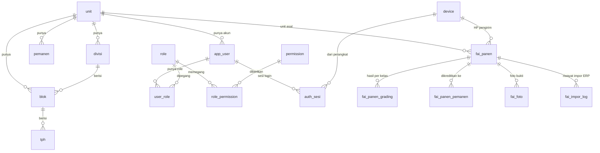

# fAI26: Panduan Lengkap Sistem (untuk asisten yang menangani sisi ERP / TCode HVDM)

Dibuat 18 November 2026 dari kode, skema SQL, dan dokumen proyek yang sebenarnya, bukan dari ingatan. Tujuannya satu:
supaya Anda memahami **seluruh aplikasi fAI26 yang sudah jadi**, dan bisa membangun sisi ERP (TCode **HVDM** di mySAP365)
tanpa salah menangkap bentuk data, relasi, status, maupun aturan yang sudah diputuskan.

Cara membaca label:

| Label | Arti |
|---|---|
| **[Fakta]** | Diambil dari kode atau skema yang berjalan dan sudah diuji. Boleh dipegang. |
| **[Keputusan]** | Sudah diputuskan Ptoni (pemilik proyek). Jangan diubah tanpa bertanya. |
| **[Belum diputuskan]** | Masih terbuka. Jangan mengarang jawabannya; tanyakan ke Ptoni atau pembimbing. |
| **[Dugaan]** | Kesimpulan dari bukti tidak langsung. Cocokkan dengan database ERP sebelum dipakai. |

Daftar isi: 1 Gambaran umum · 2 Tugas Anda (sisi ERP) · 3 Komponen dan teknologi · 4 Alur dan status · 5 Aplikasi HP ·
6 Server (API) · 7 Web admin · 8 **Database server (lengkap)** · 9 **Database HP (lengkap)** · 10 Relasi dan pemetaan
antar lapisan · 11 Pengetahuan tentang ERP · 12 Rancangan HVDM yang disarankan · 13 Keputusan dan butir terbuka ·
14 Larangan dan jebakan · 15 Lingkungan dan cara menguji · 16 Istilah · 17 Status pengerjaan · 18 Tanggapan atas catatan kekurangan aplikasi.

> **Pembaruan 18 Nov 2026 (baca dulu).** Rekan Ptoni di PT memastikan: **satu TPH hanya untuk satu pemanen** (butir B1 selesai).
> Akibatnya: (a) setiap catatan membawa **tepat satu pemanen** dan **seluruh janjang** dikreditkan ke dia, jadi catatan fAI26
> memetakan ke **tepat satu baris `hvd1da`**; (b) HP dan server **menolak** catatan tanpa pemanen; (c) header HVD1 dikelompokkan per
> **mandor + afdeling + tanggal**, maka server kini menyimpan **afdeling** dan **mandor** pada tiap catatan (migrasi `005`) dan view
> menampilkannya; (d) tersedia peran database sempit `fai26_hvdm` untuk login HVDM (migrasi `006`). Catatan Anda
> (`catatan_HVDM_Kekurangan_Aplikasi_fAI26.md`) sudah ditanggapi di bagian 18.

> **Pembaruan 18 Nov 2026 (sore): MANDOR yang menginput** (menanggapi `Perubahan_Mobile_API_fAI26_untuk_HVDM.md`).
> Pencatat sekarang **mandor** (akun mandor), bukan krani: akun mandor membawa `mandor_hrmb_code` dan `afdeling_kode` (diisi admin di web), dan
> HP-nya hanya menerima **pemanen miliknya** serta blok/TPH afdelingnya. Mandor yang menekan Simpan **menyetujui sendiri** (tidak ada langkah
> persetujuan terpisah) dan catatan langsung masuk antrean kirim, jadi di `fai_panen` langsung `status_erp='BARU'`. Mandor dan afdeling di
> catatan **diambil server dari akun** (bukan dari isi kiriman). **Anti ganda:** tanggal + unit + blok + TPH + pemanen hanya boleh satu catatan
> (API menjawab 409; ada indeks unik `ux_fai_panen_tph_pemanen`). Catatan **DITOLAK** bisa diperbaiki di HP lalu dikirim ulang dengan `panen_id`
> yang sama (`kirim_ulang=true`): isi diganti dan status kembali `BARU`. Kolom baru `fai_panen.pemanen_hrmb_code`; tabel `fai_panen_pemanen` **deprecated**
> (HVDM jangan membacanya). View `v_fai_panen_siap_impor` menambah `unit` dan `waktu_panen`. Migrasi `007_mandor_input.sql`. Detail di bagian 19.
> Akun krani lama tetap berfungsi (krani menyimpan sebagai DRAFT dan mandor menyetujui, seperti sebelumnya).

---

## 1. Gambaran umum

**Masalah.** Di kebun sawit, krani menghitung tandan (janjang) dan menilai kematangannya dengan mata di TPH (Tempat
Pengumpulan Hasil), menulis di kertas, lalu mengetik ulang ke ERP malam harinya. Lambat, rawan salah, dan penilaian
mutunya berbeda antarorang.

**Solusi (fAI26).** Krani menyisir tumpukan tandan dengan kamera HP. Model AI (YOLOv8n, 6 kelas) di HP mengenali tiap
tandan dan kelas kematangannya, ada pelacak supaya tandan yang sama tidak dihitung dua kali. Hasilnya, ditambah foto
bukti (panorama), lokasi GPS, dan persetujuan mandor (mandor yang menginput menyetujui sendiri), tersimpan **offline di HP** lalu dikirim ke server saat ada sinyal.
Server menyimpannya di tabel perantara (`fai_*`). **Sisi ERP membaca tabel perantara itu** dan membuat dokumen panen di
mySAP365 lewat TCode HVDM, lalu melaporkan hasilnya (diterima atau ditolak beserta alasan) kembali ke HP.

```
 HP krani (Android, offline-first)          Server fAI26 (Go + SQL Server)             mySAP365 (ERP)
 +-----------------------------+            +--------------------------------+         +-----------------------+
 | kamera + model AI + tracker |  HTTPS     | API REST (44 rute)             |         | TCode HVDM (ANDA)     |
 | panorama foto bukti, GPS    | ---------> | validasi, simpan ke fai_*      |         | membaca view          |
 | SQLite (Room) sendiri       |  JSON/JPEG | web admin (React) di server    | <------ | v_fai_panen_siap_impor|
 | login offline 7 hari        | <--------- | database "fai26"               |  baca   | memanggil prosedur    |
 | persetujuan mandor di HP    |  status    |  tabel fai_panen, ...          |  tulis  | sp_fai_impor_ok/gagal |
 +-----------------------------+            +--------------------------------+  lewat  | -> hvd1m, hvd1da      |
                                                         ^                       prosedur+-----------------------+
                                                         |
                                       Web admin (React): master, QR, panen, pengguna, hak akses, perangkat, audit
```

**Prinsip yang tidak boleh dilanggar [Keputusan]:**

1. HP **tidak pernah** menyentuh database ERP (kredensial tidak boleh ada di HP; ERP punya constraint sendiri).
2. Tidak ada API resmi mySAP365: **ERP mengambil langsung dari database `fai26`**. API milik kita hanya supaya HP bisa mengisi `fai26`.
3. Tabel `fai_*` **tidak ditulis langsung** oleh kode ERP. Perpindahan status dilakukan lewat prosedur `sp_fai_*` (lihat bagian 2 dan 12).
4. Semua waktu disimpan **UTC**. Tampilan di aplikasi WIB.
5. Data **tidak dihapus permanen**; hanya diisi `dihapus_pada`.
6. ID catatan panen dibuat di HP (UUID). Pengiriman ulang aman: tidak membuat data ganda.

---

## 2. Tugas Anda (sisi ERP)

Yang **sudah jadi** (jangan dibuat ulang): HP, API, database `fai26`, web admin, dan "jembatan" SQL ke ERP.
Yang **belum ada dan menjadi tugas Anda**: TCode **HVDM** (salinan HVD1) di mySAP365 yang:

1. Membaca catatan yang siap diimpor dari view **`dbo.v_fai_panen_siap_impor`** (database `fai26`). Pemanen tunggalnya sudah ada di
   view (`pemanen_hrmb_code`, `pemanen_jjg`), begitu pula `afdeling_kode`, `afdeling_erp_oid`, `mandor_hrmb_code`.
   (`v_fai_panen_pemanen_siap_impor` tetap ada, isinya selalu satu baris per catatan.)
2. Membuat/mencari header **`hvd1m`** (satu per **mandor + afdeling + tanggal panen** [Dugaan: sesuai kelompok di HVD1]) dan satu baris **`hvd1da`** untuk tiap catatan,
   mengisi kolom `JJG_*` sesuai pemetaan (bagian 10 dan 12).
3. Melaporkan hasilnya dengan **memanggil prosedur** (bukan UPDATE langsung):

| Situasi | Panggilan | Efek |
|---|---|---|
| Mulai memproses (opsional) | `EXEC dbo.sp_fai_tandai_dibaca @panen_id` | BARU → DIBACA. Mengembalikan `berubah` (1 atau 0). |
| Berhasil dibuat di ERP | `EXEC dbo.sp_fai_impor_ok @panen_id, @hvd1m_oid, @hvd1da_oid, @diimpor_oleh` | BARU/DIBACA → **DIIMPOR**; menulis `fai_impor_log` (OK) dan `audit_log` (IMPOR). HP melihat **DITERIMA**. |
| Ditolak (data ERP kurang, dsb.) | `EXEC dbo.sp_fai_impor_gagal @panen_id, @pesan, @diimpor_oleh` | → **DITOLAK**; menulis `fai_impor_log` (GAGAL + `pesan_error`) dan audit `IMPOR_GAGAL`. **`@pesan` wajib diisi dan tampil di HP krani.** |
| Perbaiki lalu coba lagi | `EXEC dbo.sp_fai_ulang_impor @panen_id, @oleh` | DITOLAK → BARU. Riwayat log tetap. |

Tipe parameter: `@panen_id UNIQUEIDENTIFIER`, `@hvd1m_oid BIGINT`, `@hvd1da_oid BIGINT`, `@diimpor_oleh INT NULL`
(user_id fAI26 bila ada; boleh NULL), `@pesan NVARCHAR(500)`. Prosedur melempar galat (50001 tidak ditemukan,
50002 status sudah diproses, 50003 pesan kosong) bila dipanggil tidak sah.

**Mengapa harus lewat prosedur:** prosedur mengisi `diubah_pada`. HP mengetahui status baru dari
`GET /api/panen?sejak=...` yang membandingkan `COALESCE(diubah_pada, diterima_server)`. Bila status diubah tanpa mengisi
`diubah_pada`, **HP tidak akan pernah tahu**. Prosedur juga menjaga perpindahan status yang sah, dan menulis log serta audit
dalam satu transaksi. Skrip pembuatnya: `fai26-api/migrations/003_jembatan_erp.sql` (aman dijalankan berulang).

Alur uji penuh sudah terbukti otomatis: HP kirim → ERP tolak dengan alasan → HP melihat alasannya → ulang → impor OK →
HP melihat DITERIMA (tes `TestJembatanErpAlurPenuh`).

---

## 3. Komponen dan teknologi

Folder proyek (`L:\GRADING_MAGANG\`): `fAI26-Mobile/` (Android), `fai26-api/` (server Go), `fai26-web/` (web admin),
`erd/` (ERD dan skema SQL, **acuan basis data**), `doc/` (panduan alur), `progres/` (PROGRES.md, PERTANYAAN.md,
SPEK_QR_TPH.md, DAFTAR_UJI_LAPANGAN.md), `flow/` (diagram Mermaid), `tools/` (pembuat QR), `best.tflite` dan `best.pt` (model).

| Komponen | Teknologi [Fakta] |
|---|---|
| HP | Android native **Java** (package `com.example.fai26`), minSdk 24, targetSdk 35, **Room 2.7.2** (SQLite, skema v3, ada migrasi 1→2→3), **CameraX 1.4.2**, **TensorFlow Lite 2.16.1** (GPU delegate dengan cadangan CPU), **WorkManager** (sinkron latar tiap 15 menit), ZXing (baca QR), `HttpURLConnection` + `org.json` (tanpa pustaka HTTP tambahan), UI Material 3 dengan menu kaca kustom |
| Model | YOLOv8n `best.tflite`, masukan `[1,3,640,640]` float32, keluaran `[1,10,8400]`, 6 kelas. Dataset Roboflow `palm-fruit-ripeness-detection-f6sac` v1 (CC BY 4.0), **tidak dilatih ulang** |
| Server | **Go 1.25**, `net/http` ServeMux, `go-mssqldb`, JWT HS256, bcrypt; struktur `cmd/{api,seed}`, `internal/{controller,service,repository,model,routes,middleware,auth,...}`; SQL hanya di `repository` |
| Database server | **SQL Server** (diuji di 2025), database `fai26`, waktu `DATETIME2` UTC |
| Web admin | React 18 + TypeScript + Vite + Ant Design 5 + React Router + TanStack Query; dilayani oleh API dari alamat yang sama (`FAI26_WEB_DIR`) |
| Dokumentasi API | `fai26-api/docs/API.md` (panduan) dan `openapi.yaml` (OpenAPI 3), versi saat ini **0.9.0**; dijaga tes supaya selalu sama dengan rute yang terpasang |

---

## 4. Alur dan status

### 4.1 Alur lengkap satu catatan panen

1. **Admin** (web) mengisi master: divisi, blok (dengan `erp_oid` = OID blok di ERP), TPH (QR dibuat otomatis), pemanen
   (dengan `erp_hrmb_code`), pengguna, dan mencetak QR TPH.
2. **HP krani** login online sekali (master + akun turun ke HP), lalu bisa bekerja offline sampai 7 hari.
3. Di TPH: krani **scan QR** (atau memilih TPH manual) → memilih **pemanen (wajib; satu TPH hanya untuk satu pemanen)** → **MULAI** menyisir tumpukan →
   **SELESAI**. Kamera + AI menghitung janjang per kelas, tracker mencegah hitungan ganda, foto bukti dibuat (panorama).
4. Layar **Hasil**: krani boleh koreksi jumlah per kelas (+/−), mengisi brondolan (kg) dan catatan, lalu **Simpan**
   (status `DRAFT`). GPS dicatat dan dinilai terhadap koordinat TPH (hanya menandai, tidak memblokir).
5. **Mandor** (login di HP itu) **menyetujui** catatan → `DISETUJUI` dan catatan masuk antrean kirim.
6. Saat ada sinyal (otomatis di latar atau tombol "Kirim sekarang"): HP mengirim catatan (`POST /api/panen`), lalu foto
   (`POST /api/panen/{id}/media`), lalu audit (`POST /api/audit/batch`). Status HP → `TERKIRIM`. Server menyimpan ke
   `fai_panen` (+ `fai_panen_grading`, `fai_panen_pemanen`, `fai_foto`) dengan `status_erp = 'BARU'`.
7. **HVDM (Anda)** membaca baris siap impor, membuat `hvd1m`/`hvd1da`, dan memanggil `sp_fai_impor_ok` atau `sp_fai_impor_gagal`.
8. HP menanyakan status (`GET /api/panen?sejak=`) dan menampilkan **DITERIMA** atau **DITOLAK + alasan**.

### 4.2 Dua status yang berbeda (jangan tertukar)

| Di HP (`panen_header.status`) | Arti |
|---|---|
| `DRAFT` | Disimpan krani (bukan mandor), belum disetujui mandor. Catatan dari akun mandor tidak pernah DRAFT: langsung `DISETUJUI`. |
| `DISETUJUI` | Mandor sudah menyetujui; masuk antrean kirim. |
| `SIAP_KIRIM` | Nilai ada di daftar tetapi **tidak dipakai** alur sekarang. |
| `TERKIRIM` | Server sudah menerima. |
| `DITERIMA` | ERP sudah mengimpor (server `DIIMPOR`). |
| `DITOLAK` | ERP menolak, atau server menolak isi catatan. `pesan_server` berisi alasannya. |

| Di server (`fai_panen.status_erp`) | Diubah oleh | Arti |
|---|---|---|
| `BARU` | API saat menerima | Menunggu ERP. |
| `DIBACA` | `sp_fai_tandai_dibaca` | ERP sedang memproses (opsional). |
| `DIIMPOR` | `sp_fai_impor_ok` | Sudah menjadi dokumen di ERP. |
| `DITOLAK` | `sp_fai_impor_gagal` | ERP menolak; `fai_impor_log.pesan_error` terakhir dikirim ke HP. |

Pemetaan yang dilihat HP (`model.StatusUntukHP`): `BARU` dan `DIBACA` → `TERKIRIM`; `DIIMPOR` → `DITERIMA`; `DITOLAK` → `DITOLAK`.
Catatan yang `DITERIMA` tidak boleh diubah di HP; koreksi lewat catatan baru atau lewat ERP.

### 4.3 Aturan server saat menerima catatan [Fakta]

Server **menolak** (422) catatan yang: belum disetujui mandor; penyetujunya tidak dikenal atau tidak memegang
`panen.setujui`; `unit_kode` tidak dikenal; `status_lokasi`/`kelas_kode` tidak dikenal atau kelas ganda; jumlah negatif;
**blok/TPH/pemanen tidak ada di master**; **pemanen bukan milik mandor akun** (akun mandor); **total janjang nol**; **pemanen tidak tepat satu** (atau `hrmb_code` kosong, atau `jjg_alokasi` ≠ total janjang); tanggal/UUID salah format. Unit pada catatan harus sama dengan unit akun pengirim (403 bila beda).
Pencatat catatan = pemilik token, **kecuali** `pencatat_username` dikirim oleh pemegang `panen.koreksi` (mandor yang
mengirim atas nama krani). Karena itu `fai_panen.dibuat_oleh` adalah **user_id pencatat sebenarnya**, bukan pengirim.
`disetujui_username` boleh kosong: pengirim yang memegang `panen.setujui` (mandor) dianggap menyetujui sendiri. Kombinasi tanggal + unit + blok + TPH + pemanen yang sudah ada dengan `panen_id` lain dijawab **409**.

Saat diterima, server juga **menyalin** ke catatan: `afdeling_kode` dan `afdeling_erp_oid` (dari blok ber-`erp_oid` = `asm3_oid`, lalu divisinya)
dan `mandor_hrmb_code` (dari master pemanen). Salinan ini tidak berubah bila master diubah kemudian. Master belum lengkap berarti **NULL** dan
catatan tetap diterima; **HVDM yang harus menolaknya dengan pesan jelas** lewat `sp_fai_impor_gagal`.

---

## 5. Aplikasi HP (fitur lengkap)

Layar: **Login**, **Beranda**, **Riwayat**, **Persetujuan** (hanya pemegang `panen.setujui`), **Akun**, **Scan QR**, **Scan (kamera)**,
**Hasil**. Menu bawah berbentuk kapsul kaca yang bisa digeser.

**Login dan akun.** Login online dulu bila server diatur (server yang menentukan; password salah/terkunci/nonaktif = ditolak,
**tidak** jatuh ke offline). Sukses → verifier offline di HP diperbarui (PBKDF2-HMAC-SHA256, 100.000 iterasi, salt acak) dan
masa login offline diperpanjang **7 hari**. Jaringan putus → login offline. Salah password 5 kali → terkunci 15 menit (di HP dan
di server, terpisah). Token akses 15 menit, refresh 30 hari dan **diganti tiap dipakai** (rotasi). Token akses dan refresh
disimpan **terenkripsi** (AES-256-GCM, kunci di Android Keystore) dan dikecualikan dari cadangan Android. Ganti password sendiri
(hanya online, mencabut sesi di HP lain). Hak akses dibaca dari role (`role` → `role_permission`) dan **mengikuti server**:
master baru membawa `role_permission`, cache hak sesi diperbarui tanpa login ulang.

**Master.** Diunduh dari `GET /api/master` (unit, divisi, blok, TPH, pemanen, akun + role, hak role), dibandingkan lewat `versi`
(hash dari jumlah baris dan waktu ubah terbaru). Diterapkan dalam satu transaksi; baris yang dihapus lunak di server ditandai
(tidak dibuang); koordinat TPH yang direkam di HP tidak ditimpa kosong. **Aturan emas: semua alat yang mengubah master wajib mengisi `diubah_pada`.**

**QR TPH.** Format isi: `FAI26|TPH|1|<kode unit>|<kode blok>|<no tph>` (contoh `FAI26|TPH|1|KP_STL|A12|07`), harus sama persis dengan
`tph.qr_kode`. QR hanya berisi kode (data lain dicari di master lokal, jadi terbaca tanpa sinyal). Server membuat `qr_kode` otomatis;
mengubah kode blok atau nomor TPH mengubah QR (QR lama tidak berlaku). Cetak: koreksi galat H, margin minimal 4 modul (spesifikasi di `progres/SPEK_QR_TPH.md`).

**Scan dan hitungan.** Model berjalan di HP (sekitar 100 ms per frame di SM-A528B, GPU). Urutan kelas keluaran model:
`0 abnormal, 1 empty, 2 overripe, 3 ripe, 4 underripe, 5 unripe`. Pelacak `BunchTracker` memberi ID ke tiap tandan dan hanya menghitung yang
sudah stabil beberapa frame, serta menggabung kotak ganda. Ambang saat ini longgar untuk tumpukan padat (`CONF` 0,17). Hitungan
adalah **estimasi**: tandan yang tertutup tidak terlihat kamera; krani wajib bisa mengoreksi, dan selisih `jml_ai` dengan `jml_final` tercatat.

**Foto bukti = satu panorama.** Selama menyisir, HP menaksir geser antar frame, menyimpan potongan, lalu menyambungnya menjadi satu JPEG
(kotak deteksi bernomor `#1 #2 ...`, banner ringkasan). Bila sapuan hanya melihat satu tumpukan atau penyejajaran gagal, hasilnya satu foto
frame penuh. Ada penampil layar penuh dengan zoom. **Aturan produk: satu foto bukti per scan, bukan banyak foto.**

**GPS (verifikasi lokasi pencatat).** Status: `DI_TPH`, `DI_LUAR`, `AKURASI_RENDAH`, `TANPA_GPS`, `TPH_TANPA_KOORDINAT`. Sementara:
radius 50 m, akurasi maksimum 30 m; **hanya menandai, tidak memblokir**, tanpa GPS tetap boleh simpan. Koordinat TPH direkam krani saat pertama kali
dipakai (hanya bila TPH belum punya titik) lalu dikirim ke server (`PUT /api/tph/{id}/koordinat`), server tidak menimpa titik yang sudah ada.

**Sinkronisasi.** Antrean (`sync_queue`): `PANEN`, `FOTO`, `TPH_KOORDINAT`; dikirim dari yang paling lama; jaringan putus → coba lagi
dengan jeda 30 detik berlipat sampai 30 menit (maksimal 8 kali baru `GAGAL`); penolakan server (isi tidak sah) langsung `GAGAL` dan catatan
`DITOLAK` dengan alasan. HP hanya mengirim catatan milik pengguna yang login online, kecuali pemegang `panen.koreksi` (mandor) yang boleh
mengirim semua. 429 dan 5xx dianggap sementara (dicoba lagi). Audit lokal dikirim berkelompok. Foto dikirim setelah catatannya.

**Beranda.** Ringkasan hari ini (catatan, janjang, belum terkirim), dashboard dari server (`GET /api/panen/ringkasan`: per kelas, per blok,
tren 7 hari, per status; digabung dengan catatan lokal yang belum terkirim; cache bila offline), status online/offline, peringatan baterai
rendah (<15%) dan ruang simpan menipis (<300 MB).

---

## 6. Server (API)

**Autentikasi:** header `Authorization: Bearer <token akses>`; hak akses dibaca ulang dari database **di setiap panggilan** (akun/perangkat yang
dinonaktifkan langsung tidak bisa dipakai). Batas waktu 20 detik per permintaan (503 bila database lambat). Batas laju per IP: login/refresh
30 per menit, seluruh API 600 per menit (429 + `Retry-After`). Galat selalu `{"error": "pesan"}`. Kode: 200/201 sukses, 400, 401, 403, 404, 409, 413, 415, 422, 423 (terkunci), 429, 500, 503.

**Endpoint (44 rute)** (rincian body dan contoh di `fai26-api/docs/API.md`):

| Kelompok | Rute |
|---|---|
| Sistem/Auth | `GET /api/health` · `POST /api/auth/login` · `POST /api/auth/refresh` · `POST /api/auth/logout` · `GET /api/auth/me` · `POST /api/auth/password` |
| Panen (HP) | `POST /api/panen` (`panen.kirim`) · `GET /api/panen?sejak=` (status) · `GET /api/panen/ringkasan?tanggal=` · `POST /api/panen/{id}/media` (JPEG mentah; header `X-Foto-Id`, `X-Sha256`; query `jenis`) · `POST /api/audit/batch` (maks 500) |
| Master (HP) | `GET /api/master?versi=` · `PUT /api/tph/{id}/koordinat` |
| Admin master | `GET/POST /api/admin/{divisi,blok,tph,pemanen}` · `PUT/DELETE .../{id}` · `POST /api/admin/tph/massal` (buat TPH berurutan, atomik, maks 500) |
| Admin akses | `GET /api/admin/peran` · `GET /api/admin/hak-akses` · `PUT /api/admin/hak-akses/{id}` · `GET/POST /api/admin/pengguna` · `PUT .../{id}` · `POST .../{id}/reset-password` · `GET /api/admin/perangkat` · `PUT .../{id}` |
| Admin laporan | `GET /api/admin/ringkasan` · `GET /api/admin/panen` · `GET /api/admin/panen/{id}` · `GET /api/admin/foto/{id}` · `GET /api/admin/audit` |

**Kontrak `POST /api/panen`** (inti, yang akhirnya Anda baca dari `fai_*`):

```json
{
  "panen_id": "aaaaaaaa-aaaa-4aaa-8aaa-aaaaaaaaaaaa",
  "unit_kode": "KP_STL", "tanggal_panen": "2026-11-10", "asm3_oid": 1012, "blok_kode": "A12", "tph_kode": "01",
  "brondolan_kg": 12.5,
  "gps_lat": -2.000123, "gps_lon": 113.000456, "gps_akurasi_m": 8, "gps_waktu": "2026-11-10T01:00:00Z",
  "gps_mock": false, "jarak_ke_tph_m": 22, "status_lokasi": "DI_TPH",
  "model_versi": "best 1", "catatan": "tumpukan dekat parit",
  "dibuat_pada": "2026-11-10T01:00:00Z",
  "pencatat_username": "krani1", "disetujui_username": "mandor1", "disetujui_pada": "2026-11-10T03:00:00Z",
  "grading": [
    { "kelas_kode": "ripe", "erp_kolom": "JJG_RIPE", "jml_ai": 7, "jml_final": 9, "diubah_manual": true },
    { "kelas_kode": "unripe", "jml_ai": 1, "jml_final": 1, "diubah_manual": false }
  ],
  "pemanen": [ { "hrmb_code": 5001, "jjg_alokasi": 10 } ]
}
```

Catatan isi: `asm3_oid` = `blok.erp_oid` (OID blok di ERP). `tph_kode` = **hanya nomor TPH** (mis. `01`), bukan QR penuh. `rotasi` dan
`kondisi_cuaca` **selalu kosong** dari HP sekarang (HP tidak mengumpulkannya). `grading` berisi **satu baris per kelas termasuk yang nol**.
`erp_kolom` datang dari tabel kelas di HP (`JJG_RIPE`, `JJG_OVERRIPE`, `JJG_EMPTY`, `JJG_UNKNOWN` untuk abnormal; unripe dan underripe kosong).
`jml_final` = angka akhir setelah koreksi krani (itulah yang dipakai untuk ERP); `jml_ai` = hitungan kamera. `pemanen` **wajib tepat satu** dengan `jjg_alokasi` = total `jml_final`. Jawaban: 201 `DITERIMA` (baru) atau 200 `SUDAH_ADA` (idempoten).

**Foto:** disimpan di disk server `<FAI26_MEDIA_DIR>/<panen_id>/<foto_id>.jpg`, dicek SHA-256 dan tanda JPEG, maksimum 8 MB; baris `fai_foto` merujuk ke berkas. Jenis `ASLI` atau `DETEKSI` (HP mengirim `DETEKSI`: panorama dengan kotak).

---

## 7. Web admin

Dilayani dari alamat yang sama dengan API. Halaman (menurut hak): **Dasbor**, **Catatan Panen** (filter, detail, galeri foto), **Produktivitas Pemanen** (ranking janjang per pemanen per hari, 19 Nov 2026; hanya membaca, premi tidak dihitung: tarif dan basis premi milik ERP), **Blok**, **TPH dan QR**
(buat massal berurutan, cetak QR 3 ukuran), **Divisi**, **Pemanen**, **Pengguna** (buat, ubah role, reset password), **Hak Akses**
(matriks role × permission), **Perangkat** (nonaktifkan = cabut sesi), **Audit Log** (hanya baca). Menu "Ganti password" untuk akun sendiri.
Penghapusan master selalu lunak. Admin yang mereset password membuat pengguna **wajib ganti password** saat login berikutnya.

---

## 8. Database server (lengkap)

Database `fai26` di SQL Server. Skrip sumber: `erd/fAI26_server_sqlserver.sql` (18 tabel) ditambah migrasi
`fai26-api/migrations/002_master.sql` (bila database lama), `003_jembatan_erp.sql` (view + prosedur), `004_audit_log_deny.sql` (dijalankan DBA di server sungguhan). Jalankan dengan `sqlcmd -I` (indeks terfilter butuh `QUOTED_IDENTIFIER ON`).

### 8.1 Konvensi yang berlaku di (hampir) semua tabel

- **Kolom audit standar** (enam kolom): `dibuat_pada` (default `SYSUTCDATETIME()`), `dibuat_oleh`, `diubah_pada`, `diubah_oleh`,
  `dihapus_pada`, `dihapus_oleh`. Padanan di ERP: `REC_CREATDATE/CREATBY`, `REC_MODIFDATE/MODIFBY`, `REC_DELDATE/DELBY`.
  Kolom `*_oleh` berisi `app_user.user_id` dan **sengaja tanpa foreign key**.
- **Hapus lunak:** baris dianggap ada bila `dihapus_pada IS NULL`. Banyak keunikan memakai **indeks terfilter** `WHERE dihapus_pada IS NULL`.
- Waktu: `DATETIME2` **UTC**. `diubah_pada` wajib diisi tiap perubahan (versi master dan deteksi perubahan status oleh HP bergantung padanya).
- Kolom audit di bawah ini disingkat **[audit6]** (enam kolom di atas), kecuali disebut lain.

### 8.2 Peta relasi (foreign key dan relasi logis)



**Relasi logis tanpa foreign key** (dijaga aplikasi): `fai_panen.asm3_oid` → `blok.erp_oid` → ERP `asm3.OID`; `fai_panen.blok_kode`/`tph_kode` → teks
turunan dari `blok.kode`/`tph.no_tph` (bukan FK); `fai_panen_pemanen.hrmb_code` → `pemanen.erp_hrmb_code` → ERP `hrmb`; `fai_panen.dibuat_oleh`/`disetujui_oleh`
→ `app_user.user_id`; `audit_log.baris_id` → id baris di `tabel`; `unit.erp_db` → nama database ERP unit itu.

### 8.3 Tabel akses dan perangkat

**`unit`** (kebun/unit ERP)

| Kolom | Tipe | Keterangan |
|---|---|---|
| `unit_id` | INT IDENTITY PK | |
| `kode` | NVARCHAR(20) NOT NULL **UNIQUE** | mis. `KP_STL` |
| `nama` | NVARCHAR(100) NOT NULL | |
| `erp_db` | NVARCHAR(50) NOT NULL | nama database ERP unit, mis. `kp_stl2025` |
| `tahun_cluster` | INT NOT NULL | tahun cluster ERP |
| `aktif` | BIT NOT NULL DEFAULT 1 | |
| [audit6] | | |

**`device`** (HP yang pernah login; dibuat saat login pertama)

`device_id` UNIQUEIDENTIFIER PK (UUID dibuat HP) · `nama` NVARCHAR(60) · `os_versi` NVARCHAR(30) · `app_versi` NVARCHAR(20) · `aktif` BIT DEFAULT 1 (nonaktif = login ditolak, sesi dicabut) · `terakhir_sinkron` DATETIME2 · [audit6]. Web admin juga mendaftar sebagai perangkat.

**`app_user`** (akun fAI26; akun sendiri, bukan akun ERP)

| Kolom | Tipe | Keterangan |
|---|---|---|
| `user_id` | INT IDENTITY PK | |
| `unit_id` | INT NOT NULL FK→`unit` | |
| `erp_user_oid` | INT | opsional, kaitan ke user ERP |
| `username` | NVARCHAR(50) NOT NULL **UNIQUE** | huruf kecil, `a-z 0-9 . _ -`, 3 sampai 50 |
| `nama` | NVARCHAR(100) NOT NULL | |
| `aktif` | BIT DEFAULT 1 | |
| `gagal_login` | INT DEFAULT 0 | 5 gagal → `terkunci_sampai` +15 menit |
| `terkunci_sampai`, `login_terakhir` | DATETIME2 | |
| `password_hash` | NVARCHAR(255) NOT NULL | bcrypt |
| `wajib_ganti_password` | BIT DEFAULT 0 | 1 setelah reset admin |
| [audit6] | | |

**`role`**: `role_id` INT PK · `kode` NVARCHAR(30) **UNIQUE** · `nama` · `deskripsi` · `bawaan` BIT · [audit6].
**`permission`**: `permission_id` INT PK · `kode` NVARCHAR(50) **UNIQUE** · `modul` NVARCHAR(30) · `nama` · [audit6].
**`user_role`**: `ur_id` PK · `user_id` FK→`app_user` · `role_id` FK→`role` · `berlaku_mulai` DATE · `berlaku_sampai` DATE · [audit6]; **unik** (`user_id`,`role_id`) `WHERE dihapus_pada IS NULL`. Role berlaku bila hari ini di antara `berlaku_mulai` dan `berlaku_sampai` (kosong = tanpa batas).
**`role_permission`**: `rp_id` PK · `role_id` FK→`role` · `permission_id` FK→`permission` · [audit6]; **unik** (`role_id`,`permission_id`) `WHERE dihapus_pada IS NULL`.

**`auth_sesi`** (sesi login per perangkat): `sesi_id` UNIQUEIDENTIFIER PK · `user_id` FK→`app_user` · `device_id` FK→`device` · `refresh_token_hash` NVARCHAR(128) NOT NULL (**hash SHA-256**, token asli tidak disimpan) · `kedaluwarsa_pada` DATETIME2 NOT NULL · `dicabut_pada` DATETIME2 · `ip` NVARCHAR(45) · `dibuat_pada`/`dibuat_oleh`/`diubah_pada`/`diubah_oleh`. Indeks `ix_auth_sesi_user_id`. Refresh token diganti tiap dipakai.

**`audit_log`** (hanya-tambah; akun API diberi `DENY UPDATE, DELETE` di server sungguhan)

| Kolom | Tipe | Keterangan |
|---|---|---|
| `audit_id` | UNIQUEIDENTIFIER PK | dibuat HP untuk audit HP (kunci idempoten) |
| `tabel` | NVARCHAR(50) NOT NULL | nama tabel yang diaudit |
| `baris_id` | NVARCHAR(50) NOT NULL | id baris (bisa teks/UUID/angka) |
| `aksi` | NVARCHAR(20) NOT NULL | contoh `BUAT`, `UBAH`, `HAPUS`, `SETUJU`, `LOGIN`, `LOGIN_GAGAL`, `TERIMA`, `IMPOR`, `IMPOR_GAGAL`, `IMPOR_ULANG`, `RESET_PASSWORD`, `GANTI_PASSWORD` |
| `nilai_lama`, `nilai_baru` | NVARCHAR(MAX) | JSON/teks |
| `user_id` | INT | tanpa FK |
| `username`, `device_id`, `ip`, `keterangan` | | |
| `waktu` | DATETIME2 NOT NULL | waktu kejadian (dari HP bila audit HP) |
| `waktu_server` | DATETIME2 | waktu diterima server |

Indeks: (`tabel`,`baris_id`), (`user_id`,`waktu`). Tabel ini **tidak** memakai kolom audit6.

### 8.4 Tabel master (diunduh HP lewat `GET /api/master`)

**`divisi`**: `divisi_id` INT IDENTITY PK · `unit_id` FK→`unit` NOT NULL · `erp_oid` INT · `kode` NVARCHAR(20) · `nama` · `aktif` · [audit6].

**`blok`**

| Kolom | Tipe | Keterangan |
|---|---|---|
| `blok_id` | INT IDENTITY PK | |
| `unit_id` | INT NOT NULL FK→`unit` | |
| `divisi_id` | INT FK→`divisi` | boleh kosong |
| `erp_oid` | BIGINT NOT NULL | **OID blok di ERP (`asm3.OID`)**; inilah `fai_panen.asm3_oid` |
| `kode` | NVARCHAR(20) NOT NULL | mis. `A12`; **unik per unit** `WHERE dihapus_pada IS NULL` (`ux_blok_unit_id_kode`); tidak boleh mengandung `|` |
| `nama`, `luas_ha`, `tahun_tanam`, `sph` | | `sph` = pokok per hektar |
| `aktif` | BIT | |
| [audit6] | | |

**`tph`**

| Kolom | Tipe | Keterangan |
|---|---|---|
| `tph_id` | INT IDENTITY PK | |
| `blok_id` | INT NOT NULL FK→`blok` | |
| `no_tph` | NVARCHAR(10) NOT NULL | mis. `07`; **unik per blok** `WHERE dihapus_pada IS NULL` |
| `qr_kode` | NVARCHAR(100) NOT NULL **UNIQUE** | `FAI26|TPH|1|<unit>|<blok>|<no>`; dibuat server |
| `lat`, `lon` | FLOAT | koordinat TPH; kosong sampai direkam/diisi |
| `aktif` | BIT | |
| [audit6] | | |

**`app_user`** (migrasi 007) menambah `mandor_hrmb_code INT NULL` (kode HRMB mandor pemilik akun) dan `afdeling_kode NVARCHAR(20) NULL` (= `divisi.kode`), diisi admin di web (halaman Pengguna). Akun mandor wajib punya keduanya agar HP-nya menerima master yang benar.

**`pemanen`**: `pemanen_id` INT IDENTITY PK · `unit_id` FK→`unit` · `erp_hrmb_code` INT NOT NULL (**kunci pemanen di ERP**, dipakai sebagai `HRMBCODE`) · `mandor_hrmb_code` INT NULL (**kode HRMB mandor kelompoknya**, diisi admin di web; [Dugaan] mandor di ERP diidentifikasi dengan kode HRMB; migrasi 005) · `kode` NVARCHAR(20) · `nama` NOT NULL · `aktif` · [audit6].

### 8.5 Tabel perantara ERP (staging, **inilah yang Anda baca**)

**`fai_panen`** (satu baris per catatan panen = satu TPH sekali scan)

| Kolom | Tipe | Keterangan |
|---|---|---|
| `id` | UNIQUEIDENTIFIER PK | = `panen_id` dari HP (UUID). Kunci anti-ganda |
| `unit_id` | INT NOT NULL FK→`unit` | |
| `device_id` | UNIQUEIDENTIFIER NOT NULL FK→`device` | HP pengirim |
| `tanggal_panen` | DATE NOT NULL | **tanggal panen** (bukan tanggal kirim). Menentukan tahun cluster ERP |
| `asm3_oid` | BIGINT NOT NULL | OID blok di ERP |
| `blok_kode`, `tph_kode` | NVARCHAR(20)/(30) | teks bantu: kode blok dan **nomor** TPH (bukan QR) |
| `rotasi` | INT | selalu kosong dari HP saat ini |
| `kondisi_cuaca` | INT | selalu kosong dari HP saat ini |
| `brondolan_kg` | FLOAT | **kilogram** (janjang tidak dicatat dalam kg) |
| `gps_lat`, `gps_lon` | DECIMAL(9,6) | lokasi pencatat |
| `gps_akurasi_m` | FLOAT | akurasi GPS (m) |
| `gps_waktu` | DATETIME2 | |
| `gps_mock` | BIT NOT NULL DEFAULT 0 | 1 bila Android menandai lokasi palsu |
| `jarak_ke_tph_m` | FLOAT | jarak pencatat ke titik TPH |
| `status_lokasi` | NVARCHAR(20) NOT NULL DEFAULT `TANPA_GPS` | `DI_TPH`/`DI_LUAR`/`AKURASI_RENDAH`/`TANPA_GPS`/`TPH_TANPA_KOORDINAT` |
| `model_versi` | NVARCHAR(50) | model AI yang dipakai |
| `catatan` | NVARCHAR(500) | catatan krani (bebas) |
| `diterima_server` | DATETIME2 NOT NULL DEFAULT `SYSUTCDATETIME()` | |
| `status_erp` | NVARCHAR(12) NOT NULL DEFAULT `BARU` | **CHECK** `BARU`/`DIBACA`/`DIIMPOR`/`DITOLAK` |
| `afdeling_kode` | NVARCHAR(20) NULL | afdeling catatan: **dari akun pencatat** (cadangan: divisi blok), disalin saat diterima (migrasi 005) |
| `afdeling_erp_oid` | INT NULL | **salinan** `divisi.erp_oid` (OID afdeling di ERP; admin harus mengisinya) |
| `mandor_hrmb_code` | INT NULL | mandor catatan: **dari akun pencatat** (cadangan: master pemanen), disalin saat diterima |
| `pemanen_hrmb_code` | INT NULL | **pemanen tunggal** catatan (`HRMBCODE`); sumber utama, menggantikan `fai_panen_pemanen` (migrasi 007) |
| `disetujui_oleh` | INT | `user_id` mandor penyetuju |
| `disetujui_pada` | DATETIME2 | |
| [audit6] | | `dibuat_oleh` = **pencatat sebenarnya** |

Indeks: (`status_erp`,`tanggal_panen`), (`unit_id`,`tanggal_panen`).

**`fai_panen_grading`** (satu baris per kelas, **termasuk kelas bernilai 0**)

| Kolom | Tipe | Keterangan |
|---|---|---|
| `id` | BIGINT IDENTITY PK | |
| `panen_id` | UNIQUEIDENTIFIER NOT NULL FK→`fai_panen(id)` **ON DELETE CASCADE** | |
| `kelas_kode` | NVARCHAR(20) NOT NULL | `unripe`, `underripe`, `ripe`, `overripe`, `empty`, `abnormal` |
| `erp_kolom` | NVARCHAR(30) | kolom `hvd1da` tujuan: `JJG_RIPE`, `JJG_OVERRIPE`, `JJG_EMPTY`, `JJG_UNKNOWN` (abnormal). **NULL untuk unripe dan underripe** |
| `jml_ai` | INT NOT NULL DEFAULT 0 | hitungan kamera |
| `jml_final` | INT NOT NULL DEFAULT 0 | **angka akhir setelah koreksi krani: pakai ini untuk ERP** |
| `diubah_manual` | BIT NOT NULL DEFAULT 0 | 1 bila `jml_ai` ≠ `jml_final` |
| [audit6] | | |

Unik (`panen_id`,`kelas_kode`) `WHERE dihapus_pada IS NULL`.

**`fai_panen_pemanen`** (**DEPRECATED sejak migrasi 007**: HVDM tidak membacanya; masih ditulis satu baris per catatan hanya sebagai salinan kompatibilitas untuk detail di web admin): `id` BIGINT IDENTITY PK · `panen_id` FK→`fai_panen(id)` ON DELETE CASCADE · `hrmb_code` INT (= `pemanen.erp_hrmb_code`) · `jjg_alokasi` INT (janjang yang dikreditkan ke pemanen itu; **= total janjang catatan**, karena satu TPH hanya untuk satu pemanen) · [audit6].

**`fai_foto`**: `id` UNIQUEIDENTIFIER PK (`foto_id` dari HP) · `panen_id` FK→`fai_panen(id)` ON DELETE CASCADE · `jenis` NVARCHAR(10) **CHECK** `ASLI`/`DETEKSI` · `nama_file` NVARCHAR(200) NOT NULL (path relatif `<panen_id>/<foto_id>.jpg` di folder media) · `sha256` NVARCHAR(64) · [audit6].

**`fai_impor_log`** (riwayat setiap percobaan impor; ditulis oleh prosedur `sp_fai_*`)

| Kolom | Tipe | Keterangan |
|---|---|---|
| `id` | BIGINT IDENTITY PK | |
| `panen_id` | UNIQUEIDENTIFIER NOT NULL FK→`fai_panen(id)` | |
| `waktu_impor` | DATETIME2 NOT NULL | |
| `hvd1m_oid`, `hvd1da_oid` | BIGINT | OID header dan baris yang dibuat di ERP (NULL bila gagal) |
| `hasil` | NVARCHAR(10) NOT NULL **CHECK** `OK`/`GAGAL` | |
| `pesan_error` | NVARCHAR(500) | **tampil di HP krani** (log GAGAL terakhir) |
| `diimpor_oleh` | INT | |
| `dibuat_pada`/`dibuat_oleh`/`diubah_pada`/`diubah_oleh` | | (tanpa `dihapus_*`) |

Indeks `ix_fai_impor_log_panen_id`.

### 8.6 View dan prosedur jembatan ERP (`003_jembatan_erp.sql`, view diperbarui di `005_hvdm_satu_pemanen.sql`, peran di `006_peran_hvdm.sql`)

**`dbo.v_fai_panen_siap_impor`**: satu baris per `fai_panen` dengan `status_erp IN ('BARU','DIBACA')` dan `dihapus_pada IS NULL`. Kolom:
`panen_id`, `unit_id`, `unit_kode`, `unit_erp_db`, `tanggal_panen`, `asm3_oid`, `blok_kode`, `tph_kode`, **`afdeling_kode`, `afdeling_erp_oid`, `mandor_hrmb_code`, `pemanen_hrmb_code`, `pemanen_jjg`**, `rotasi`, `kondisi_cuaca`, `brondolan_kg`, `catatan`, `status_erp`,
`status_lokasi`, `gps_lat`, `gps_lon`, `jarak_ke_tph_m`, `model_versi`, `diterima_server`, `disetujui_pada`, `pencatat_username`, `disetujui_username`,
**`JJG_RIPE`, `JJG_OVERRIPE`, `JJG_EMPTY`, `JJG_BUSUK`, `JJG_SAKIT`, `JJG_UNKNOWN`, `JJG_LANDAK`** (jumlah `jml_final` per `erp_kolom`),
**`jjg_tanpa_kolom`** (jumlah `jml_final` kelas yang `erp_kolom`-nya kosong, yaitu unripe+underripe), `jjg_total`, `jml_ripe`, `jml_overripe`, `jml_underripe`,
`jml_unripe`, `jml_empty`, `jml_abnormal` (per kelas model, apa adanya), `jumlah_pemanen`; sejak 007 juga **`unit`** (= `unit_kode`) dan **`waktu_panen`** (waktu catatan dibuat di HP, UTC).

**`dbo.v_fai_panen_pemanen_siap_impor`**: `panen_id`, `hrmb_code`, `jjg_alokasi` untuk catatan yang sama (satu baris per catatan; sejak 007 diturunkan dari `fai_panen.pemanen_hrmb_code`). Cukup pakai kolom `pemanen_hrmb_code` di view utama.

**Peran `fai26_hvdm` (migrasi 006):** hanya `SELECT` pada kedua view dan `EXECUTE` pada empat prosedur `sp_fai_*`; **tanpa hak tulis tabel**
(prosedur dan view memakai hak pemilik lewat ownership chaining). Login HVDM sebaiknya hanya anggota peran ini. Sudah diuji: view terbaca,
`SELECT`/`UPDATE` langsung ke `fai_panen` ditolak, prosedur berjalan.

**Prosedur:** `sp_fai_tandai_dibaca`, `sp_fai_impor_ok`, `sp_fai_impor_gagal`, `sp_fai_ulang_impor` (parameter dan efek di bagian 2).

### 8.7 Data awal (role dan permission)

Role: `KRANI`, `MANDOR`, `ASISTEN`, `ADMIN`, `AUDITOR` (semua `bawaan`=1). Permission (17): `panen.lihat`, `panen.buat`, `panen.ubah`, `panen.koreksi`, `panen.hapus`,
`panen.kirim`, `panen.setujui`, `grading.ubah`, `master.lihat`, `master.kelola`, `laporan.lihat`, `impor.erp`, `user.kelola`, `role.kelola`, `device.kelola`, `audit.lihat`, `model.kelola`.

| Role | Permission |
|---|---|
| KRANI | panen.lihat, panen.buat, panen.ubah, panen.kirim, grading.ubah, master.lihat |
| MANDOR | panen.lihat, panen.buat, panen.ubah, panen.kirim, **panen.setujui**, grading.ubah, master.lihat, **panen.koreksi**, panen.hapus, laporan.lihat |
| ASISTEN | panen.lihat, panen.koreksi, panen.hapus, laporan.lihat, master.lihat, **impor.erp** |
| ADMIN | panen.lihat, laporan.lihat, master.lihat, master.kelola, user.kelola, role.kelola, device.kelola, model.kelola |
| AUDITOR | panen.lihat, laporan.lihat, master.lihat, **audit.lihat** |

Hak role bisa diubah admin dari web (Hak Akses); `ADMIN` tidak boleh kehilangan `role.kelola`. `panen.koreksi` berarti boleh melihat/mengirim catatan **orang lain di unit yang sama**.

---

## 9. Database HP (SQLite lewat Room)

Database di HP, **skema v3** (entitas Room dihasilkan dari `erd/fAI26_mobile_sqlite.sql`, 22 tabel). Waktu disimpan **teks UTC ISO 8601** (`YYYY-MM-DDTHH:MM:SSZ`).
Boolean disimpan 0/1. Kolom audit6 sama dengan server. `CHECK` pada skrip SQL **tidak ditegakkan** di Room (pembatasan nilai ada di kode); indeks unik parsial dibuat ulang saat database dibuat.
ID master (`unit_id`, `blok_id`, ...) **sama persis dengan ID di server** karena master diunduh apa adanya.

| Tabel | Isi dan kolom penting | Relasi |
|---|---|---|
| `unit`, `divisi`, `blok`, `tph`, `pemanen` | Salinan master dari server (kolom sama dengan bagian 8.4). `tph.lat/lon` boleh diisi HP (rekam koordinat) | `blok→unit,divisi`; `tph→blok`; `pemanen→unit` |
| `periode_rotasi` | `periode_id`, `unit_id`, `rotasi_no`, `tgl_mulai`, `tgl_selesai` (belum dipakai alur sekarang) | →`unit` |
| `kelas_grading` | `kelas_id` 1..6, `kode`, `nama`, **`label_model`** (nomor kelas keluaran model), **`erp_kolom`**, `boleh_dipanen`, `urutan` | data awal tetap (lihat bawah) |
| `model_versi` | `model_id`, `nama`, `versi`, `file_hash` (SHA-256 model), `aktif` | |
| `device` | Identitas HP ini (`device_id` UUID) | |
| `app_user` | akun; **`offline_hash`, `offline_salt`, `offline_berlaku_sampai`** (verifier login offline), `gagal_login`, `terkunci_sampai` | →`unit` |
| `role`, `permission`, `user_role`, `role_permission` | hak akses lokal (mengikuti server lewat master) | seperti server |
| **`panen_header`** | `panen_id` TEXT PK (UUID), `unit_id`, `blok_id`, `tph_id`, `user_id` (pencatat), `device_id`, `model_id`, `periode_id`, `tanggal_panen`, `rotasi_no`, `kondisi_cuaca`, `brondolan_kg`, `gps_lat/lon/akurasi_m/waktu`, `gps_mock`, `jarak_ke_tph_m`, `status_lokasi`, `catatan`, **`status`** (DRAFT/DISETUJUI/SIAP_KIRIM/TERKIRIM/DITERIMA/DITOLAK), `dikirim_pada`, **`pesan_server`** (alasan penolakan dari ERP), `disetujui_oleh`, `disetujui_pada` | →`unit,blok,tph,app_user,device,model_versi,periode_rotasi` |
| `panen_grading` | `grading_id`, `panen_id`, `kelas_id`, **`jml_ai`**, **`jml_final`**, `diubah_manual`; unik (`panen_id`,`kelas_id`) | →`panen_header` (CASCADE), `kelas_grading` |
| `panen_pemanen` | `pp_id`, `panen_id`, `pemanen_id`, `jjg_alokasi`, `catatan` | →`panen_header` (CASCADE), `pemanen` |
| `foto` | `foto_id` TEXT PK, `panen_id`, `jenis` (ASLI/DETEKSI), `path_lokal`, `sha256`, `lebar`, `tinggi`, `status_unggah` (BELUM/SUDAH) | →`panen_header` (CASCADE) |
| `deteksi` | `deteksi_id`, `foto_id`, `kelas_id`, `confidence`, `x,y,w,h` (0..1) | →`foto` (CASCADE), `kelas_grading`. Pada foto panorama baris deteksi tidak disimpan |
| `audit_log` | seperti server tetapi `disinkron` 0/1 (belum/sudah terkirim) | |
| `sync_queue` | `queue_id`, `panen_id` (boleh NULL), **`entitas`** (`PANEN`, `FOTO`, `AUDIT`, dan **`TPH_KOORDINAT`**), `aksi`, `payload_json`, `percobaan`, `status` (MENUNGGU/JALAN/GAGAL/SELESAI), `error_terakhir`, `coba_terakhir` | →`panen_header` (CASCADE) |
| `master_sync` | `nama_master`, `unit_id`, `versi_server`, `sinkron_terakhir` (PK gabungan) | →`unit` |

**Data awal `kelas_grading`** (tetap; `label_model` = urutan keluaran model):

| `kelas_id` | `kode` | `label_model` | `erp_kolom` | `boleh_dipanen` |
|---|---|---|---|---|
| 1 | unripe | 5 | NULL | 0 |
| 2 | underripe | 4 | NULL | 0 |
| 3 | ripe | 3 | `JJG_RIPE` | 1 |
| 4 | overripe | 2 | `JJG_OVERRIPE` | 1 |
| 5 | empty | 1 | `JJG_EMPTY` | 0 |
| 6 | abnormal | 0 | `JJG_UNKNOWN` (**sementara**) | 0 |

---

## 10. Relasi dan pemetaan antar lapisan

### 10.1 Perjalanan satu catatan (nama kolom di tiap lapisan)

| HP (`panen_header` dll.) | Server (`fai_*`) | ERP (HVDM) |
|---|---|---|
| `panen_id` | `fai_panen.id` | tidak ada di ERP; disimpan di `fai_impor_log.panen_id` |
| `tanggal_panen` | `fai_panen.tanggal_panen` | `hvd1m.TGLBUKTI` dan `hvd1da.TGLBUKTI`; **satu header per tanggal dan unit** |
| (dibuat ERP) | | `hvd1m.NOBUKTI` dibuat ERP saat impor |
| `blok.erp_oid` | `fai_panen.asm3_oid` | `hvd1da.ASM3CODE` |
| `tph.no_tph` | `fai_panen.tph_kode` | **tidak ada kolom**; usulan: tulis di `hvd1da.KETDETAIL` |
| `pemanen.erp_hrmb_code` | `fai_panen_pemanen.hrmb_code` → view `pemanen_hrmb_code` | `hvd1da.HRMBCODE` (**wajib**, satu pemanen per catatan) |
| `pemanen.mandor_hrmb_code` | `fai_panen.mandor_hrmb_code` | header `hvd1m` (mandor) [Dugaan: kolom dan bentuk kode, cocokkan dengan HVD1] |
| `divisi.erp_oid`, `divisi.kode` | `fai_panen.afdeling_erp_oid`, `afdeling_kode` | header `hvd1m` (afdeling) [Dugaan: cocokkan dengan HVD1] |
| `panen_grading.jml_final` (ripe) | `fai_panen_grading` → view `JJG_RIPE` | `hvd1da.JJG_RIPE` |
| (overripe) | view `JJG_OVERRIPE` | `hvd1da.JJG_OVERRIPE` |
| (empty) | view `JJG_EMPTY` | `hvd1da.JJG_EMPTY` |
| (abnormal) | view `JJG_UNKNOWN` | `JJG_BUSUK`/`JJG_SAKIT`/`JJG_UNKNOWN` **[Belum diputuskan]**; sementara semua di `JJG_UNKNOWN` |
| (unripe, underripe) | view `jjg_tanpa_kolom`, `jml_unripe`, `jml_underripe` | **tidak ada kolom**; tetap di staging **[Belum diputuskan]** |
| ripe + overripe (dihitung) | | `hvd1da.HASILHI1` **[Belum diputuskan]** |
| `rotasi_no`, `kondisi_cuaca` | `fai_panen.rotasi`, `kondisi_cuaca` | `hvd1da.ROTASI`, `KONDISI_CUACA` (HP mengirim kosong; lihat bagian 11) |
| `catatan` | `fai_panen.catatan` | `hvd1da.KETDETAIL` |
| `brondolan_kg` | `fai_panen.brondolan_kg` | **tidak ada kolom** **[Belum diputuskan]** |
| `disetujui_oleh/pada` | `fai_panen.disetujui_*` | tidak ada (jejak persetujuan tetap di fAI26) |
| `user_id` pencatat | `fai_panen.dibuat_oleh` → `app_user.username` (di view: `pencatat_username`) | `REC_CREATBY` diisi **user ERP yang menjalankan impor**; usulan: tulis username fAI26 pencatat ke `KETDETAIL` |
| `foto`, `deteksi`, `gps_*`, `device_id`, `model_id`, `audit_log` | `fai_foto`, `fai_panen.gps_*`, `audit_log` | tidak ada (bukti dan jejak tetap di fAI26) |
| `status` DITERIMA/DITOLAK, `pesan_server` | `status_erp`, `fai_impor_log.pesan_error` | hasil prosedur `sp_fai_*` |

### 10.2 Kunci yang menghubungkan tiga dunia

- **Blok:** `blok.blok_id` (fAI26, hanya internal) ≠ `blok.erp_oid` (**inilah kunci ke ERP**: `asm3.OID`). Jangan memakai `blok_id` untuk ERP.
- **Pemanen:** `pemanen.pemanen_id` (internal) ≠ `pemanen.erp_hrmb_code` (**kunci ke ERP**: `hrmb`).
- **Unit/tahun:** `unit.kode` (mis. `KP_STL`) → `unit.erp_db` (nama database ERP, mis. `kp_stl2025`) dan `unit.tahun_cluster`. **Tahun cluster ERP harus
  diturunkan dari `tanggal_panen`** (31 Des dan 1 Jan jatuh ke tahun berbeda). Tabel cluster 2026 menurut Ptoni "belum ada, nanti dibuat" (tugas sisi ERP).
- **User:** `app_user.user_id` (fAI26) ≠ user ERP; kaitannya opsional lewat `erp_user_oid`.

### 10.3 Contoh: dari JSON ke baris `fai_*` dan view

JSON pada bagian 6 menghasilkan: 1 baris `fai_panen` (`status_erp='BARU'`, `disetujui_oleh`=id mandor1, `dibuat_oleh`=id krani1), 2 baris `fai_panen_grading`
(`ripe` `erp_kolom=JJG_RIPE` `jml_final=9`; `unripe` `erp_kolom=NULL` `jml_final=1`), 1 baris `fai_panen_pemanen` (`hrmb_code=5001`, `jjg_alokasi=10`), lalu foto di `fai_foto`.
Pada `v_fai_panen_siap_impor` barisnya terbaca: `asm3_oid=1012`, `JJG_RIPE=9`, `jjg_tanpa_kolom=1`, `jjg_total=10`, `jml_unripe=1`, `jumlah_pemanen=1`, `pemanen_hrmb_code=5001`, `pemanen_jjg=10` (afdeling dan mandor terisi bila master lengkap),
`pencatat_username='krani1'`, `disetujui_username='mandor1'`.

---

## 11. Pengetahuan tentang ERP (hasil pembacaan database ERP oleh Ptoni, 10 Nov)

**Lingkungan [Fakta dari catatan Ptoni]:** mySAP365; transaksi dikenal: TCMA, TCDA (tiket panen; simpan dokumen baru di TCDA pernah gagal `ConstraintViolationException` pada insert ke `dbo.tcdam`), TCRA (laporan), HVD1 (harvest harian). TCode tujuan **HVDM** (salinan HVD1;
"HVD1" di dokumen lama dibaca HVDM). Dibangun di Visual Studio (XPO/EF), **dipublikasikan lewat DevAgro Hub**. Data dipisah per **cluster Unit-Tahun** (database seperti `kp_stl2025`, `kp_le2026`; master di `sap365pub_kp`).
ERP tidak memakai foreign key; relasi dijaga XPO dari sisi aplikasi.

**Tabel ERP yang relevan (hanya kolom penting) [Fakta]:**

```
hvd1m  (header)   OID PK, NOBUKTI (dibuat ERP), TGLBUKTI, KETMASTER, PERIODEM, PERIODEY, REC_CREATDATE, REC_CREATBY
hvd1da (baris)    OID PK, hvd1m FK, NOURUT, HRMBCODE (pemanen), ASM3CODE (blok), ROTASI, HASILHI1, JJG_RIPE, JJG_OVERRIPE,
                  JJG_EMPTY, JJG_BUSUK, JJG_SAKIT, JJG_UNKNOWN, JJG_LANDAK, BJR, KONDISI_CUACA, TGLBUKTI, KETDETAIL,
                  FCM4CODE, HVM2CODE, NOTIKETPANEN, NOSPB, harvest_employee_id, REC_*
asm3   (blok)     OID PK, CODE (kode blok), NAME_ID, LUASBLOK, BLNTANAM, SPH
```

Struktur lengkap DDL ERP **tidak ada** di dokumen proyek; lihat database ERP langsung. Kolom lain yang ada tetapi belum dipetakan harus dicek.

**Temuan dari pembacaan database ERP (jawaban atas pertanyaan terbuka sebelumnya):**

| Hal | Temuan | Keyakinan |
|---|---|---|
| `FCM4CODE` | Akun biaya dari master `fcm4` (database `sap365pub_kp`), isinya "TM-Upah Panen", terisi di semua baris. Ada **dua versi masa berlaku**: OID 889 (sampai 29-07-2026) dan OID 9148 (mulai 01-07-2026). HVDM sebaiknya memilih versi yang berlaku pada **tanggal panen**, bukan nilai tetap | Tinggi |
| `HVM2CODE` | Kosong semua tahun 2026; tabel `hvm2` kosong. Isi NULL | Sedang |
| Janjang mentah/kurang matang | Tidak ada kolom di `hvd1da`; `hvd1db` kosong. Tetap di staging fAI26 | Tinggi |
| Pecah kelas abnormal | Kolom `JJG_*` jarang terpakai; usulan: busuk→`JJG_BUSUK`, sakit→`JJG_SAKIT`, sisanya `JJG_UNKNOWN`; **model belum memisah kelas abnormal** (tidak dilatih ulang) | Sedang (usulan) |
| `HASILHI1` | Jumlah janjang (bilangan bulat, rata-rata 10,3, maksimum 923). Cara menjumlah kelas **belum diputuskan** | Sedang |
| `KONDISI_CUACA` | Hanya ada di `kp_stl2025` dan kosong; tidak ada master cuaca. Kirim NULL | Tinggi |
| Pembagian per pemanen | HVD1 mencatat **satu baris per pemanen per tiket panen** (`HRMBCODE` terisi 100%, 83 pemanen berbeda, `NOTIKETPANEN` terisi). Tidak ada kolom TPH. **Cocok dengan keputusan 18 Nov: satu TPH = satu pemanen = satu baris** | Tinggi |
| `divisi` | Belum ketemu tabel master divisi di ERP (`asm1`/`asm2` bukan divisi) | Rendah |
| Kolom terpakai | Di `kp_le2026`: `NOSPB` terisi 3% (**jangan dipakai**), `BJR` belum terisi (**jangan dipakai**), `harvest_employee_id` terisi hampir semua baris (apakah harus diisi dari master pemanen: B7) | Tinggi |
| Master blok | Tabel `asm3` di `kp_stl2025` kosong; sumber master blok nyata belum dipastikan (B8) | |

**[Dugaan]** Kolom ber-akhiran `CODE` di ERP (`FCM4CODE`, `HRMBCODE`, `ASM3CODE`) menyimpan **OID** tabel master terkait (terbukti untuk `FCM4CODE`: nilainya OID 889/9148). Karena itu
`asm3_oid` dipetakan ke `ASM3CODE` dan `hrmb_code` ke `HRMBCODE`. **Cocokkan dengan data nyata `hvd1da` sebelum menulis.**

---

## 12. Rancangan HVDM yang disarankan

**[Usulan]** (bukan keputusan; sesuaikan dengan struktur nyata ERP).

1. **Pilih bahan.** `SELECT * FROM fai26.dbo.v_fai_panen_siap_impor WHERE unit_kode = @unit AND tanggal_panen BETWEEN @dari AND @sampai ORDER BY tanggal_panen, diterima_server`. Pengguna ERP dengan permission `impor.erp` memilih unit dan tanggal.
2. **Per catatan (satu transaksi ERP per catatan):**
   - (opsional) `EXEC sp_fai_tandai_dibaca @panen_id`.
   - Mandor, afdeling, dan pemanen pada view sudah dari akun mandor yang menginput; satu mandor mengirim banyak catatan sehari (satu per TPH) dan **HVDM yang mengelompokkan** menjadi dokumen (header per mandor + afdeling + tanggal).
   - **Tolak dulu bila master tak lengkap:** `afdeling_erp_oid`, `mandor_hrmb_code`, atau `pemanen_hrmb_code` NULL → `sp_fai_impor_gagal` dengan pesan yang menyebut apa yang harus dilengkapi admin (mis. "Mandor pemanen belum diisi di master").
   - Tentukan **database cluster ERP** dari `unit.erp_db`/tahun `tanggal_panen`. Bila tabel cluster tahun itu belum ada → `sp_fai_impor_gagal` dengan pesan jelas.
   - Cari/buat header `hvd1m` untuk (**mandor, afdeling, tanggal panen**, unit) [Dugaan: sesuai pengelompokan data HVD1; cocokkan]. `NOBUKTI` dibuat ERP.
   - Validasi: blok `asm3` dengan OID = `asm3_oid` ada (kalau tidak → gagal "Blok tidak ditemukan di ERP"); pemanen `hrmb_code` ada (bila diisi).
   - Buat baris `hvd1da`: `ASM3CODE`=`asm3_oid`; `HRMBCODE` = `pemanen_hrmb_code` dari view; `JJG_RIPE/OVERRIPE/EMPTY/UNKNOWN(+BUSUK/SAKIT)` dari view; `HASILHI1` menurut keputusan B6;
     `KETDETAIL` = catatan + nomor TPH + username pencatat (usulan); `FCM4CODE` versi yang berlaku pada tanggal panen; `HVM2CODE` NULL; `KONDISI_CUACA`/`ROTASI` NULL; **jangan** mengisi `NOSPB` dan `BJR`.
   - `REC_CREATBY` = user ERP yang mengimpor; `REC_CREATDATE` saat impor.
   - Berhasil → `EXEC sp_fai_impor_ok @panen_id, @hvd1m_oid, @hvd1da_oid, @diimpor_oleh`. Gagal → `EXEC sp_fai_impor_gagal @panen_id, @pesan, @diimpor_oleh` (pesan singkat yang bisa dipahami krani, ≤ 500 karakter).
3. **Satu catatan = satu TPH = satu pemanen = satu baris `hvd1da`** (keputusan 18 Nov; tidak ada pembagian janjang antar pemanen).
   Bila HVDM menolak sebuah catatan (`sp_fai_impor_gagal`), mandor memperbaikinya di HP (Riwayat → Edit dan kirim ulang) dan server mengembalikan catatan itu ke `BARU` dengan `panen_id` yang sama; **tidak perlu** memanggil `sp_fai_ulang_impor` (prosedur itu tetap ada untuk perbaikan sisi ERP tanpa perubahan data).
4. **Idempoten.** Catatan yang sudah `DIIMPOR` tidak muncul lagi di view; memanggil `sp_fai_impor_ok` untuk catatan yang sudah diproses dilempar galat 50002 (bukan menggandakan).
5. **Perbaikan setelah ditolak.** Setelah data ERP dibenahi (mis. blok dibuat), `EXEC sp_fai_ulang_impor @panen_id` mengembalikan ke BARU; HP melihatnya `TERKIRIM` lagi.
6. **Penguncian periode gaji** (tutup sekitar tanggal 1 sampai 4 awal bulan) dan koreksi setelah impor belum dirancang di sisi fAI26; HVDM sebaiknya menolak impor ke periode yang sudah ditutup dengan pesan jelas lewat `sp_fai_impor_gagal`.

Contoh pemanggilan:

```sql
EXEC dbo.sp_fai_impor_ok     @panen_id = 'AAAAAAAA-AAAA-4AAA-8AAA-AAAAAAAAAAAA', @hvd1m_oid = 700001, @hvd1da_oid = 800001, @diimpor_oleh = NULL;
EXEC dbo.sp_fai_impor_gagal  @panen_id = 'AAAAAAAA-AAAA-4AAA-8AAA-AAAAAAAAAAAA', @pesan = N'Blok tidak ditemukan di ERP', @diimpor_oleh = NULL;
```

---

## 13. Keputusan dan butir terbuka

### 13.1 Sudah diputuskan [Keputusan]

| Soal | Hasil |
|---|---|
| Alur data | Offline-first di HP → API kita → `fai26` → **HVDM membaca langsung database `fai26`** (tidak ada API resmi mySAP365) |
| TCode tujuan | **HVDM** |
| Pemanen per TPH | **Satu TPH hanya untuk satu pemanen** (18 Nov, dari rekan Ptoni di PT). Pemanen wajib dan tunggal; seluruh janjang dikreditkan ke dia |
| Buah per TPH | Satu scan = satu TPH (buah tidak bercampur antar pemanen). Hitung per **janjang**; brondolan dalam **kg** |
| Kelas | 6 kelas model apa adanya (kriteria sama dengan dataset). **Tidak latih ulang** model |
| Login | Akun fAI26 sendiri; login pertama wajib online; login offline **7 hari** |
| Persetujuan | **Mandor yang menginput menyetujui sendiri** saat menyimpan (18 Nov); server menolak catatan dari pengirim tanpa hak setuju yang tidak membawa persetujuan mandor (alur krani lama) |
| Pencatat | **Mandor** (akun mandor dengan `mandor_hrmb_code` dan afdeling); mandor/afdeling catatan dari akun, bukan isi kiriman |
| Foto bukti | **Satu panorama per scan** (bukan banyak foto); keyframe, bukan klip video |
| GPS | Dipakai memverifikasi pencatat; saat ini hanya menandai |
| Basis data | ERD adalah acuan (`erd/`); audit kolom + `audit_log`; hapus lunak |
| Brondolan | Dicatat per kg di staging |

### 13.2 Belum diputuskan [Belum diputuskan] (jangan dikarang)

| Kode | Soal |
|---|---|
| ~~B1~~ | **Selesai 18 Nov:** satu TPH = satu pemanen, tidak ada pembagian janjang. |
| B3 | Jumlah hari rotasi |
| B4 | Pemecahan kelas abnormal ke `JJG_BUSUK`/`JJG_SAKIT`/`JJG_UNKNOWN` (model belum memisah) |
| B6 | Isi `HASILHI1`: ripe saja, ripe+overripe, atau semua janjang |
| B7 | `harvest_employee_id` yang terisi hampir semua baris: apakah harus diisi dari master pemanen |
| B8 | Sumber master blok, TPH, pemanen di ERP (tabel `asm3` di `kp_stl2025` kosong) |
| B9 | Perlu dicatat atau tidak: tangkai panjang, nomor tiket, SPB |
| B10 | Siapa admin aplikasi |
| B17 | Bentuk identifikasi **mandor** dan **afdeling** di header HVD1 (kode HRMB? OID?), dan apakah `divisi.erp_oid` = OID afdeling ERP. Server menyimpan keduanya apa adanya [Dugaan] |
| B18 | Nilai `ROTASI`, `NOURUT`, `FCM4CODE` (aturan versi Juli), nomor bukti (`MDR.PNN.AFD.7`) dan siapa yang mengisinya: usulan HVDM mengisi sendiri (lihat bagian 18) |
| B12 sampai B16 | Parameter GPS (radius 50 m dan akurasi 30 m masih usulan), apakah luar radius hanya ditandai, perlakuan tanpa GPS, sumber koordinat TPH, siapa menindaklanjuti catatan bertanda lokasi |
| lain | Kolom ERP untuk unripe/underripe dan brondolan; kode `KONDISI_CUACA`; arti penuh `FCM4CODE` (dua versi); tanggal tutup periode gaji dan siapa yang boleh membuka kunci; penguncian data bulan lalu belum ada di fAI26 |

---

## 14. Larangan dan jebakan

1. **Jangan `UPDATE`/`INSERT`/`DELETE` langsung ke tabel `fai_*`** dari kode ERP. Pakai prosedur `sp_fai_*`. Bila terpaksa mengubah status, **wajib mengisi `diubah_pada`** (kalau tidak HP tidak tahu), tulis `fai_impor_log` dan `audit_log`.
2. **Jangan memakai `blok_id`/`pemanen_id`/`user_id` internal fAI26 sebagai kunci ERP.** Kunci ke ERP: `blok.erp_oid`/`fai_panen.asm3_oid` dan `pemanen.erp_hrmb_code`/`hrmb_code`.
3. **Jangan menjumlah `jml_ai`.** Yang sah untuk ERP adalah `jml_final` (setelah koreksi krani). View sudah memakai `jml_final`.
4. **Jangan mengasumsikan setiap kelas punya kolom ERP.** `jjg_tanpa_kolom` (unripe+underripe) tidak punya tempat di `hvd1da`; jangan dibuang diam-diam, putuskan dulu.
5. **Waktu semua UTC.** Konversi ke WIB hanya untuk tampilan. Tahun cluster diturunkan dari `tanggal_panen` (tanggal panen, **bukan** tanggal kirim/impor).
6. **Jangan menghapus baris** (hapus lunak saja). Catatan `DIIMPOR` tidak boleh diubah; koreksi lewat catatan baru atau ERP.
7. **`tph_kode` hanya nomor TPH**, bukan QR; **`rotasi` dan `kondisi_cuaca` dari HP selalu kosong**. Jangan menganggap kosong sebagai kesalahan.
8. Jangan menaruh kredensial database di HP, dan jangan membuat HP menulis ke ERP.
9. Prosedur dan view dibuat dengan `CREATE OR ALTER` (SQL Server 2016 SP1 ke atas); skrip migrasi aman dijalankan berulang dan harus dijalankan dengan `sqlcmd -I`.
10. **Satu catatan = satu pemanen.** Jangan menunggu atau membuat baris `hvd1da` lebih dari satu per catatan; bila `pemanen_hrmb_code`, `mandor_hrmb_code`, atau `afdeling_erp_oid` NULL, tolak lewat `sp_fai_impor_gagal`, jangan menebak.
11. `fai_panen_grading` selalu memuat **enam baris per catatan (termasuk nol)**; total janjang nol ditolak server, jadi catatan yang sampai ke Anda selalu punya minimal satu janjang.

---

## 15. Lingkungan dan cara menguji

- Folder: `L:\GRADING_MAGANG\`. API: `fai26-api` (`go run ./cmd/api`, port 8080; konfigurasi di `.env` yang **tidak boleh dibagikan**). Web: `fai26-web` (`npm run dev` atau dilayani API lewat `FAI26_WEB_DIR`). HP: `fAI26-Mobile` (Android Studio; JDK 17 untuk Gradle).
- Database pengembangan lokal: `fai26_dev` di SQL Server lokal (kredensial hanya di `fai26-api/.env`). **Jangan menyentuh kredensial server asli.** Akun contoh dibuat oleh `go run ./cmd/seed` (lihat `internal/seed/seed.go`): `krani1` (KRANI), `mandor1` (MANDOR), `admin1` (ADMIN+AUDITOR); unit `KP_STL` dengan blok `A12` (`erp_oid` 1012) dan `A13` (1013), 5 TPH dan 5 pemanen. Itu **hanya data uji**, bukan data kebun.
- Tes: API `go test ./internal/...` (unit) dan `go test ./test/integration` (butuh `FAI26_TEST_DSN` ke database uji; **tes ini menghapus isi tabel `fai_*`, `auth_sesi`, `audit_log`, `device`**, jadi jangan diarahkan ke database sungguhan); web `npm test`; HP `gradlew testDebugUnitTest` dan tes di perangkat via `adb`.
- Dokumen lain: `fai26-api/docs/API.md` dan `openapi.yaml` (kontrak lengkap setiap endpoint), `fai26-api/docs/DEPLOY.md` (pemasangan di server), `progres/PROGRES.md` (status), `progres/PERTANYAAN.md` (keputusan dan temuan ERP), `progres/SPEK_QR_TPH.md`, `erd/fAI26_ERD_Database_Mobile.md` (ERD, pemetaan, alur impor), `doc/fAI26_Panduan_Alur_Lengkap.md` (alur lapangan; **sebagian sudah usang**, mis. siklus status di sana bukan yang dipakai).
- Cara memastikan sisi ERP bekerja: kirim satu catatan uji dari HP/API, lihat di `v_fai_panen_siap_impor`, jalankan HVDM, lalu pastikan di HP status berubah ke Diterima atau Ditolak dengan alasannya (HP menanyakan status tiap sinkron).

---

## 16. Istilah

TBS: tandan buah segar. **Janjang**: satu tandan (satuan hitung). **Brondolan**: buah lepas dari tandan (kg). **TPH**: tempat pengumpulan hasil. **Blok**: petak kebun (kode mis. A12).
**Divisi/afdeling**: kelompok blok. **Krani**: pencatat di TPH. **Mandor**: pengawas yang menyetujui catatan. **Pemanen**: pemotong tandan. **Rotasi**: satu putaran panen sebuah blok.
**Grading**: penilaian kematangan (6 kelas). **Staging/tabel perantara**: tabel `fai_*` di `fai26`. **OID**: kunci utama tabel ERP. **Cluster Unit-Tahun**: pemisahan data ERP per unit dan tahun.
**Idempoten**: dikirim ulang tidak membuat data ganda. **Hapus lunak**: baris ditandai `dihapus_pada`, tidak dibuang. **UTC**: waktu acuan penyimpanan.

---

## 17. Status pengerjaan (18 Nov 2026)

**Selesai dan diuji otomatis:** HP (login offline/online, master, QR, scan + tracker, panorama, GPS, persetujuan mandor, sinkron latar, dashboard, ganti password, hak role dari server, token terenkripsi);
API (44 rute, dokumentasi 0.11.0, batas laju, ganti password, hak akses, koordinat TPH, jembatan ERP); web admin; skrip pemasangan (`DEPLOY.md`).
Terakhir diverifikasi (18 Nov, sesudah mandor yang menginput): tes unit API, 20 tes integrasi API, 65 tes web, tes JVM HP, dan 137 tes di perangkat HP.

**Belum / menunggu:**

1. **Sisi ERP (HVDM): belum dibuat. Ini tugas Anda dan jalur kritis.**
2. Uji lapangan di TPH sungguhan (akurasi hitungan, panorama, GPS di bawah tajuk, thermal) belum dilakukan; daftar ada di `progres/DAFTAR_UJI_LAPANGAN.md`.
3. Pemasangan di server sungguhan (database, login API, HTTPS, migrasi 005, `004_audit_log_deny.sql`, `006_peran_hvdm.sql`) menunggu Ptoni/DBA (migrasi berurutan 005, 006, 007).
4. Butir terbuka bagian 13.2.
5. Belum dibuat di fAI26: penguncian data bulan lalu, pengiriman koreksi mandor setelah catatan terkirim, peringatan kualitas saat scan, informasi TPH dari ERP (jumlah pokok, mandor, panen terakhir).
6. Persetujuan mandor berlaku di HP tempat mandor login (catatan tersimpan di HP krani); mekanisme beda-HP belum diputuskan.

Bila ada yang tidak jelas atau bertentangan dengan database ERP yang Anda lihat, **berhentilah dan tanyakan ke Ptoni**; jangan menebak.

---

## 18. Tanggapan atas `catatan_HVDM_Kekurangan_Aplikasi_fAI26.md` (18 Nov 2026)

| Temuan Anda | Tanggapan |
|---|---|
| Pemanen opsional / pembagian janjang | **Diperbaiki.** Satu TPH = satu pemanen: HP wajib memilih pemanen sebelum scan dan sebelum simpan; server menolak catatan tanpa tepat satu pemanen atau dengan `jjg_alokasi` ≠ total (422). |
| Header butuh mandor dan afdeling | **Diperbaiki.** Kolom `mandor_hrmb_code` (master pemanen) dan `divisi.erp_oid`/`kode`; server menyalinnya ke `fai_panen` saat diterima; view `v_fai_panen_siap_impor` menampilkan `afdeling_kode`, `afdeling_erp_oid`, `mandor_hrmb_code`, `pemanen_hrmb_code`, `pemanen_jjg`. Admin mengisi mandor di web (halaman Pemanen) dan OID afdeling di master divisi. Bentuk kodenya masih [Dugaan] (B17). |
| Hak akses login HVDM | **Diperbaiki.** Peran `fai26_hvdm` (migrasi 006): baca dua view, jalankan empat prosedur, tanpa hak tulis tabel. |
| `ROTASI`, `NOURUT`, `FCM4CODE`, nomor bukti | **Bukan tugas aplikasi lapangan**; usulan: HVDM yang mengisi dan menghitung sendiri (HP tidak mengirim). Aturan `FCM4CODE` (versi Juli) dan arti `MDR.PNN.AFD.7` butuh keputusan Ptoni (B18). |
| Unripe/underripe/brondolan/cuaca tanpa kolom ERP, `HASILHI1`, abnormal | **Belum diputuskan** (tetap di bagian 13.2: B4, B6, kolom lain). Data tetap utuh di staging. |
| Kunci periode gaji, cluster 2026 | Sisi ERP/HVDM; fAI26 belum mengunci periode (bagian 12 butir 6). |

Alur input krani sesudah perubahan: login → scan QR TPH → **pilih pemanen** → scan → koreksi + brondolan + catatan → simpan → mandor setuju → kirim.

---

## 19. Mandor yang menginput (18 Nov 2026, migrasi 007)

Menanggapi `Perubahan_Mobile_API_fAI26_untuk_HVDM.md`. Ringkasan yang sudah diterapkan dan diuji:

| Butir dokumen | Status |
|---|---|
| Satu TPH = satu pemanen; pembagian janjang dihapus | Selesai (sejak 18 Nov pagi) |
| Pencatat = mandor; akun membawa `mandor_hrmb_code`, `afdeling_kode`, unit | Selesai: kolom di `app_user`, field di admin pengguna dan web, login mengembalikan di `profil` |
| Tanpa persetujuan terpisah; BARU langsung saat Kirim | Selesai dengan **jalur kompatibel**: mandor (pemegang `panen.setujui`) menyetujui sendiri otomatis; krani lama tetap lewat persetujuan. Layar Persetujuan tidak dihapus |
| `fai_panen`: `mandor_hrmb_code`, `afdeling_kode`, `pemanen_hrmb_code`, `tph_kode`, `blok_kode` | Selesai (yang sudah ada dipakai; `pemanen_hrmb_code` baru) |
| Anti ganda tanggal + unit + blok + TPH + pemanen (409) | Selesai: indeks unik + pemeriksaan di API + peringatan/penolakan di HP. Kunci blok = `asm3_oid` |
| `fai_panen_pemanen` deprecated | Selesai (masih ditulis satu baris sebagai salinan; tidak dibaca HVDM) |
| View: `unit`, `waktu_panen` | Ditambahkan; kolom lama dipertahankan. `waktu_panen` = `dibuat_pada` (jam catatan dibuat di HP, UTC) |
| Prosedur `sp_fai_*`: tanda tangan tetap | Tidak diubah |
| Login mengembalikan profil mandor | Selesai |
| Master HP per mandor/afdeling | Selesai: `GET /api/master` untuk akun mandor hanya memuat pemanen miliknya dan blok/TPH afdelingnya; versi master per akun |
| Validasi server: pemanen milik mandor, blok/TPH ada di master, `jjg_total` | Selesai (422 dengan pesan) |
| Daftar catatan + status (TERKIRIM/DITERIMA/DITOLAK + alasan) | Sudah ada (`GET /api/panen?sejak=`) |
| HP: `panen_id` dibuat sekali dan dipakai ulang saat retry | Sudah (UUID dibuat saat simpan) |
| HP: 409 jangan diulang otomatis | Selesai: 409 menandai catatan DITOLAK di HP dengan pesan server |
| HP: cek ganda sebelum simpan | Selesai (peringatan sebelum scan, penolakan saat simpan) |
| HP: DITOLAK bisa diedit lalu kirim ulang (`panen_id` sama) | Selesai: Riwayat → Edit dan kirim ulang; server menerima `kirim_ulang=true` hanya untuk catatan DITOLAK |
| HP: migrasi Room tanpa menghapus data | Selesai (versi 4, hanya menambah kolom) |

**Belum / catatan jujur:**
1. **Kondisi cuaca** (butir 5 form): belum ada input; tidak ada master cuaca di ERP, dikirim NULL (tetap).
2. **Tanggal panen** bisa dipilih di layar Hasil (bawaan hari ini, tidak boleh masa depan).
3. Sumber master pemanen/blok/TPH: **diisi manual admin** di web (belum sinkron dari ERP). Admin harus mengisi `divisi.erp_oid`, `blok.erp_oid`, `pemanen.mandor_hrmb_code`, dan akun mandor.
4. Pertanyaan terbuka (bagian 8 dokumen itu): boleh tidaknya mandor mengedit catatan TERKIRIM yang belum ditarik (sekarang **tidak**: hanya DITOLAK yang bisa diedit); unit pertama yang diuji; pengisian `asm3_oid` (sekarang dari master fAI26: `blok.erp_oid`).
5. Migrasi 007 **belum** dijalankan di server sungguhan. Aturan baru memengaruhi data lama: indeks unik gagal dengan pesan bila ada catatan ganda lama (hapus lunak yang berlebih lalu ulangi).

---

## 20. Persetujuan krani lewat server (19 Nov 2026, migrasi 008)

Koreksi alur: **mandor menginput, krani memvalidasi dan menyetujui**, masing-masing di HP sendiri. Akibatnya:

- `fai_panen.status_erp` punya nilai baru **`MENUNGGU`** (CHECK diperluas): catatan yang dikirim mandor tanpa penyetuju. **View `v_fai_panen_siap_impor` hanya memuat `BARU`/`DIBACA`, jadi HVDM tidak melihat catatan MENUNGGU** (aman: belum disetujui).
- Krani (pemegang `panen.setujui`) memakai `GET /api/panen/menunggu`, lalu `POST /api/panen/{id}/setujui` (`MENUNGGU` menjadi `BARU`, `disetujui_oleh` = krani, audit `SETUJU`) atau `POST /api/panen/{id}/tolak` (`MENUNGGU` menjadi `DITOLAK`; alasan masuk `fai_impor_log` sebagai `Ditolak krani: ...` dan tampil di HP mandor).
- Mandor memperbaiki catatan DITOLAK lalu mengirim ulang (`kirim_ulang=true`, `panen_id` sama): kembali `MENUNGGU`.
- Untuk HVDM tidak ada yang berubah: kolom `disetujui_username` pada view kini berisi **krani** penyetujunya, `pencatat_username` tetap mandor. Siklus status ke HP: `MENUNGGU_SETUJU` (menunggu krani), `TERKIRIM` (BARU/DIBACA), `DITERIMA`, `DITOLAK`.
- Hak akses dibaca dari database (bisa diubah admin di web): saat ini `panen.setujui` dipegang KRANI dan ADMIN, bukan MANDOR.

---

## 21. IPD: Inspeksi Panen Detail dan layar awal dua kotak (21 Nov 2026, migrasi 009, API 0.16.0)

**Tujuan:** mengetahui **loses** (kehilangan hasil) di titik panen: brondolan tidak dikutip, buah tinggal, dan temuan lain. Fitur ini berdiri sendiri di fAI26 (belum terhubung ke ERP; TCode belum ditentukan, data sudah disimpan terstruktur: `asm3_oid`, `pemanen_hrmb_code`, kode HRMB mandor).

**Layar awal HP (Home):** dua kotak, **Panen** (semua fitur panen yang sudah ada, tidak diubah) dan **IPD**. Kotak yang tampil mengikuti hak `akses.panen` dan `akses.ipd` yang diatur admin di halaman Hak Akses web (dinamis). Menu bawah bertingkat: di Home hanya Home dan Akun; di Panen: Home, Beranda, Riwayat, Persetujuan (bila `panen.setujui`), Akun; di IPD: Home, Mulai, Riwayat, Persetujuan (bila `ipd.setujui`), Akun.

**Alur inspeksi:**
1. Inspektur (biasanya mandor, bisa asisten) memilih **tanggal, divisi** (asisten terisi otomatis dari divisi), blok (difilter divisi), **pemanen** (satu catatan = satu ancak), nomor ancak (opsional), **kemandoran** (satu mandor, dipilih atau diketik dari akun berperan MANDOR; blok dan pemanen juga bisa dicari dengan mengetik). Bila pemanen + blok yang sama pernah diinspeksi dalam **7 hari terakhir** (inspeksi tiap Jumat), HP memberi **peringatan** (bukan larangan).
2. **Pokok per pokok** (foto bukti bisa diambil langsung di layar ini dengan tombol "Ambil foto pokok ini"; keterangannya otomatis memuat baris dan pokok; bawaan **dua baris sekaligus**, mis. baris 120 dan 121 satu lorong; sakelar bisa dimatikan untuk satu baris): nomor baris dan nomor pokok (naik otomatis), tombol besar **BERSIH** atau pilih kode temuan **A, G, S, M1, M2, M3, M4, B1, B2, C, R** (boleh beberapa, jumlah bawaan 1). Semua pokok yang diperiksa dicatat supaya persen loses bisa dihitung. Draf baru tersimpan otomatis tiap pokok.
3. **Ringkasan dan kirim:** loses langsung terhitung; foto bukti **tanpa batas jumlah**, dikompres (sisi terpanjang 1600 px, JPEG 80), tiap foto diberi keterangan; setelah foto terkirim ke server, **berkas di HP dihapus**. **Kirim** otomatis menyatakan inspeksi valid.
4. **Persetujuan asisten:** inspeksi menunggu **asisten divisi yang tercatat** (`divisi.asisten_user_id`, diatur admin di halaman Divisi web, bisa diganti; yang masih menunggu ikut pindah). Asisten melihat ringkasan per kode dan foto, lalu menyetujui (terkunci) atau menolak dengan alasan. Pengirim yang memegang `ipd.setujui` (asisten) langsung disetujui.
5. **Aturan edit** sama dengan panen: selama belum disetujui (draf, menunggu asisten, ditolak) inspektur boleh mengubah dari Riwayat dan kirim ulang; setelah disetujui terkunci (server 423, HP menandai disetujui).

**Laporan (web):** menu **Inspeksi IPD** (daftar, rincian pokok, foto) dan **Laporan Loses IPD** (per kode, kelompok buah/brondolan/pelepah, pemanen, blok, divisi, tanggal; hanya inspeksi disetujui). Rumus: **loses** = kode buah dan brondolan (A, G, S, M1 sampai M4, B1, B2); persen loses = pokok yang memuat kode loses dibagi pokok diperiksa. Kerusakan pelepah (C, R) tidak memengaruhi produksi, jadi dilaporkan terpisah sebagai **temuan lain** dan tidak masuk persen loses. Role baru **ASKEP** dan **KTU** (hanya melihat): dasbor, catatan panen, produktivitas, daftar dan laporan IPD. Daftar inspeksi, rincian satu inspeksi, dan laporan loses bisa **diekspor ke Excel (.xlsx) dan PDF** dari tombol Ekspor (daftar mengikuti filter dan mengambil semua baris, bukan hanya satu halaman). **Role bisa dibuat admin** dari halaman Hak Akses (kode, nama, keterangan, hak awal bisa disalin dari role lain), diubah namanya, dan dihapus selama bukan role bawaan dan tidak dipegang akun aktif; hak yang dicentang menentukan menu web dan kotak di HP.

**Tabel baru:** `ipd_kode_temuan`, `fai_ipd`, `fai_ipd_pokok`, `fai_ipd_temuan`, `fai_ipd_foto`; kolom `divisi.asisten_user_id`. Detail di `erd/fAI26_ERD_Database_Mobile.md` bab 13, diagram di `flow/fAI26_IPD_*.mmd`, endpoint di `docs/API.md`.

**Belum / catatan:** (1) tidak ada jembatan ke ERP; (2) migrasi 009 baru dijalankan di database dev lokal dan `fai26_tes`, belum di server sungguhan; (3) master HP untuk akun mandor dibatasi ke pemanen dan blok afdelingnya (aturan panen): bila mandor harus menginspeksi pemanen mandor lain, aturan itu perlu dilonggarkan untuk IPD; (4) kode temuan dikelola lewat migrasi (belum ada halaman admin); (5) ambil foto lewat kamera sistem belum diuji otomatis.
